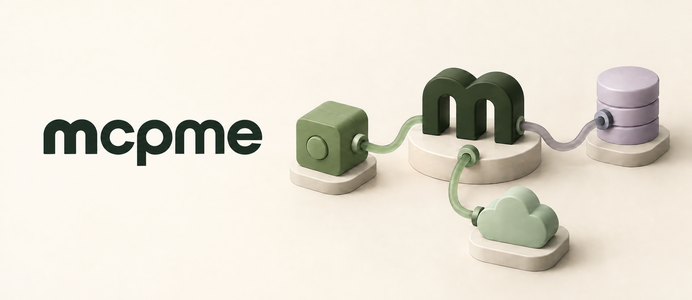

# mcpme



**Give your AI tools a home on your Mac.**

mcpme runs local MCP tools and models from your macOS menu bar. Add an app, connect it to your AI assistant, and keep an eye on it while you work. MCP (Model Context Protocol) lets assistants call those tools; mcpme takes care of keeping them running. An app is a configured local tool or model service with its own controls and connection settings.

Run a JSON validator alongside a local decision model. Connect several clients to the same model. Stop an app when you're done with it. Manage them all in one place.

## What you can do

- **See what's running.** The menu groups apps that need attention, running apps, and stopped apps. See incoming requests, recent traffic, and work in flight at a glance. Click an app to open its live details to the right, with controls, failures, latency, tools, and connection setup.
- **Manage apps in one place.** Search and filter the app sidebar, then select an app for live requests, tools, connection details, and recent operations. Start, stop, or restart a service. Choose **Manual** or **Automatic when mcpme opens**, or remove the app while keeping its data for recovery.
- **Connect your assistant.** Copy an app's connection configuration and add it to your MCP client. Its endpoint stays stable across restarts.
- **Share a local model.** Use a model of your choice through a prepared package, and connect multiple assistants to the same running app.
- **Bring your own tools.** Install a prepared package, or start from source code and use an external coding agent to prepare it.
- **Give an assistant management access.** Create an expiring grant for a separate management MCP connection. Allow inspection, preparation, controls for selected apps, or installation of one reviewed plan.

mcpme requires **Apple silicon and macOS 26 or later**. The supported features and remaining work are listed below.

## Install

Download the Apple silicon `.dmg` from the [latest release](https://github.com/jshahbazi/mcpme/releases/latest). Public installers are signed with Developer ID and notarized. Each release includes checksums and a `.dmg.build.json` verification receipt; see [GitHub releases](docs/GITHUB_RELEASES.md).

Open the disk image, open `mcpme.app` on the image, and choose **Install and Restart**. The prompt shows the destination in `/Applications` or `~/Applications`. The installer verifies the new bundle, gracefully quits the current copy, replaces it, and opens the installed app. Installed apps and settings remain in `~/Library/Application Support/mcpme`; services follow their saved startup policies after restart.

The installer waits up to 75 seconds for the current app to quit. A refusal or timeout stops replacement. A confirmed launch failure restores the previous bundle; an unconfirmed launch leaves a recovery copy. Installing manually by dragging the app from the DMG to Applications requires quitting mcpme before copying, then opening the installed app. See [macOS distribution](docs/MACOS_DISTRIBUTION.md) for installation and recovery details.

The installer includes **JSON Utilities**, a small local tool you can try immediately. Open **Add App…**, select **Try JSON Utilities**, review its tool and access, then select **Add App** or **Add & Start App**. No package download, compiler, or model is needed. Other apps can be added from a prepared package or through the source-preparation workflow below. Application updates currently use this installation flow; an [automatic updater is planned](docs/AUTO_UPDATE_PLAN.md).

## Build from source and try JSON Utilities

Build mcpme and give it a first app: JSON Utilities, a small tool that checks whether a JSON document is valid and reports its top-level type. No model download is needed.

You'll need Xcode Command Line Tools and `uv`. From the repository root:

```sh
uv python install 3.12.13
uv sync --locked
uv run --locked python scripts/build_mcpme_app.py
uv run --locked python scripts/prepare_json_package.py
open dist/mcpme.app
```

The app bundles its own Python runtime and dependencies. Once built, it can run without `uv`, Homebrew, or the checkout. Builders require a fresh output path; for another app build, pass `--output dist/mcpme-dev.app`.

1. Open **Add App…** from the menu bar and choose `dist/json-utilities-package`.
2. Check **Start after install**, then select **Review Package** to see the tools and declared access.
3. Select **Add & Start App**.
4. Once the app is ready, use **Copy Connection Configuration** and add it to your MCP client's settings.

Your assistant can now call `validate_json(document)`. Connection formats vary by client; copying the configuration doesn't change its settings for you. If you move the app, copy the configuration again to get its new path.

Closing the Apps window keeps services running. Quitting mcpme stops the processes it owns. Changing an app's startup choice affects future launches. An explicit Stop remains in effect until Start clears it. Removing an app stops its owned processes and closes its connection; its source, package, and retained data remain available for recovery.

To build a development DMG from current source at an explicit output path:

```sh
uv run --locked python scripts/build_mcpme_dmg.py --output dist/mcpme-dev.dmg
open dist/mcpme-dev.dmg
```

Local builds are ad hoc signed development artifacts. The DMG builder creates a fresh app and verifies the mounted image, copied app, and private runtime; its receipt is `dist/mcpme-dev.dmg.build.json`. Public releases use the protected-main signing and notarization workflow described in [GitHub releases](docs/GITHUB_RELEASES.md).

## Bring your own tools

A useful script can become a tool your assistant calls. **Add App** accepts local source folders and Markdown or text setup instructions, as well as prepared packages.

Describe what you want your assistant to do, then use **Copy Agent Instructions** to hand preparation to your coding agent. The agent builds a package in a separate workspace. Bring it back with **Import Prepared Package…**, review the tools and access it declares, and install it. Your draft is saved, so you can close the window and pick up later.

The agent does the work of exposing your code through MCP. mcpme snapshots and inspects the source without running it, binds the returned package to the saved source revision, then checks the package before installation. Installation runs candidate readiness and protocol checks, including when **Start after install** is off. See [source onboarding](docs/PHASE2_ONBOARDING.md) for the implemented workflow and the [package-authoring guide](docs/PACKAGE_AUTHORING.md) for manifests, locked artifacts, and templates.

If a publisher gives you a prepared package link, open **I already have a package download link** in Add App and select **Enter Package Link…**. Supply the publisher's URL, size, and checksum, then review the verified package. This is a manual download option; there is no public package browser. The owner CLI supports the same [pinned downloads](docs/PINNED_DOWNLOADS.md).

Packages can declare [typed configuration and secret references](docs/CONFIGURATION_SECRETS.md). The owner selects nonsecret settings and private credential references in the installation plan; package processes receive the selected values through a private descriptor.

Add App supports pinned package downloads, typed configuration and secret references, and raw pinned JevK5 weights with a selected verified engine. Reviewed [upgrades and recovery](docs/UPGRADES_RECOVERY.md) preserve app identity and data. Reference-document services and integrated provider preparation remain later work; see the [completion audit](docs/PHASE2_COMPLETION.md).

The next onboarding milestone is [automatic app preparation](docs/AUTOMATIC_PREPARATION.md): select an app directory or configure a service connection, answer missing questions, and let mcpme assemble and test the integration. Packages are generated installation artifacts; users should not need to write manifests or assemble dependency trees. The merged preparation foundation manages recipes and job identities, but automatic build execution is not yet available. Supported build recipes and agent-assisted adapter creation will use the same review/install path.

## Let an assistant manage apps

mcpme has a separate [management MCP connection](docs/MANAGEMENT_MCP.md). The owner issues a grant through the local owner CLI and chooses its scope: read, prepare, start/stop/restart selected apps, or install one exact reviewed plan. Grants expire and can be revoked. The host must already be running; connecting the management client does not launch it.

Preparation access can save drafts and attach packages, but installation requires its own grant. Changing startup policies, removing apps, and issuing or revoking grants remain owner actions. Copy the management configuration into your MCP client using the guide; each app's ordinary MCP connection continues to expose its own tools.

## Put a local model to work

[JevK5-4B](https://github.com/allebee/jevk5) is the first model packaged for mcpme. It evaluates evidence against a question you supply and returns probabilities for the possible answers. You can ask a yes/no question, choose among named alternatives, or score something against ordered criteria.

For example, an assistant can call `jevk5_decide` with:

```json
{
  "state": "Refunds require a receipt and a purchase within 30 days. The customer bought 12 days ago and has no receipt.",
  "question": {
    "type": "noul",
    "instructions": "Is a refund permitted under the policy?"
  }
}
```

The result includes probabilities, model and profile identity, token count, latency, and cache information. `jevk5_status()` reports readiness and aggregate counts. Calls share one model engine and serialize complete decisions; the cache reuses only identical consecutive token sequences. The assistant chooses when to call it and what to do with the result. Probabilities need validation against your own task before you use them as decision thresholds.

To prepare JevK5-4B from source, first build mcpme as above. The current model packager also needs the legacy `dist/JevK5.app` bundle and the pinned GGUF in `models/`. Have a compatible Metal-enabled Homebrew `llama-server` available: the verified runtime is llama.cpp build 11146 with ggml 0.25.3, and the builder expects that Homebrew library/plugin layout. See the [runtime verification](docs/VERIFICATION.md) and [model manifest](model-manifest.json).

```sh
uv run --locked python scripts/fetch_model.py
uv run --locked python scripts/build.py --llama-server /absolute/path/to/llama-server
uv run --locked python scripts/prepare_jevk5_package.py --legacy-app dist/JevK5.app --output dist/jevk5-package --host dist/mcpme.app/Contents/Resources/host
```

The fetch verifies the pinned revision, size, and SHA-256; the model download is about 4.48 GB. Replace the `llama-server` placeholder with the actual executable path. Add the resulting `dist/jevk5-package` through **Add App**. If you already use the standalone JevK5 app, the [migration guide](docs/MCPME_STATUS.md#import-the-existing-jevk5-installation) covers its explicit port, credential, and login-policy transfer.

## Where things stand

The current host supports `mcp-stdio` packages for CPU tools, authenticated `mcp-http` server factories, and `model-service` packages with a shared model engine. JevK5-4B and JSON Utilities have been tested together. Source imports, saved drafts, external-agent preparation, scoped management MCP and reviewed upgrades are implemented. The host currently permits one resident GPU package; first-call wake loading remains unsupported.

**Start at Login** is implemented through macOS ServiceManagement; registration and next-login behavior for the development bundle still need verification. Reviewed package upgrades and exposure-aware recovery are implemented. An automatic host updater remains planned. Live request counters are limited to the current host session, while model-runtime statistics reset with that runtime.

Services listen on `127.0.0.1`, require authentication, and check Host/Origin headers. The host does not log tool inputs, outputs, or raw exception payloads. Packages run with your account's permissions, so install code you trust. The [implementation guide](docs/MCPME_STATUS.md) covers supported package types, resource limits, and recovery.

## Development and docs

Run the repository tests with:

```sh
uv run --locked python -m pytest -q
swift test
.build/debug/McpmeMenuBar --native-self-test
.build/debug/McpmeMenuBar --dashboard-ui-self-test
.build/debug/McpmeMenuBar --management-ui-self-test
```

For the opt-in installer lifecycle checks, run `MCPME_RUN_INSTALL_LIFECYCLE_TESTS=1 swift test`; they create and replace synthetic app bundles. See [macOS distribution](docs/MACOS_DISTRIBUTION.md) for the checks and their limits. UI previews are available through `.build/debug/McpmeMenuBar --ui-preview` and `--manage-preview`, without modifying host state.

- [Implementation guide](docs/MCPME_STATUS.md): CLI usage, builds, package contracts, and migration.
- [Host design](docs/MCPME_DESIGN.md): architecture and planned features.
- [Source onboarding](docs/PHASE2_ONBOARDING.md), [package authoring](docs/PACKAGE_AUTHORING.md), and [management MCP](docs/MANAGEMENT_MCP.md): preparation, review, and assistant access.
- [macOS distribution](docs/MACOS_DISTRIBUTION.md), [GitHub releases](docs/GITHUB_RELEASES.md), and [automatic update plan](docs/AUTO_UPDATE_PLAN.md): installation, release verification, and planned updates.
- [Verification](docs/MCPME_VERIFICATION.md): tested behavior and known limits.
- [Visual identity](docs/BRAND.md): artwork, icons, and the [menu bar preview](assets/brand/icon-preview.html).
- [Model provenance](model-manifest.json), [model card](docs/MODEL_CARD.md), and [third-party notices](THIRD_PARTY_NOTICES.md).
