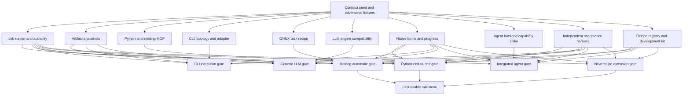

# Automatic and agent-assisted app preparation

Status: implementation plan, updated 2026-10-03. The [metadata and admission foundation](PREPARATION_FOUNDATION.md) is implemented; automatic build execution remains unavailable. This is the Phase 3 product milestone. Multiple managed model engines follow in Phase 4.

The [Phase 3 implementation ledger](PHASE3_IMPLEMENTATION.md) tracks the component, private builder, controlled execution and independent probe checkpoint, its review repairs, and the full acceptance gates still open. Public execution and native automatic preparation remain unavailable until installed-host integration passes those gates.

Baseline: `1d723e5af50639aa40702091c3e39e47dc3020dd`, including the standalone hotdog example. This plan extends [project onboarding](PROJECT_ONBOARDING.md), [package authoring](PACKAGE_AUTHORING.md), and the [implemented Phase 2 boundary](PHASE2_ONBOARDING.md).

## Intended result

A user selects source, a program, or model artifacts, supplies any missing intent, and prepares a package inside meecp. Complete supported recipes run without an LLM. Optional integrated agents resolve unfamiliar interfaces or implement adapters. Every route produces the same sealed package and resumes the same import review and installation flow.

Users should not author package manifests, collect dependency trees, or manually return prepared artifacts for the supported automatic path. A directory may contain several services or languages; inspection proposes bounded integration candidates and asks only for missing choices. Package generation is a host preparation responsibility. Preserve the external-agent route while automatic capabilities are being implemented.

Keep source family independent from execution target. A local adapter can expose tools backed by a remote LLM provider, an existing local LLM endpoint, or a managed local engine. Remote connectors need protocol/auth components, configuration and secret references, rather than local weights or engine metadata. Provider-specific behavior belongs in versioned modules and recipes, with actual compatibility and credential/cancellation tests before enablement. The [directory-to-app review](reviews/DIRECTORY_ONBOARDING_REVIEW.md) records the component boundaries, current Python-only planner limitations, and next execution packet.

Broad app support means an extensible set of adapters and tested runtime combinations. An unfamiliar GUI application needs a supported API, CLI, or automation adapter. Unresolved compatibility remains visible. Adding an agent does not establish runtime compatibility.

The first usable milestone must prepare both a Python callable and the exact hotdog CPU ONNX application without copying a prompt, invoking an external agent, editing a manifest, or manually supplementing the model. It must also accept an independently added recipe through the extension workflow. General CLI, local LLM, and integrated-agent work can advance concurrently against the common contracts.

## Verified starting point

| Current implementation | Consequence for this plan |
| --- | --- |
| [ImportStore](../backend/meecp/imports.py) snapshots selected source and attaches packages statically. | Preserve code-free intake, attachment, and installation planning. |
| Text-source intake excludes models, runtime trees and binaries, with 16 MiB/file and 64 MiB total bounds. | Add separate binary-artifact intake and ownership. Preserve existing source discovery and digest rules. |
| [The preparation generator](../templates/prepare.py) packages explicitly selected Python callables and existing foreground MCP servers using private Python and locked wheels. | Reuse the deterministic builder behind a durable preparation worker. Interface selection and recipe completeness need new support. |
| [The catalog](../templates/catalog.json) includes Python, existing MCP, and a JevK5-specific recipe. | These identifiers do not establish general CLI, YOLO, or LLM support. |
| [Schema 1](../backend/meecp/contracts.py) supports macOS arm64/macOS 26+, tools-only MCP 2025-11-25, `mcp-stdio`, constrained authenticated `mcp-http`, and `model-service`. | Package HTTP support is implemented; automatic HTTP preparation remains unsupported by the current planner. Additional platforms need separate capability work. |
| Schema-1 stdio requires CPU-only operation, no model/process-graph fields and a memory declaration of at most 4096 MiB. | Package the first detector as embedded CPU ONNX with one session. GPU or resident vision requires a later contract extension. |
| Model-service metadata requires `context_tokens`. [JevK5 preparation](../templates/jevk5-llamacpp-v1/README.md) uses a specific engine, scorer and model identity. | Preserve JevK5 semantics. Introduce separate engine recipes and task adapters; avoid fictional context metadata for vision. |
| [Preparation grants](../backend/meecp/grants.py) authorize bounded metadata/attachment/planning without package execution. | Create distinct job-bound authority for preparation execution and probes. Existing grants retain their scope. |
| [The Phase 2 verifier](../scripts/verify_phase2.py) already prepares synthetic Python through explicit generator arguments, installs it, invokes it and restarts the host. | Extend this end-to-end harness to exercise automatic preparation through the native/API route. |

The [recorded hotdog preparation baseline](HOTDOG_PREPARATION_BASELINE.md) established 19 source-test passes and 31 package checks, including real inference on three generated negative images and relocation with original source, global runtime, network and package writes denied. Positive postprocessing used controlled tensors. Those checks establish functionality for that workload; they provide no generalization accuracy result.

## Common preparation contract

Add `meecp.prepare.json` with **preparation descriptor schema 1**. Keep descriptor, import/export and package versions independent. Preserve package schema 1 initially. The descriptor is bounded declarative data interpreted by versioned recipes; it contains no arbitrary shell commands.

The implemented descriptor-v1 foundation is limited to Python callable/MCP inputs and requires a source lock and complete tool schemas. Generalize new families through a new descriptor version and component validation/result seam; preserve v1 parsing and identities. Missing source locks or dynamically discovered interfaces require a bounded discovery/resolution attempt that produces separately identified derived artifacts before the final build is bound. Do not pretend generated locks were original source inputs. A fresh Python recipe proves extension within Python capabilities; separately verify a non-Python implementation before advertising family-independent execution.

Service-only onboarding also needs a versioned input identity: the current `ImportStore.create()` requires a filesystem source. Add an explicit service-connection source/descriptor binding for nonsecret endpoint, protocol/auth component, model/tool choices, and opaque secret references. Generate and seal the adapter snapshot from that binding inside preparation, recording its derivation. The user should not create a dummy directory or write an adapter to add a provider connection. Keep original directory digests unchanged and require actual connector probes before admitting the generated package.

A repository may supply a descriptor. The setup wizard may produce the same descriptor. Source descriptors and agent proposals are untrusted inputs requiring structural validation and explicit bindings.

Separate the portable descriptor from the host job binding:

| Portable descriptor field | Required meaning |
| --- | --- |
| `schema_version` | Preparation descriptor version, initially 1. Unknown fields and versions fail. |
| `recipe` | Exact recipe ID and version, plus the selected catalog implementation digest. |
| `interface` | Selected callable, MCP entrypoint or supported CLI contract; exact tool schemas and annotations. |
| `dependencies` | Selected dependency-project paths, frozen lock identity, runtime recipe and platform. |
| `artifacts` | Role/name, kind, expected bytes and SHA-256, provenance, license reference and an explicit local selection or permitted immutable locator. |
| `engine` and `task_adapter` | Optional engine compatibility profile, adapter version and typed task configuration. |
| `access`, `resources`, `lifecycle` | Declared effects/access and bounded resource, session, startup and operation limits. |
| `validation` | Nonsecret fixture generators or explicitly selected fixtures, expected structural/semantic assertions and execution limits. |

The host binding adds `job_id`, import ID, integer draft revision, exact source identity, normalized descriptor digest, immutable artifact-collection digest, execution-policy digest and recipe implementation digest. A portable descriptor cannot select another draft or manufacture host authority.

Canonical digests use a versioned serialization: reject duplicate keys/nonfinite numbers, encode UTF-8 JSON with sorted keys and compact separators, preserve array order, and prefix each digest input with its contract/version domain. File identities cover the original bytes. Apply this rule to new descriptor/job/artifact contracts; existing folder-source identities remain byte-for-byte compatible.

Recipe eligibility requires exactly one compatible recipe and every required binding verified against immutable bytes. Static inspection may suggest candidates using filenames, manifests or AST signatures. A confidence score never authorizes execution or resolves an ambiguous interface. Importing source modules to discover callables is prohibited during inspection.

Store a versioned preparation receipt as an ordinary **locked package artifact**. It binds descriptor, source, artifact collection, recipe, runtime/dependency and fixture identities. Do not add arbitrary fields to strict `PackageLock`, and do not put the final package digest inside its own receipt. After sealing, store the final digest and runtime attestation in the preparation-job record.

Managed automatic/agent returns additionally check their receipt against the bound job before calling the existing static attachment path. External legacy packages retain existing compatibility unless that draft explicitly requires the new receipt.

## Adding and managing recipes

Recipe extension is a first-milestone requirement. A new combination using supported capabilities must be addable through a self-contained recipe bundle and fixture set, without modifying the host dispatcher, native forms, import methods or every existing recipe. A new transport, runtime authority or unsupported process topology requires explicit host capability work.

Keep three objects distinct: the **descriptor** selects a recipe and supplies app-specific inputs; the **recipe bundle** defines its input schema and implementation; the **registry** records available versions, provenance and admission state. Migrate the current template implementations behind this interface while preserving their external generator CLI and exported legacy template IDs.

### Bundle and stable runner contract

A recipe bundle has `meecp.recipe.json`, `meecp.recipe.lock.json`, input/form schemas, documentation, nonsecret fixtures, and any declared implementation/runtime artifacts. Its closed-tree lock hashes every file and preserves licenses/provenance. Recipe IDs are namespaced; semantic versions are immutable. A `(recipe_id, version)` collision with different content fails rather than replacing the existing bytes.

The manifest declares recipe-worker API version, descriptor/form schema versions, platform/package/protocol requirements, required runner capabilities, accepted artifact roles, matching rules, runtime/task dependencies, resource/effect ceilings, supported process topology, replay/cancellation behavior, and required acceptance gates. Bundle admission is static. Merely viewing or adding a bundle never launches its implementation.

Use two extension kinds:

- **Declarative composition:** typed configuration combines existing runtime, adapter, artifact and validation steps. This is the simplest way to add variants, class mappings, callable contracts and supported model profiles. Every referenced component/version/digest is resolved and pinned; reject cycles or missing dependencies.
- **Executable preparation worker:** a reviewed foreground worker adds preparation logic beyond the built-in steps. It has a pinned self-contained runtime and a versioned JSON/stdin-stdout interface. It runs out of process only under job-bound execution authority. It is never imported into the host process or invoked for code-free inspection/planning. Introducing this kind requires worker ownership/cancellation and capability-interface acceptance before it can be enabled.

The runner contract separates these operations:

| Operation | Contract and owner |
| --- | --- |
| Match and normalize | Host interprets bounded eligibility/schema/form metadata using host-owned static metadata/AST parsers. No recipe/source module imports, subprocesses, dependency resolution, downloads or worker invocation occur. Returns bindings, missing fields or blockers without recipe/source execution. |
| Plan | Host validates exact immutable inputs and compiles supported declarative steps plus declared executable-worker scope. Returns effects, resources, dependencies and required authority without launching worker code. |
| Prepare | An admitted recipe executes known steps or its foreground worker in the job workspace, requesting typed runner services. Returns candidate metadata and artifacts. |
| Seal and verify | Host closes the artifact set, compares descriptor fidelity and runs independent required protocol/runtime fixtures. Recipe-specific assertions supplement mandatory host checks. |
| Return | Host admits the exact verified digest through the existing attachment transaction. The recipe has no installation authority. |

Runner services own artifact resolution, controlled process launch/reaping, resource reservations, cancellation, deadlines, private working/data directories and sanitized progress. Recipes receive versioned requests and scoped service handles; they receive no arbitrary host object, manager credential or public-port authority. Executable extensions retain the documented same-user trust boundary unless a separate isolation mechanism is implemented.

The supported worker contract prohibits direct subprocess creation. All process requests go through runner services, with host ownership of the full descendant tree, resource accounting, cancellation and reaping. Executable-worker admission is blocked until those topology guarantees pass; a worker's declaration alone does not prove them. New static file parsers are reviewed host capability additions, not executable matching hooks hidden in a recipe bundle.

Use a bounded form vocabulary for files, callable choices, enums, strings, numeric limits and schema previews. A recipe can supply its schema, descriptions, defaults and static extraction rules without supplying executable UI or HTML. Complex unsupported fields remain explicit blockers or use the agent proposal route. Execution code, provider credentials and arbitrary import/module names cannot enter through form metadata.

### Easy authoring and addition

Provide a recipe development kit with a scaffold command, reusable step library, schema helpers, fake runner services and a common acceptance harness. Proposed commands are `meecp recipes scaffold`, `check`, `test`, `add`, `list`, `inspect`, `enable`, `disable`, `remove` and `deprecate`.

An author or agent scaffolds from the nearest supported recipe, fills input/form metadata and fixtures, and runs `check` for static validation. `test` runs the common and family-specific gates under explicit preparation authority using a development-verification attempt bound to the candidate digest. This attempt may test a proposed bundle before enablement, but cannot promote it or bypass production attachment admission. `add` statically snapshots the bundle into private versioned storage and presents identity, provenance, effects and compatibility for admission. Enabling a third-party executable recipe requires applicable review/authority; an agent cannot approve its own extension. Publisher signatures may strengthen provenance when supported, but a hash alone does not establish publisher trust.

The native **Manage Recipes** view offers **Add Recipe**, enabled/disabled status, versions, documentation, compatibility blockers and acceptance evidence. Drop/select a local recipe folder for the initial workflow. Repository URL/catalog synchronization and automatic downloads are later acquisition capabilities; adding a recipe must not silently execute a repository installer. Initial discovery is local and uses installed/bundled metadata.

Adding an app whose descriptor names an unavailable recipe offers resolution through Manage Recipes or the agent proposal route. Do not substitute a similar recipe silently. New compatible versions are separate entries; existing descriptors/jobs/receipts retain their selected implementation digest. Existing generated app packages remain independently sealed and usable without loading the recipe worker.

### Registry lifecycle and retention

Add a versioned runtime recipe registry alongside the existing bundled template catalog. Advertise admitted recipe/capability summaries through the management API. Preserve legacy `template_ids` compatibility until its explicit migration; users should not edit catalog source to register a recipe.

| Operation/state | Defined behavior |
| --- | --- |
| Add / proposed | Validate and snapshot exact bundle bytes; display provenance and unmet capabilities. No execution or automatic enablement of new executable code. |
| Enable | Permit new jobs only after compatibility/admission and required gate evidence pass. Each job binds the resolved version and bundle digest. |
| Update | Add a new immutable version with fresh validation. Existing jobs/receipts do not change. |
| Disable | Block new plans/starts. Already executing authorized jobs may finish with their pinned bundle; queued jobs cannot start. Installed app packages remain independent. |
| Deprecate | Show replacement guidance and an explicit new-job cutoff; preserve inspection and receipt verification. |
| Revoke | Block new execution and result admission for the affected digest, request cancellation of active jobs, and flag receipts/packages for review. Installed-app control uses its own authorized lifecycle actions. |
| Remove / withdraw | Remove selection availability; retain bundle identities/evidence and referenced bytes until job/reproduction retention rules permit collection. Never delete generated apps or invalidate their package locks. |

A recipe's receipt records the full resolved component/recipe digest set. Recheck registry revocation and input authority at execution admission and before attachment. Ordinary disabling cannot rewrite a running job's inputs; revocation closes late-result admission. Avoid mutable global module discovery or a user's Python/Node installation as a recipe runtime.

### Extensibility acceptance gate

After baseline recipe-management support exists, build a fresh minimal recipe using the development kit outside the host tree. Add it through CLI and native recipe management, complete its generated input form, prepare a synthetic app, validate and attach it, restart meecp, then repeat inspection. Adding this recipe must require zero host dispatcher/UI/import source edits.

Exercise version collision, incompatible worker/schema/platform/capability, unsupported form field, dependency cycle, missing notice/runtime artifact, false gate evidence, worker cancellation/reaping, disabled queued start, revocation during verification/attachment, update during an active job, and removal with retained receipts. Recipe-reported results alone cannot satisfy mandatory independent acceptance checks. Common checks plus recipe-specific fixtures run in parallel where independent; their evidence is tied to the exact bundle/component digests.

Port the existing recipe definitions through this same contract. Their platform, CPython/MCP SDK assumptions and compatibility gates become recipe metadata. Acceptance must prove a new supported recipe is additive before first automatic preparation is advertised.

## Artifact acquisition and source lifetime

Create separate immutable storage for `model-weights`, `runtime-file`, `license`, and approved validation artifacts. Runtime trees are represented as bounded file manifests; archives need a dedicated extraction recipe with path, expansion and link checks. First automatic acquisition supports explicit local files and the existing Python runtime/wheel resolver. Pinned HTTPS acquisition can land independently behind a capability flag.

Every artifact requires an expected size/hash, origin record and applicable license before execution. For a locally selected file without an upstream hash, the host computes and records its content identity and marks publisher provenance as unverified. It captures those bytes during asynchronous snapshotting before runnable execution admission. A mutable path plus a hash does not become a worker input.

Use race-safe file-descriptor traversal and before/after identity checks equivalent to current source intake. Reject symlinks/hardlinks, changed ancestors, nonregular files and changed contents. Keep credential files outside artifact intake. Copy or clone immutable bytes into a job-owned workspace; verify again before use. Large-artifact bounds and aggregate disk reservations are separate from the text-source limits and visible in preparation review.

Artifact or descriptor changes increment the draft revision and invalidate unapplied bindings, even if the original text-source identity is unchanged. Downloaded data is bounded by declared bytes, timeout, disk reservation and explicit origins; credentials in URLs and unreviewed redirect destinations fail. Runtime launch never performs dependency or weight acquisition. The downloader and locked wheel resolver must enforce the same declared-origin policy, including mirror/redirect behavior, before start authority covers their acquisition.

For source-only drafts, retain the existing resolved source identity. Add a versioned `artifact_collection` source variant for model-only/native-only intake after its canonical identity, export and migration tests exist. Its identity binds selected artifact roles and hashes; the task contract is independently bound by the descriptor digest. It cannot be represented as an unrelated text snapshot. This extension must preserve legacy import reads and folder-source digests, with an explicit source-contract version/capability so older clients reject the new variant cleanly.

Jobs own their source/artifact copies before execution. Draft edit/cancel/expiry stops result admission first, requests worker cancellation, waits for copying/download threads and owned processes to settle, then permits job cleanup. Deleting draft staging cannot race an active worker's inputs.

## Preparation jobs and authority

Add a durable preparation store and a controlled worker separate from installation operations. Publish a queued record with requested input/authority bindings through a short transaction and return its ID before copying. Snapshot asynchronously, then admit execution only after rechecking the revision and captured identities. Build, copy, download and probe work never blocks the management server's event loop. Never hold a SQLite transaction or the event loop while awaiting copying, cancellation, download threads or process settlement.

Proposed states are `queued`, `snapshotting`, `preparing`, `verifying`, `ready_to_attach`, `attaching`, `succeeded`, `cancel_requested`, `canceled`, `failed`, and `interrupted`. `ownership_lost` uses the existing reconciliation principle: close admission, preserve relevant reservations and never signal a discovered/reused PID.

Execution order within one job:

1. Validate the descriptor and intended operation scope; reserve disk/resources.
2. Snapshot selected source/artifacts asynchronously under the published job ID and recheck draft/authority/input bindings before moving to runnable preparation.
3. Materialize locked dependencies, private runtime, adapter and notices through known recipes.
4. Seal the candidate with complete artifact closure.
5. Compare the manifest/receipt's full tools, schemas, access, resources and fixture declarations against the normalized descriptor, then probe the exact sealed digest under a preparation verification supervisor. Require complete package validation/digest equality both before and after probes. Deny package writes where enforceable and route legitimate runtime caches/temp files to job-private data directories. Store the attestation outside the package. Any repair creates a new seal and reruns affected checks.
6. Recheck revision, job authority, source/artifact identities and cancellation; pass the expected verified package digest into the host's attachment admission transaction. Reject a different snapshot digest before an attachment is committed. Reuse the current static validation/snapshot implementation behind that admission check.
7. Confirm the host attachment digest, publish success and release preparation reservations.

Preparation authorization covers the selected source/artifacts, declared acquisition/build/probe operations, network destinations and time/resource bounds. An intentional Prepare action can supply this scope once. Reuse valid authority without another approval for the same scope. Expanded source transfer, execution or access requires a corresponding authority update. Installation uses its existing exact-plan authority.

Workers and integrated agents cannot submit installation, create a slot, select public ports or obtain owner credentials. A host coordinator performs result admission and attachment. Probe execution uses private temporary endpoints and synthetic inputs under job authority; it does not call installation apply to create a stopped candidate slot.

Job scopes constrain host interfaces and supported execution paths. Code still runs as the current macOS user unless an enforceable isolation layer is separately implemented. Current sealed files remain owner-writable; cryptographic sealing detects changes and does not make same-user bytes tamper-proof. Access/effects declarations and fixture passes do not establish every behavior of arbitrary source.

Start idempotency binds the normalized job inputs and caller key. Duplicate starts join the same compatible active attempt. Failed/interrupted retries receive a new attempt ID; arbitrary build or provider actions are not silently replayed. Concurrent preparation results cannot replace an existing same-revision attachment: the existing digest/idempotency rules apply, and a changed result needs a revised draft.

On restart, reconcile process ownership and stage receipts before resuming. Restart only recipe steps declared replay-safe; an arbitrary agent/build action becomes interrupted and needs controlled recovery. A completed attachment whose success publication was interrupted is recovered by inspecting its recorded digest. Cancellation during attachment has a defined commit winner: if attachment commits first, report completion; if cancellation wins admission first, no late result attaches. Preserve terminal installation history independently of preparation cleanup.

Persist bounded stage names, progress counters, sanitized error codes, recipe identities and aggregate usage. Keep source contents, prompts, images, model responses, credentials, raw subprocess output and exception dumps out of host journals and exports.

## Recipe coverage

### Python and existing MCP

Reuse `python-function-v1` and `existing-mcp-v1`. Require explicit callable/entrypoint and schemas, wheel-only locked closure, private CPython and complete notices. Preserve source selection and full real-client schema comparison. A supplied lock may need a preparation-specific locked project to add the MCP SDK; never rewrite the imported source lock silently.

Multiple-callable support gets a separately versioned adapter; it does not broaden the existing single-callable contract in place. Node and additional ecosystems require private runtime/lock/closure recipes before automatic admission. HTTP-only existing servers remain blocked until a supported package transport recipe exists.

### Deterministic CLI

Define `cli-json-v1`: one approved foreground command, a typed one-shot JSON input/output contract, fixed executable and argument template, explicit variable positions, sealed working directory/environment, exit-code mapping, finite output limits and a deadline. Argument substitution uses an argv array; no shell expansion. Stderr is discarded or sanitized. Effects and runtime closure are explicit.

An early topology spike must prove that the host can own, cancel and reap both adapter and command execution, including descendants, crashes and SIGKILL. Current stdio session supervision does not automatically authorize an adapter-owned subprocess tree. Add a dedicated supervised invocation facility if the spike requires one. Unsupported topology blocks this recipe's release; no hidden `Popen`, daemonization, service adoption or package-manager downloads are permitted as a shortcut.

Ship CLI only after this execution contract passes. It can develop concurrently with the first Python/vision milestone.

### YOLO/ONNX

Separate engine recipe `onnxruntime-cpu-v1` from task adapter `yolo11-coco-detect-v1`. Initially support the exact fixed-shape FP32 export demonstrated here: RGB letterboxing/normalization to `[1,3,640,640]`, raw `[1,84,8400]` output, COCO labels, class 52 for the hotdog task and the existing threshold/NMS contract. Pin runtime, weights, class map, preprocessing and adapter identities.

ONNX Runtime exposes model inference and execution-provider selection; the application supplies input/output interpretation. The recipe must validate those task assumptions explicitly. [ONNX Runtime API](https://onnxruntime.ai/docs/api/python/api_summary.html)

The first recipe uses CPU stdio, one session and measured memory bounds. Measure peak memory at the maximum advertised byte/pixel limits, including decoding and preprocessing; increase the permitted reservation or reduce image limits before release if the budget fails. Later weights/exports enter a named compatibility matrix after validation. File extension or a YOLO label cannot establish eligibility. Exporting `.pt` checkpoints is separate build work with a pinned toolchain; initially require the supported ONNX artifact.

Resident/GPU vision requires a versioned discriminated model-metadata contract, schema-1 compatibility and readiness/admission tests. Keep this outside the first milestone. Never fabricate `context_tokens` for a vision model.

### Local LLM

Add a generic llama.cpp engine recipe and a separate bounded `text-generate-v1` task adapter. Preserve JevK5's existing scorer, cache rules, typed decision contract and pinned profile. JevK5 is an independent regression fixture.

The compatibility spike selects and pins a small general text model, publisher revision, quantization, weight hash/license, tokenizer/template identity and exact relocated engine build. Record that fixture selection before implementation acceptance. Test CPU and Metal profiles only as their declared matrix passes; do not infer support for all GGUF models.

Use nonstreaming bounded text generation first, with enforced context/output limits and actual-token template/stop tests. Define the adapter's JSON object result and error contract. Embeddings, multimodal operations, calibration, model quality and structured-generation guarantees require separate adapters/gates. llama.cpp's documented API capabilities are inputs to this work, not verification of the bundled engine revision. [llama.cpp server documentation](https://github.com/ggml-org/llama.cpp/blob/master/tools/server/README.md)

Start with one inference slot and a bounded shared queue; serialize complete operations across clients. Cancellation retains the slot and reservations until inference settles or its verified owned runtime is stopped and reaped. A canceled caller cannot trigger overlapping replacement inference.

The current JevK5 preparer derives its own source identity. Reconciling it with raw imports requires proving which snapshot supplied adapter/scorer bytes, preserving the import's exact source identity and resealing. A manifest identity edit alone fails this gate.

## Native experience and interfaces

The setup window displays a detected candidate and focused missing-fields questions. Complete supported bindings enable **Prepare automatically**. Incomplete or unfamiliar inputs offer **Prepare with agent**, the external handoff and an explanation of unresolved compatibility. UI labels describe user actions; implementation profile names belong in technical details.

A native descriptor form and repository descriptor generate the same normalized request. Show actual tools, effects, source/artifact provenance, download requirements, declared resources and preparation execution scope. Progress comes from real worker stages, bytes/files and validation counts. Closing the window preserves the job. **Cancel Preparation** terminates owned preparation and preserves the draft. **Cancel Draft** invalidates pending results and coordinates source/staging cleanup. Installation cancellation remains unsupported; new preparation controls cannot imply it exists.

Add versioned recipe management and preparation plan/start/list/inspect/cancel operations to the CLI, management API and management MCP facade. Proposed namespaces are `meecp recipes ...` for the versioned registry and `meecp preparations inspect-source|plan|start|list|get|cancel` for app jobs. Recipe metadata routes live under `/v1/recipes`; preparation routes live under `/v1/preparations`. Code-free planning remains static. Execution requires its own scope. Import summaries reference preparation job ID/status without conflating them with installation operation ID/status.

The [management preparation workflow contract](MANAGEMENT_PREPARATION_WORKFLOWS.md) implements the MCP recipe/preparation/resolution surfaces with separately owner-issued exact execution grants. Earlier read/prepare/install/lifecycle grants retain their execution denials. New job authority and grant association commit together; current checks cannot reinterpret a missing association as owner authority.

The CLI/API needs descriptor and artifact-selection file arguments or structured request bodies; current `imports create` does not expose a general requirements-file argument. Extend explicit import create/revise contracts and keep unknown-field rejection. Native polling must observe job stage/revision changes alongside existing draft and installation changes.

Runtime MCP checks target revision 2025-11-25 and compare the full tool definitions. MCP specifies tool input schemas and structured output conformity; adapters must satisfy the declared contract. [MCP tools specification](https://modelcontextprotocol.io/specification/2025-11-25/server/tools)

## Integrated agent route

Use the same job, workspace, descriptor, artifact and attachment contracts. Add a provider-neutral agent backend with a documented programmatic interface, cancellation and usage accounting. A bounded initial spike must select and prove one concrete backend before this route is advertised. Copying text into a UI or assuming an arbitrary CLI supports automation is insufficient.

The coordinator decomposes custom work into independent interface analysis, dependency/runtime closure, adapter implementation, fixture development and verification tasks. Agents receive scoped workspace access and return typed proposals/patches. One integration owner resolves shared-contract changes. Reusable proposals may become reviewed recipe versions after independent acceptance; an agent cannot promote its own code to the trusted catalog automatically.

Incomplete requirements can start a bounded analysis/proposal phase using an `analysis-request-v1` binding over source identity, provider, permitted read/proposal tools and usage limits. This phase can inspect selected bytes and write proposed adapters/descriptors in its private workspace without a complete runnable recipe. Source execution, builds and probes wait until the completed descriptor, candidate adapter identities and required execution scope are validated and bound to a draft revision/job attempt. Only expanded effects or transfer scope need updated authority; existing authorized scope remains reusable. This phase split allows unfamiliar applications to enter the agent route while retaining strict automatic-execution eligibility.

Provider credentials reside in Keychain/references outside drafts and packages. Before transfer, bind provider and exact selected source scope to user authority. Source text and model output never confer tool/installation authority. Limit tokens/tool calls, wall time, parallelism and resource use; reserve allowed provider spend against verified rate information before dispatch where a monetary ceiling is required.

The initial recipe routes require no LLM provider. Agent execution is an optional capability, with external preparation retained as a supported return path. Provider-backed runtime model services need a separate secret/network runtime contract; configuring a preparation provider does not implement that feature.

## Parallel execution graph

Plan around ready tasks, immutable inputs and acceptance dependencies. The coordinator dispatches independent work immediately, keeps ownership boundaries explicit and integrates as soon as a verified slice is ready. Development of later families starts while the first user path is assembled.

| Lane | Agent-owned implementation area | Dependencies and concrete output |
| --- | --- | --- |
| A: contract/integration | Preparation request/receipt schema, bindings, central routes and grants | Freeze minimal interfaces, error taxonomy, migrations and fake worker/recipe fixtures. Own all shared-contract edits. |
| B: worker | New preparation store/runner/verifier modules and lifecycle tests | Starts against A's skeleton; produces durable jobs, ownership, cancellation, restart and sealed-result admission. |
| C: artifacts | Separate artifact store/acquisition and import extension tests | Starts against A; produces immutable large inputs, disk reservations and source identity compatibility. |
| D: stdio recipes | Python/existing-MCP recipe library and template tests | Starts against A; refactors the existing builder without breaking its external CLI. |
| E: CLI | Supervised invocation spike, adapter and process-tree fixtures | Starts immediately with an executable fixture; release depends on ownership enforcement. |
| F: vision | ONNX runtime/task recipe, model provenance and detector fixtures | Starts with the verified local model; integrates C's artifact inputs when available. |
| G: LLM | Engine/task adapter split, compatibility matrix and actual-model fixture | Starts with capability/source research and relocation tests; integrates B/C without waiting for the detector release. |
| H: UI | Native preparation forms, polling and progress | Uses a fake job API from A before the worker is complete; shared routing changes go through A. |
| I: agent | Programmatic backend spike, scoped orchestration and provider tests | Uses the same fake job interface; production agent execution waits for B's authority/recovery gate. |
| J: independent verification | Acceptance/race harness and evidence review | Starts adversarial cases with A; verifies immutable integrated outputs and reported scope. |
| R: recipe extensibility | Registry, bundle/worker contract, development kit and extension fixtures | Starts against A's seeded contract; owns additive registration/version lifecycle. UI hooks go through H; central API/authority changes go through A. |

There are four active-agent slots including the coordinator in this planning session. Queue ready lanes and reuse freed workers; use a larger configured pool when available. Simple local reads go to a lower-cost agent. Substantial implementation and independent review receive models appropriate to their task. Concurrency respects CPU/disk limits and model/GPU reservations; actual inference tests on one constrained engine serialize while static work and unrelated CPU fixtures continue.

Each implementation lane uses its own branch/worktree and agreed files. The coordinator maintains task ID, input contract revision, ownership, deliverable, blocking dependency and required evidence. A dependency change sends targeted follow-up work to affected agents. An out-of-scope discovery becomes a separate bounded investigation; it does not absorb the main lane.

Agents commit complete slices. The integration owner applies them into the integration branch, runs relevant checks and dispatches an independent reviewer before promoting a capability. Do not wait for every lane to finish before checking Python or hotdog end to end. Avoid concurrent edits to one shared schema or native file; interface changes pass through its owner. Push verified commits to the working branch; open a PR only when requested.

## Acceptance and release gates

| Gate | Required evidence |
| --- | --- |
| A0: contracts | Descriptor canonicalization and unknown-version/field rejection; legacy source digests/exports/packages unchanged; receipt/job identity tests; static inspection executes nothing; old preparation grants cannot run code. |
| A0R: recipe extension | Independently scaffolded recipe is added, managed, selected through generated forms, prepared and attached with zero host dispatcher/UI/import edits. Exact bundle versions/components, lifecycle races, capability blockers, independent evidence and restart retention pass. |
| A1: automatic stdio | Separate native/API cases prepare a selected synthetic Python callable and an existing foreground MCP server. Each validates full MCP contract and relocation, attaches the matching revision, then follows existing authorized plan/apply verification. User performs no external prompt handoff or manifest editing. Existing-MCP capability requires its own passing case. |
| A2: automatic hotdog | Same user path, with explicit selected ONNX artifact, verified model hash, complete runtime/notices, synthetic real inference and controlled tensor tests. Measure maximum accepted image-size memory/deadline behavior or reduce advertised limits. No manual copying from the original checkout. Wrong weights/layout/classes fail eligibility. |
| A3: CLI | Actual command execution with bounded argv/input/output, exit mapping, timeout/cancel, descendant and process-group cleanup, crashes/restart, private runtime closure and declared effects. Release remains blocked until ownership is enforceable. |
| A4: generic LLM | A separately pinned general text model/engine/template performs actual inference, enforces token/output limits, shares one engine/one inference slot with a bounded serialized queue, respects memory/GPU policy and settles inference before releasing cancellation reservations. JevK5 parity/cache tests still pass. |
| A5: integrated agent | Documented backend works end to end on unfamiliar synthetic source; source transfer and execution are scoped; parallel subtask outputs integrate; bounded usage/cancellation/restart succeed; stale output cannot attach or install. |
| A6: broader coverage | New runtimes, model families, resident/GPU vision, GUI automation or provider-backed runtime services each pass their own compatibility and authority gates before advertisement. |

Extend [import tests](../tests/test_meecp_imports.py), [host tests](../tests/test_meecp_host.py), [grant tests](../tests/test_meecp_grants.py), [process tests](../tests/test_meecp_processes.py), [template tests](../tests/test_meecp_templates.py) and [Phase 2 verification](../scripts/verify_phase2.py). Preserve existing multi-slot and management regressions.

Exercise races at source/artifact copy, dependency resolution, seal, probe, attach and success publication. Include revise/cancel/expiry versus start/attach; authority expiry while queued or awaiting resource admission; cancellation versus spawn acknowledgement; provider disconnect versus tool completion; duplicate start; disk exhaustion; source mutation; symlink/ancestor replacement; missing notices; tampered receipts; raw log/credential leakage; unsupported capabilities; crash after seal/attachment publication; and restart with an old worker still running. Terminal cancellation leaves no owned work or admissible late result. Lost ownership retains reservations and requires reconciliation.

Probes use real MCP clients, nonsecret fixtures and the actual bundled runtime. A sealed probe runs from an unrelated directory with original source/build/global-runtime/network unavailable and package writes denied where the recipe permits this validation policy. Record limits when platform/runtime behavior prevents a restriction; never substitute a mocked engine for an actual-inference gate.

Current installed-host candidate checks establish MCP initialization and tool discovery, plus supported HTTP session termination. Synthetic functional calls, expected outputs, resource/deadline measurements and package mutation checks are new preparation-verifier work. Installation continues to run its own existing checks; preparation attestations do not silently broaden their claimed coverage.

Report declared resource budgets separately from measured workload peaks, and functional checks separately from task quality. The hotdog gate preserves the current negative-model/positive-tensor distinction. If recognition accuracy becomes an acceptance requirement, select explicit nonsecret positive/negative fixtures and thresholds before the run. Packaging success cannot establish model calibration or quality.

The first release capability flag enables automatic Python, supported existing MCP and the exact CPU hotdog recipe only after A0, A0R and A1–A2 pass. CLI, generic LLM and agent routes enable individually as A3–A5 pass. This allows concurrent development and independently verified delivery without broad compatibility claims.

## Immediate execution packet

At implementation start, the coordinator freezes descriptor/job/receipt and recipe-worker/registry interfaces and seeds fake recipes, a fake job API and adversarial fixtures. Dispatch worker/artifact lanes and recipe/registry/UI lanes against those interfaces immediately; rotate queued LLM, CLI and provider spike work into available slots. Keep the independent verifier supplied with every immutable candidate and acceptance claim.

The critical path for the first usable result is contract seed → controlled worker plus Python/vision recipes and artifact storage → native preparation binding → independent sealed probes → current attachment/review flow. A failed lane produces a concrete blocker and a targeted repair task while other ready lanes continue.
