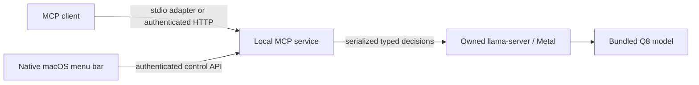

# meecp: JevK5 decision component

This document preserves the original standalone JevK5 decision component contract. The current meecp host architecture is described in [MEECP_DESIGN.md](MEECP_DESIGN.md); JevK5 model and tool names remain unchanged.

Status: implementation design, 2026-09-30. First local build: Apple silicon, macOS 26 or newer (the bundled Homebrew runtime targets macOS 26). Repository: `/Users/johnshahbazian/development/jevk5-menubar`.

## Purpose

Provide a local decision model that stays available from the macOS menu bar and can be called by MCP clients. JevK5 scores supplied evidence against declared alternatives. It returns option probabilities, a boolean probability, or an expected score. It does not produce explanations or general chat completions.

The first build bundles the previously tested JevK5-4B v0.3 Q8 GGUF, the Metal-enabled llama.cpp runtime, a private Python runtime, and the app's server. Running the built app requires neither Homebrew nor a Python installation. Source, provenance, build scripts, tests, and documentation live in this repository. Model files and generated app bundles live in ignored directories here, rather than in another project's checkout.

## Components and ownership

The native AppKit app has no Dock icon. It starts one backend process, polls its status, and exposes readiness, pause/resume, MCP configuration, launch at login, and quit. It owns backend shutdown. A parent-process watchdog also closes the backend if the app exits unexpectedly. The backend owns exactly one supervised llama-server child; shutdown or pause terminates only that child. A small native supervisor reaps inference when the backend dies, including SIGKILL. It holds its child's process identity until reaping and watches its actual parent relationship, avoiding signals to a reused discovered PID. A process lock prevents a second backend from taking over the same application state.

The service starts the model in the background while HTTP becomes available. MCP decision calls await readiness. Pausing unloads the model and rejects decisions until resumed. All clients share one scorer and one inference lock. Queued calls are bounded; overload returns a sanitized error. Quit stops both servers and clears in-memory prompt/cache state. The app can be registered as a login item through macOS's native ServiceManagement API; it starts only when the user enables that setting.

## Runtime and correctness

Use Q8, 8192 context tokens, 99 GPU layers, one slot, flash attention auto, batch 2048, microbatch 512, and no context shifting. The tested larger batches and forced flash attention did not improve fresh-request latency. The original benchmark used temperatures 1.22 and 0.93; preserve those explicitly as the named benchmark profile, without claiming confidence thresholds have been validated for a user's task.

Vendor only the dependency-free upstream prompt and GGUF client modules at commit `f944fe37ff1d5ed3830aa4c8d88b7189c8c1268a`, retaining Apache license and notices. Preserve upstream prompt formatting, special-token parsing, option ordering, answer formatting, and letter readout. Reject incomplete option coverage, truncated prompts, and prompts that exceed the context budget. Version one accepts 2–16 options per decision, avoiding unvalidated many-pass behavior.

Enable llama.cpp prompt caching only if the entire token sequence equals the immediately preceding successful completion. Changed inputs disable reuse. Clear the remembered identity after any inference error or restart. Do not persist decisions or cache results to disk. A shared lock covers tokenization, inference, and answer formatting; status and controls cannot mutate a scorer in the middle of a decision.

The previous exact-repeat measurements were about 18–21 ms; fresh decisions ranged from about 71 ms at 132 tokens to 1310 ms at 4096 tokens. Packaging and MCP add overhead, so verify the final app independently. Those numbers describe one machine and synthetic inputs, and do not establish decision quality.

## MCP contract

The official Python MCP SDK implements protocol negotiation and Streamable HTTP at `http://127.0.0.1:19385/mcp`. A bundled stdio adapter calls the same shared backend and automatically opens the app if needed. Clients using stdio do not load duplicate models. Both transports expose:

- `jevk5_decide(state, question)`: one typed decision, the upstream answer shape, latency, model identity, and cache metadata. `question` is a discriminated union on `type` (`noul`, `choice`, `score`), with `instructions` and type-appropriate `criteria`. Evidence is a JSON string, object, or list. Choice criteria may be an ordered object or a list of distinct labels; score criteria must be an ordered array of descriptions for levels 0 through N−1. Both MCP transports and the control API use the same question types and validator.
- `jevk5_status()`: readiness, model identity, pause state, aggregate call/cache counts, and endpoint information. It contains no evidence or decisions.

Tool descriptions explain when to call the model and that it has no retrieval or external knowledge source. Errors do not echo evidence, options, backend responses, credentials, or stack traces. The native menu copies a stdio configuration and can reveal setup documentation. Installing a client configuration is an explicit client-side action; the app does not rewrite unrelated client settings.

## Local API and state

All routes require the per-install bearer token. `GET /api/status` returns status. `POST /api/control` accepts `{"action":"pause"}` or `{"action":"resume"}`. `POST /api/decide` accepts `{"state":...,"question":...}` and implements the same decision contract as MCP; the stdio adapter uses this route. The MCP endpoint remains the primary public integration.

State is stored in `~/Library/Application Support/JevK5/`, mode 0700. `connection.json`, mode 0600, contains a random token and the fixed loopback endpoint. The token is generated once and reused across launches. No request history is written. The inner llama-server uses a separate random API key, read from an owner-only temporary file and passed to the scorer in memory. Its port is allocated dynamically and binds to 127.0.0.1.

Validate Host and Origin for every route and require authentication. Reject external origins, bind only to 127.0.0.1, disable CORS, bound bodies to 1 MiB, and disable access and exception logging. This implements the local-transport protections in the [MCP transport specification](https://modelcontextprotocol.io/specification/2025-11-25/basic/transports). The token protects other local users and browser requests; processes already running as the same user can read the connection file and are within the trust boundary.

As of 2026-10-02, bundled stdio clients and native controls use HTTP over an owner-only Unix socket with no TCP fallback. The socket is stored in a mode-0700 directory under `/private/tmp`, derived from the owner UID and the resolved private-state path; its mode is 0600. Native controls also verify the connected peer UID. The legacy TCP endpoint remains available for direct HTTP clients. Updated bridges require the updated service or a migrated meecp gateway serving the legacy private-socket alias. Python launchers use safe-path mode (`-P`) with explicit bundled import paths. The inference scorer uses a dedicated proxy-disabled, redirect-disabled opener restricted to the loopback engine URL.

## Packaging and delivery

Build an arm64 `.app` with Swift Package Manager and Python-managed build scripts invoked through `uv`. Copy a standalone CPython runtime and locked server dependencies into Resources. Recursively bundle llama.cpp/ggml/OpenSSL Mach-O dependencies, rewrite their load paths to the bundle, include Metal plugins, and ad hoc sign the resulting bundle. The pinned ggml bottle searches its compiled Homebrew plugin directory before the executable/current directory; disable that one directory string in the copied library and launch the server with the bundled plugins directory as its working directory. Preserve string length and file offsets, require exactly one known constant, and record original and packaged hashes. `GGML_BACKEND_PATH` in this version accepts a single plugin file, so do not set it to a directory. Include model revision, byte count, and SHA-256 in a manifest; verify before packaging and first use. Copy model files using APFS clone copying where available.

The default local artifact is `dist/JevK5.app`. This is a local development build. Developer ID signing, notarization, an updater, universal Intel support, and public distribution are later work. The app must not claim these capabilities. Third-party licenses and model provenance ship with the app.

## Acceptance checks

1. Build and launch the native menu bar app with its bundled runtime and model.
2. Use a real SDK client to initialize, list tools, and make a synthetic decision over HTTP and stdio.
3. Verify fresh/repeated/changed input behavior and compare outputs with the pinned official scorer.
4. Verify unauthenticated, invalid-origin, malformed, oversized, over-context, and invalid-criteria requests fail without content logging.
5. Verify concurrent clients serialize inference; pause, resume, model failure, quit, and parent exit leave no owned inference child behind.
6. Verify relocation of the bundle and absence of runtime dependency on the Brekko checkout or Homebrew paths.

## Scope decisions

Use the measured llama.cpp Q8 implementation for the first build. Native MLX offered no broad improvement in the existing tests. MCP clients choose when to invoke the tool; providing a server does not force every LLM to use it. Version one has no document retrieval, general chat, network exposure, telemetry, updater, or response persistence.
