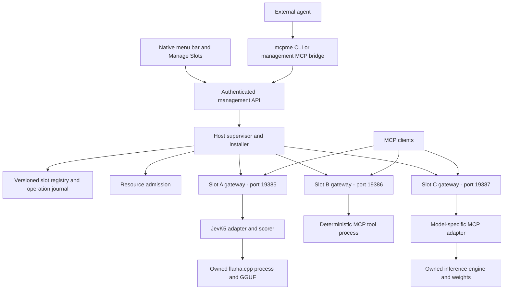
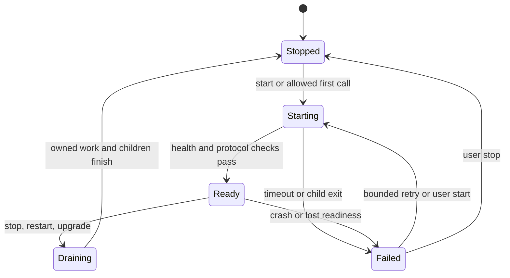

# mcpme: a menu bar host for local MCP services

Status: proposed design, 2026-10-01. This document describes the next architecture; the current implementation remains [JevK5 Menu Bar](DESIGN.md). Baseline reviewed: commit `7e7e068`.

## Product

`mcpme` is a native macOS menu bar app for installing, running, connecting to, and monitoring local MCP services. Each installed service occupies a **slot**, with a stable identity, its own public loopback port, a versioned package, independent controls, and visible health. An external coding agent can prepare and install a package through a documented CLI or management MCP server.

JevK5 becomes the first slot package. A second slot could run a deterministic JSON validator. A third could run another model with a different inference engine. Adding any of these should require a package and an adapter, with no modification to the host app.

The initial target stays Apple silicon and macOS 26+, matching the existing bundled runtime. The host remains independent of Brekko. The product name is `mcpme`; the proposed app artifact is `mcpme.app`.

### Vocabulary

| Term | Meaning |
| --- | --- |
| Host | The menu bar app and its supervisor, installer, registry, and client bridge. |
| Package | A versioned, reproducible installation containing an MCP service or adapter, dependencies, and optional model/runtime artifacts. |
| Slot | One configured installation of a package. It has an immutable UUID, user-visible name, stable port, credentials, and state. |
| Gateway | A host-owned worker exposing one slot at `http://127.0.0.1:<port>/mcp`. It applies transport policy and connects clients to the service. |
| Runtime | The slot's executable processes: for example, Python plus llama.cpp, a Node server, or a native executable. |
| Model | A pinned weight artifact with a declared engine/profile compatibility contract. A model file alone is insufficient to expose MCP tools. |

A slot is a service instance. Slot identity does not depend on its display order or port. The same package can be installed twice with separate configuration and ports. A desktop application or non-MCP executable needs a package-specific MCP adapter; mcpme cannot infer its tool schema from the executable.

## User experience

The menu bar provides quick controls. A native **Manage Slots** window provides installation, configuration, connection details, and diagnostics.

```text
mcpme                         2 ready / 3 installed
  JevK5 Judge                 Ready        :19385
  JSON Utilities              Ready        :19386
  Local Chat                  Stopped      :19387

  Add Slot...
  Manage Slots...
  Stop All
  Settings...
  Quit mcpme
```

Each slot submenu offers Start/Stop, Restart, Copy Connection Configuration, and Details. Slots with a model label Stop as **Unload Model** where this is accurate. State text accompanies any color indicator. A click opens details with the package version, endpoint, available tools, runtime/model identity, queue depth, active calls, recent error code, and resource estimates. Initial empty state offers **Install JevK5** and **Install with an agent**.

**Add Slot** accepts a prepared local package or a pinned package URL. It also provides a copyable agent instruction describing the package contract and installation command. The UI shows download size, estimated loaded memory, platform compatibility, source, licenses, executable entrypoints, requested filesystem/network access, and whether code is locally built or publisher signed. Estimates and unverified declarations are labeled as such.

Installing, downloading, verifying, starting, warming up, and ready are distinct stages. A listening socket never counts as model readiness. Long operations remain visible after closing the window, with progress, Cancel where supported, and an operation ID an agent can poll.

**Start at login** controls the host. Each slot independently chooses manual start, start with host, or start on first call. New slots default to manual; an explicitly requested install-and-start operation can override it. A user Stop suppresses automatic wake until Start. Quit stops every owned service and the supervisor. Closing the management window leaves them running.

## Architecture



The Swift app owns one Python supervisor. The supervisor owns one gateway worker per enabled installed slot, plus the slot's registered runtime processes through native reapers. Third-party Python modules never load into the supervisor or Swift process. A slot failure must not take down another slot or the management API.

The small host bundle contains the native UI, private Python runtime, locked host dependencies, supervisor, gateway/bridge, CLI, and native process reaper. Downloaded packages and models live outside the signed app bundle. Updating a slot never edits `mcpme.app` or rebuilds it. Python package preparation uses `uv` and committed locks. Other ecosystems bring their own pinned dependencies and compatible runtime; the host must not depend on a user's global Python, Node, or Homebrew installation.

### Three package execution profiles

| Profile | Package provides | Host responsibility |
| --- | --- | --- |
| `mcp-stdio` | A foreground executable speaking MCP over stdin/stdout. | Give each client session its own child/stdio channel, enforce session/process limits, and expose the slot's HTTP endpoint. |
| `mcp-http` | A foreground MCP server with configurable loopback address and authentication. | Start it on a private port, verify readiness, and proxy its MCP transport through the stable public gateway. |
| `model-service` | Engine, weights, profile, and an MCP adapter with a declared child-process topology. | Verify artifacts, admit resource use, and start/stop the adapter and engine together. |

Heavy model slots use a shared resident service, independent of client count. A generic stdio server is not assumed to support multiple clients on one channel. The safe default is one lightweight subprocess per session; a package that needs shared state or a large model supplies a shared HTTP service/adapter. Limit sessions before spawning children. A package explicitly declaring exclusive stdio access may cap itself at one session.

An ordinary deterministic executable can be wrapped by a small `mcp-stdio` adapter. The host does not define a universal `execute(command)` tool. A general LLM package must explicitly choose tools such as `generate` or `embed`, input/output schemas, context limits, streaming behavior, and engine compatibility. JevK5 keeps its own decision tools.

### MCP boundary

Each slot is a separately connectable MCP server. Tool names and schemas stay local to that server; there is no merged tool namespace in the first release. Connecting a client to JevK5 does not expose package installation or other slots.

The current lockfile uses Python MCP SDK `1.30.0`. Use the locked SDK as the migration starting point, and explicitly test protocol revision `2025-11-25` before adding other negotiated versions. This is a compatibility target, not a claim about the latest MCP revision. The documented revision supports stdio and Streamable HTTP; local HTTP needs Origin validation and authentication. mcpme additionally retains the existing Host checks and loopback-only binding. See the [versioned transport specification](https://modelcontextprotocol.io/specification/2025-11-25/basic/transports).

The gateway and generic stdio-to-HTTP bridge require protocol integration tests. They must preserve negotiated capabilities, request/response IDs, tool schemas, structured results, notifications, session ownership, and cancellation semantics. HTTP forwarding must handle JSON and SSE, protocol headers, session lifecycle, and disconnects without buffering a whole stream. Rewrite only transport routing/authentication headers; never forward a caller's public credential to a package or follow arbitrary upstream redirects.

Start with a tested tools-only compatibility profile. Unsupported requirements such as sampling, roots, elicitation, resources, or prompts must be identified during installation and rejected with a compatibility explanation until implemented and tested. Do not silently advertise capabilities the bridge cannot forward. Native HTTP forwarding and stdio adaptation get separate compatibility tests. Within the supported profile, preserve tool-list change notifications and schema refresh behavior described in the [tools specification](https://modelcontextprotocol.io/specification/2025-11-25/server/tools).

### Ports and connections

- Keep `19385` for a migrated JevK5 slot. New installations choose an available port, preferring `19386–19485`, and persist it. The range is a preference, not an externally reserved allocation.
- The supervisor reserves a public port by binding a socket and passing it to its gateway. It keeps ownership through installation/activation; a probe followed by an unrelated bind is insufficient. On host restart, a stolen port puts that slot in `port_conflict`; do not kill the other process or silently move the endpoint.
- The management API uses its own OS-assigned loopback port, published in an owner-only manager connection file. CLI/UI discover it; it is not a slot port. It uses a separate credential and exposes versioned control routes, with no arbitrary tool-call forwarding route.
- Private engine ports are ephemeral. Prefer inherited sockets where supported. Engines without socket activation retry allocation/binding within a deadline and require an authenticated readiness response from the intended child. Never adopt an unknown process already listening there.
- Every public slot listener has a separate invocation credential; private HTTP runtimes have separate keys. Invocation credentials cannot perform management operations.
- The gateway can remain available while the runtime is stopped, returning a sanitized `slot_stopped` availability error. Successful MCP initialization/listing while stopped is only promised by adapters that explicitly implement it. Slot status always remains available through management.

Define first-call loading as **wake on authenticated MCP initialization** for the generic profiles: it starts the runtime once, coalesces concurrent wake requests, and completes initialization only after readiness within the startup deadline. Subsequent discovery and calls use that live session. An adapter may instead expose discovery while unloaded and defer model loading until `tools/call`; it must declare this mode and its deadline. Manual Stop persists a wake-suppression flag, closes sessions, and rejects initialization/calls until an explicit Start clears it. Host shutdown does not rewrite the saved start policy or this flag.

For private HTTP services, the supervisor creates a fresh random key per runtime generation and passes it through an inherited descriptor or owner-only temporary file, as declared by the package. The package must support that injection mechanism; secrets never enter command-line arguments. Gateway-to-package calls use only this private key. Readiness requires the live owned child, an authenticated response, and a generation nonce supplied at launch and echoed by the adapter. Reap the child before removing its key file; a restart rotates both key and nonce. A package that cannot authenticate its private HTTP routes requires a stdio adapter instead.

The primary connection command is proposed as:

```sh
"/Applications/mcpme.app/Contents/MacOS/mcpme" connect --slot <slot-uuid>
```

This command speaks MCP stdio and resolves the slot's current endpoint and private invocation credential. It opens the host if necessary, respects the slot's start policy, and never creates a second model runtime. An optional user-installed stable launcher can survive app relocation; until then, copied client configurations use the app's actual absolute path. The UI also offers HTTP configuration for compatible clients. Credentials never enter generated documentation or ordinary diagnostic output.

## Package and slot contracts

Use a versioned `mcpme.package.json` plus a resolved `mcpme.lock.json`. These are mcpme-specific formats, not an MCP standard. A package describes reproducible software; a slot record describes one user's installation. The installer rejects unknown required fields, incompatible schema versions, unresolved versions, and invalid cross-field combinations.

| Manifest area | Required contract |
| --- | --- |
| Identity | Package ID, version, package schema version, host API compatibility range, source revision, license references. |
| Platform | Supported OS/architecture and minimum OS version for every executable dependency. |
| Artifacts | Immutable source locator, SHA-256, byte count, destination, provenance, and license. Lock every transitive artifact. |
| Execution | Profile, package-relative executable and argument array, working directory, allowlisted environment names, declared child processes. No shell command strings or arbitrary install hooks. |
| MCP | Supported protocol/profile, required capabilities, expected tools and schema digest, internal transport/authentication configuration. |
| Model, if any | Artifact identity, engine/build identity, context/profile parameters, and compatibility requirements. Retain model-specific fields. |
| Lifecycle | Readiness probe, startup/deadline limits, stop grace period, restart policy, session limits, concurrency and queue limits. |
| Resources | Download/installed sizes, estimated loaded memory, CPU/GPU use, and whether first-call loading is supported. |
| Access | Declared filesystem paths, outbound destinations, secret references, and write/side-effect behavior. These declarations describe trusted code; they are not an OS sandbox. |
| Validation | Side-effect-free health probe and package-specific synthetic smoke fixture, where available. No private user input. |

The lockfile resolves templates to exact artifact hashes and records the build recipe, builder/toolchain versions, and full dependency closure. A declared hash verifies identity against the plan; it does not establish publisher trust. Secrets are references to separately stored values and never part of either manifest.

A slot record contains an immutable UUID, mutable display name, package ID/version/digest, slot configuration, selected public port, credential reference, start policy, current generation, desired state, and observed runtime status. Renaming or reordering a slot changes neither identity nor connection command.

The first package, `local.jevk5`, carries the existing [model manifest](../model-manifest.json), pinned upstream scorer and licenses, packaged llama.cpp dependencies, and current MCP adapter. Its GGUF SHA-256 remains `aea433883bc7ed399f2fbd539e53d2eac7caf71a946fe6650995a413979d4a30`. Its adapter owns the 8192-token profile, temperatures, question contract, exact-consecutive cache, and one-decision lock. These are JevK5 behavior, not universal host settings.

### Installation layout

```text
~/Library/Application Support/mcpme/       owner-only directory
  registry.sqlite                        slots, generations, operations
  manager-connection.json                manager address; private discovery
  credentials/                           separate manager/client/slot grants
  packages/<package-id>/<digest>/         immutable verified package contents
  staging/<operation-id>/                 inactive installation candidates
  slots/<slot-uuid>/
    config.json                          nonsecret configuration
    connection.json                      endpoint and invocation credential
    data/                                package-owned persistent data
    runtime/                             temporary files and private engine keys
  events/                                bounded lifecycle metadata only
```

Private directories use mode 0700 and private files 0600. SQLite sidecars receive the same protection. There is one supervisor lock and one active generation per slot. Immutable means host-managed files are not edited in place; same-user processes remain within the trust boundary. Updates create new package directories. Runtime state and model caches are not stored inside package directories.

Model blobs may initially be copied using APFS clone copying, as today. Shared content-addressed storage can follow once reference accounting, rollback retention, and garbage collection are tested. Never share a mutable engine process or inference cache between different slots implicitly.

## Agent installation workflow

An external agent uses the same operations as the UI. A built-in autonomous agent, cloud account, marketplace, and natural-language package resolver are unnecessary for the first release.

Example user request: “Install JevK5 into mcpme and start it.”

1. The agent reads `mcpme capabilities --json` for host version, architecture, supported package schema/profiles, and configured resource limits.
2. It obtains a pinned prepared package, or builds an adapter in a separate workspace. Development/build execution belongs to that agent session; the host installer accepts verified prepared artifacts and does not execute arbitrary build scripts.
3. It calls `mcpme install plan --package /absolute/path/to/package --name "JevK5 Judge" --json`. Planning validates the manifest/lock and produces a concrete source, artifact, access, port, disk, memory, and activation plan without executing package code.
4. It calls `mcpme install apply --plan <plan-id> --start --json` within the user's granted installation authority. The host checks that authorization covers this exact plan and its effects. Existing authorization can cover the apply; the workflow does not require repeated confirmation for the same scope. An expanded access request or different artifact requires a revised plan and corresponding authorization.
5. The operation stages and verifies artifacts, starts the candidate under supervision, checks MCP compatibility and health, runs an approved synthetic smoke fixture if available, and commits the slot generation.
6. The agent polls `mcpme operations get <operation-id> --json`, then returns the slot UUID, readiness, endpoint, and connection command. It adds the client registration only if requested.

Proposed CLI groups are `capabilities`, `slots list/inspect/start/stop/restart`, `install plan/apply`, `upgrade plan/apply`, `remove plan/apply`, `operations get/cancel`, `connections export`, and `connect`. These commands do not exist yet. CLI output uses versioned JSON with stable error codes and no credential values. Long mutations return promptly with operation IDs.

An optional, separately connected **mcpme management MCP server** exposes typed equivalents: `mcpme_capabilities`, `mcpme_list_slots`, `mcpme_inspect_slot`, `mcpme_plan_install`, `mcpme_apply_install`, `mcpme_get_operation`, and bounded lifecycle/update/removal tools. It is a host control endpoint, not another installable slot, so installation cannot depend on a slot being healthy. Ordinary slot connections never include these tools.

Management credentials can be read-only, scoped to lifecycle control for selected slots, or permitted to apply installations within a grant. Grants bind package/plan digest, allowed slots/actions, and relevant resource/access limits; a model-supplied `approved: true` flag is not authority. A locally authorized agent can receive a grant through the CLI/UI bootstrap. Scoped credentials limit API behavior; they do not isolate malicious code already running as the same macOS user.

The bootstrap is a local owner action through the UI or `mcpme authorize --plan <plan-id>` under the agent session's existing user authority. It creates an opaque 256-bit bearer capability in an owner-only file, with a server-side hashed-token record containing grant ID, plan digest, actions, expiry, and revocation state. The CLI returns its file reference, never its value. A plan grant expires after 15 minutes and atomically binds to one operation on first apply; retries may only recover that operation. Longer reusable lifecycle grants require explicit slot/action scope and expiry. Every request checks expiry/revocation, and credential-file consumers reject wrong ownership, symlinks, or group/world access. Revocation blocks further calls; canceling an operation already authorized to run is a separate action. This is local account authorization, not proof that a human clicked for every action.

### Transaction and recovery rules

- Plan IDs bind the exact package/lock/configuration digest and proposed effects. Changes invalidate the plan. Recheck disk space, resource availability, and port reservation at apply time.
- Apply accepts an idempotency key and records its intent before side effects. Retrying returns the same operation/slot instead of installing duplicates. Serialize mutations per slot and use registry generation checks to reject stale updates.
- Download to staging with size limits, verify every digest before execution, reject path traversal and links escaping the package root, and seal the resolved execution tree. Local package paths are snapshotted into staging; execution never follows an editable external source tree.
- An installation is visible as installing but cannot serve ordinary tool calls until verification succeeds. A canceled or failed first install leaves no active slot process or reserved public listener; its bounded diagnostic record remains.
- An upgrade stages separately, drains the old generation, then starts and verifies the candidate. The gateway returns `updating` during the switch. A single durable registry transaction commits the new generation and operation outcome; only then may the gateway route new sessions to that generation. The registry is authoritative, so routing and database writes need not pretend to be one atomic operation. A model upgrade may unload the old model before loading the candidate to fit memory; zero downtime is not promised.
- Candidate readiness includes MCP initialization/schema validation and a safe smoke fixture when defined. A running PID is insufficient. An initialization request can execute package code and therefore happens only within apply authority.
- Preserve the previous package and configuration until rollback is no longer needed. First-release upgrades require unchanged data schemas, or a restorable snapshot/clone and declared migration. Reject automatic in-place irreversible data migrations. Rolling back binaries alone does not undo data changes.
- On restart, reconcile journaled operations with committed registry state and owned live processes. Discard uncommitted candidates, retain the last committed generation, and report interrupted operations. A corrupt registry does not trigger deletion or guessed process adoption.
- Remove stops/drains the slot, revokes credentials, releases its port, and unregisters it. Preserve package-owned data by default; **Remove and delete data** is a separate explicit choice. Shared artifact cleanup follows reference counts and rollback retention.

Persist the old generation, candidate generation, and upgrade stage (`staged`, `switching`, `committed`, or `rolling_back`). Before commit, any probe/start/database failure tears down the candidate, restores the old data snapshot if needed, and restarts the old generation. A host crash before commit follows the same rule on recovery. After a durable commit, a crash recovers the committed generation and reconstructs gateway routing from it. If activation/routing subsequently fails, record a compensating rollback transaction before routing to the retained old generation. If restoration also fails, keep the slot Failed with both artifacts/data snapshots retained and a recoverable operation record; never report a successful rollback without verified old-generation readiness.

## Lifecycle, concurrency, and resource policy

Keep installation state (`staging`, `verified`, `failed`) separate from desired runtime state (`running`, `stopped`) and observed runtime state:



`port_conflict`, `resource_blocked`, and `incompatible` are explicit blocked reasons, not “loading” forever. Active/queued calls are counters within Ready. Every start/stop operation has a deadline and content-free failure code.

Each slot controls its own concurrency, queue length, and deadlines. The host does not serialize unrelated deterministic tools. JevK5 retains one lock across tokenization, inference, and result formatting, the existing bounded admission count, and cancellation-safe ownership until the actual engine operation finishes. No transport retry automatically repeats a tool call; a disconnect can leave a side effect completed with an unknown result.

Stop first rejects new work, cancels queued requests with a stable availability error, then drains in-flight calls within the package deadline. It terminates only owned children and reaps them before releasing resources. On timeout, force termination is reported as potentially incomplete work. Restart and upgrade terminate MCP sessions; clients reinitialize against the same stable slot identity/port. A service restart resets ephemeral caches and invalidates in-flight session mappings.

The supervisor tracks child identity through direct process ownership and native reapers, adapting the existing [llama supervisor](../scripts/llama-supervisor.c). All managed executables run in the foreground and register their declared descendants through the launcher. Detached daemons and unrelated system services are unsupported in the first release. The current reaper handles one child. Phase 1 requires a tested launcher/reaper at each edge of the declared process tree, with parent-death cleanup and identity held until reaping; reject packages that spawn unmanaged persistent descendants. General-purpose adoption of arbitrary process trees is deferred. Quitting or losing the host must leave no supported owned runtime behind, including grandchildren.

Crash recovery is per slot: proposed default of three attempts in five minutes with exponential backoff, then Failed until user action. Configuration errors, missing artifacts, failed authentication, and port conflicts do not trigger restart loops. Manual Stop never triggers recovery. Repeated inference errors can mark the adapter unhealthy without restarting unrelated slots.

Several loaded models can exhaust shared memory even when each appears healthy. Before loading, the host reserves the package's estimated memory plus configured headroom against a user-visible budget. Unknown estimates require a user-set reservation. Concurrent starts reserve atomically; unloading/reaping releases the reservation. Show process memory estimates and system pressure separately; RSS is not exact GPU/unified-memory attribution.

The initial model admission policy permits one active managed GPU inference at a time, with a bounded, fair queue across model slots. Participating model adapters obtain a host lease before engine work and hold it until that work actually ends. Arbitrary third-party servers cannot be assumed to obey this scheduling contract; unsupported GPU packages require exclusive residency. CPU-only tools continue independently. Permit broader GPU concurrency only as an explicit setting after measurement. Never silently unload a busy or manually pinned model to make room.

## Monitoring and local trust

The host collects slot state, uptime, restart count, readiness latency, active/queued calls, completed/error counts, and aggregate latency buckets. Slot details distinguish host-observed health from package-reported health. Model slots also expose verified model/runtime identity and safe aggregate cache statistics. The UI can poll one batched manager snapshot every two seconds while open and less frequently while closed; inference never waits for UI polling.

Keep a bounded journal of lifecycle/installation events: time, slot UUID, operation ID, generation, event code, progress counters, exit status, and known error code. Never log prompts, evidence, responses, options, tokens, API keys, raw HTTP frames, child stdout/stderr, arbitrary exception text, command lines, or environment values. MCP stdout is protocol data and goes only through the transport. Child stderr is discarded by default. Diagnostic export includes only an explicit allowlist of metadata; unknown fields are omitted.

Slot HTTP policy applies to every route and SSE connection: loopback-only binding, exact Host/Origin validation, invocation authentication, bounded input and output, session limits, and timeouts. Preserve the current duplicate-header and malformed-envelope checks. Keep the default 1 MiB request limit; package-specific changes must remain within host limits and be visible in the plan. Bound streaming buffers, per-message size, and total operation budgets separately so streaming does not imply unbounded memory. Manager routes have their own credentials and equivalent protections.

Installed programs execute with the user's macOS account permissions in this first release. Per-slot directories, processes, and credentials prevent accidental coupling and reduce credential propagation; they do not prevent a malicious same-user program from reading another slot's files or making outbound requests. Filesystem/network declarations are shown as declarations unless an enforceable isolation mechanism is added. The host gives children a minimal environment and only their selected secrets. It does not promise to enforce arbitrary filesystem or network allowlists without an OS isolation layer.

A package is executable code. Origin/hash/license verification, publisher identity where available, a visible plan, and bounded installation authority are part of installation. They do not certify a package as safe. Public package distribution, Developer ID signing/notarization, and stronger plugin isolation need separate implementation work; the current ad hoc signed app does not already provide them.

## Migration from JevK5

| Existing component | Proposed destination |
| --- | --- |
| [Native menu app](../Sources/JevK5MenuBar/main.swift) | Keep AppKit/ServiceManagement; replace fixed backend/model status with manager discovery and slot rows. Add Manage Slots. |
| [Entry point](../backend/jevk5_app/__main__.py) and [private state](../backend/jevk5_app/state.py) | Split host supervisor/registry/connection discovery from slot execution. Remove fixed-port assumptions from generic host code. |
| [ModelManager](../backend/jevk5_app/runtime.py) | Preserve inside the JevK5 package adapter. Extract generic process supervision separately. |
| [Scorer](../backend/jevk5_app/scorer.py), [question contracts](../backend/jevk5_app/contracts.py), and vendored scorer | Keep JevK5-specific; avoid imposing a decision schema on other tools. |
| [HTTP policy and MCP registration](../backend/jevk5_app/server.py) | Extract transport policy for all gateways; keep JevK5 tool registration, evidence handling, and errors inside its adapter. |
| [Stdio bridge](../backend/jevk5_app/bridge.py) | Add generic slot bridge with explicit protocol tests. The existing bridge knows two JevK5 tools and is not a generic MCP proxy. |
| [Build pipeline](../scripts/build.py) | Build the small host and separately build the JevK5 package, retaining relocation, hash, license, and Metal-plugin checks. |
| [Existing tests](../tests) and [lifecycle checks](../scripts/verify_lifecycle.py) | Retain JevK5 regressions; add generic slot/install/protocol/process tests. |

Migration creates a `JevK5 Judge` slot from the exact existing artifacts after verification. It preserves `jevk5_decide`, `jevk5_status`, question schemas, literal string handling, probability/model/profile metadata, context rejection, and cache semantics. The slot retains port 19385. The host does not reinterpret JevK5 confidence or add escalation decisions.

Offer a deliberate **Import existing JevK5 installation** operation. Stage and verify first; then ask the old app to stop through its supported lifecycle and release its lock/port. Never run both owners of port 19385. If transfer fails, leave the old installation recoverable. Record migration progress idempotently and keep the old bundle/state until a migrated synthetic decision succeeds.

Use a durable transfer record with the old bundle/state locations, saved login/start preferences, new slot UUID, and stages `staged`, `old_stopped`, `endpoint_acquired`, and `committed`. After the old app exits, acquire its existing `backend.lock` and bind 19385 before activating the imported slot. Retain the legacy lock while mcpme owns the imported endpoint, preventing an old launcher from starting another backend. These acquisitions are not atomic: if either fails within the deadline, tear down the candidate and release partial acquisitions, then report a recoverable handoff failure. Do not evict a port owner. Recovery of an uncommitted handoff stops owned candidates and offers/resumes the recorded old installation only when its lock and port are free; a committed handoff reacquires both before starting mcpme's slot. A conflicting owner blocks recovery visibly. Rolling back releases both before relaunching the old app and restores its saved preferences; port continuity during a crash is not promised.

For direct HTTP clients, the imported slot can preserve the existing invocation token and `/api/status`, `/api/control`, `/api/decide`, and `/mcp` compatibility routes inside the JevK5 adapter. That token must have no management authority in mcpme. Port/token preservation alone does not preserve old stdio registrations: they execute the old bundle's launcher. Export replacement registrations pointing to `mcpme connect --slot <uuid>`; update only client entries the user requests, preserving unrelated settings. Retire the old login item when ownership transfers and restore it if migration is rolled back. Copy launch/start preferences explicitly.

Those legacy `/api/*` paths are an explicit JevK5-only gateway allowlist on 19385, protected by the same invocation authentication and Host/Origin policy. They forward to the private JevK5 adapter, with public credentials replaced by private runtime credentials. Preserving `/api/control` deliberately lets the legacy token pause/resume only that JevK5 slot, matching its existing authority; it cannot install, remove, update, or control other slots. A small host-owned compatibility handler must remain available while the model is unloaded so legacy resume still works. Generic slots receive no such routes.

## Delivery plan and acceptance

### Phase 1: two working slots

Build the host registry, per-slot gateways, supervision, slot controls, connection export, and JevK5 package. Add a small deterministic JSON utility package using stdio. Use prepared local packages and a minimal CLI; defer downloads and the management MCP facade. Keep existing JevK5 behavior passing throughout.

Acceptance: JevK5 and the deterministic tool run on distinct stable ports, work from real MCP clients, and can be started/stopped independently. Two clients share exactly one JevK5 engine. Stopping/restarting/killing one slot leaves the other responsive. Host exit and supervisor SIGKILL clean up all supported owned descendants. Unauthorized traffic fails on each port. The host works after relocation and has no dependency on the old checkout, Brekko, or Homebrew.

### Phase 2: agent installation and recovery

Implement the full package schema/lock, plan/apply CLI, scoped management MCP facade, installer progress UI, pinned downloads, idempotency, upgrades, rollback, and removal. Publish package-authoring instructions and a minimal adapter template in Markdown.

Acceptance: an agent, given a source tool and installation authority, creates and installs a new package without editing host source. Interrupt every install/upgrade stage and verify recovery. Concurrent duplicate applies create one slot. Changed artifacts, traversal paths, port conflicts, unavailable secrets, incompatible MCP capabilities, exhausted disk, and failed smoke probes never activate a broken generation. Rollback preserves data and stable connections; removal preserves data unless explicitly asked to delete it.

### Phase 3: multiple model engines

Add a second model package with a genuinely different engine, declared memory reservations, host GPU admission, and independent model/profile configuration. Validate cold start, resident memory, contention, queue behavior, cancellation, and unload/reload on the actual machine. Port separation alone is insufficient evidence of resource isolation.

Acceptance: both models install without changing host code, report exact checkpoint/engine identity, respect the configured memory/GPU policy, and leave deterministic tools usable under load. Repeat JevK5's synthetic parity/cache checks through the slot boundary. Publish measured overhead and contention results; do not infer model quality from packaging success.

### Cross-cutting regression matrix

| Area | Required evidence before release |
| --- | --- |
| Transport | Real SDK clients over HTTP and stdio; supported-version negotiation, notifications, cancellation, SSE, multiple sessions, structured output, and clean reconnect after restart. |
| Lifecycle | Pause/stop during load and inference, queue saturation, forced exit, crash loops, stale process identity, multi-child cleanup, sleep/wake reconciliation. |
| Isolation | Wrong-slot credentials fail; invocation cannot manage; one slot's failure does not affect another; package code remains out of the supervisor. |
| Privacy | Malformed inputs and failing packages cannot enter host logs/diagnostic exports; raw stdout/stderr and exceptions are absent. |
| Installation | Hash/path/schema checks, partial downloads, cancel/retry, full disk, operation recovery, concurrent mutations, rollback with data, safe uninstall. |
| Migration | Original tool schemas/results and cache invariants pass; old stdio registrations get explicit replacements; HTTP compatibility and login-item transfer are verified. |
| Packaging | Host and two packages launch with bundled dependencies from a relocated path; provenance/licenses and platform requirements are complete. |

## Deferred scope and choices

Keep an aggregate “all slots” MCP endpoint for later: it introduces tool-name collisions, dynamic capability changes, and different client discovery behavior. Per-slot registration already supports the requested workflow. Also defer remote/cloud workers, containers/VMs, a public marketplace, automatic package updates, shared inference engines across slots, Intel support, and remote network exposure.

The first implementation can proceed with the decisions above. Public distribution still needs a publisher/signing and trust policy. A future requirement to run untrusted packages would require enforceable isolation and a revised package/runtime contract before claiming that boundary.
