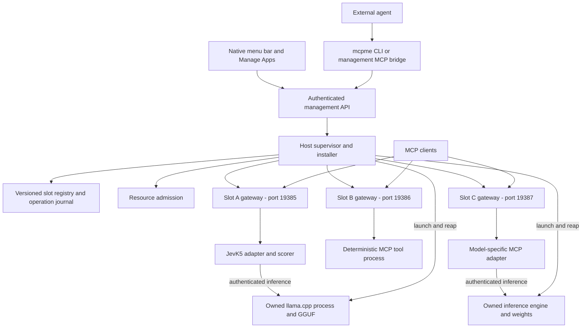
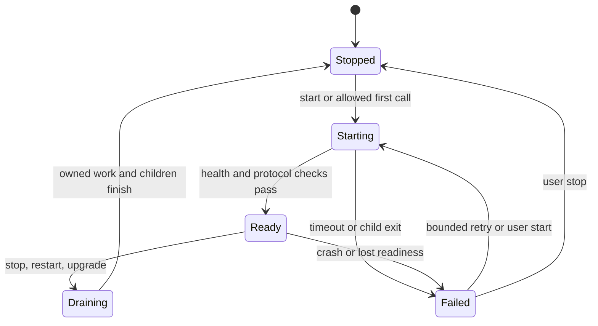

# mcpme: a menu bar host for local MCP services

Status: architecture and delivery plan, 2026-10-01. Phase 1 is implemented; Phase 2 onboarding has begun. See [implementation status](MCPME_STATUS.md) and [Phase 2 onboarding](PHASE2_ONBOARDING.md) for supported and verified behavior. The original [JevK5 Menu Bar](DESIGN.md) remains separately buildable. Baseline reviewed: commit `7e7e068`.

## Product

`mcpme` is a native macOS menu bar app for installing, running, connecting to, and monitoring local MCP services. Each installed service occupies a **slot**, with a stable identity, its own public loopback port, a versioned package, independent controls, and visible health. An external coding agent can prepare and install a package through a documented CLI or management MCP server.

JevK5 becomes the first slot package. A second slot could run a deterministic JSON validator. A third could run another model with a different inference engine. Adding any of these should require a package and an adapter, with no modification to the host app.

The initial target stays Apple silicon and macOS 26+, matching the existing bundled runtime. The host remains independent of Brekko. The product name is `mcpme`; the proposed app artifact is `mcpme.app`.

### Vocabulary

| Term | Meaning |
| --- | --- |
| Host | The menu bar app and its supervisor, installer, registry, and client bridge. |
| Package | A versioned, reproducible installation containing an MCP service or adapter, dependencies, and optional model/runtime artifacts. |
| Slot | One configured installation of a package. It has an immutable UUID, user-visible name, stable port, credentials, and state. |
| Gateway | A host-owned worker exposing one slot at `http://127.0.0.1:<port>/mcp`. It applies transport policy and connects clients to the service. |
| Runtime | The slot's executable processes: for example, Python plus llama.cpp, a Node server, or a native executable. |
| Model | A pinned weight artifact with a declared engine/profile compatibility contract. A model file alone is insufficient to expose MCP tools. |

A slot is a service instance. Slot identity does not depend on its display order or port. The same package can be installed twice with separate configuration and ports. A desktop application or non-MCP executable needs a package-specific MCP adapter; mcpme cannot infer its tool schema from the executable.

## User experience

The menu bar provides quick controls. A native **Manage Apps** window provides installation, configuration, connection details, and diagnostics. The UI calls a configured local tool or model service an **App**; slot remains the internal contract term. [App onboarding](PROJECT_ONBOARDING.md) defines the accepted Add App flow and delivery order. The vocabulary change preserves existing slot identities and package contracts.

```text
mcpme                         2 ready / 3 installed
  Requests       Last minute       In flight
  1,611          36                0

  Running
  JevK5 Judge                 Ready        1,284 requests
  JSON Utilities              Ready          327 requests
  Stopped
  Local Chat                  Stopped          0 requests

  Add App...
  Manage Apps...
  Stop All
  Settings...
  Quit mcpme
```

Apps are grouped by **Needs attention**, **Running**, and **Stopped**, with stable alphabetical ordering within groups. State text accompanies each color indicator. Clicking an app opens a companion detail panel to the right; the pair shifts left near the screen edge to stay visible. Details show live request counts, failures, work in flight, recent activity, latency, Start/Stop/Restart, Copy Connection, tools, model statistics where available, declared resources/access, and package identity. Ports appear in Connection details. The empty state leads to **Add App**. Escape or a click outside the two panels dismisses them; **Manage Apps** opens the full management window.

**Add App** opens a persistent native setup window with one drop surface and a file/folder chooser. It inspects the selected source without executing code, then asks for missing intent or configuration. A compatible prepared package proceeds through static validation to installation planning; other supported inputs become resumable import drafts for external-agent preparation. Documents require an explicit choice between reference information and setup instructions. The first release prioritizes prepared packages, source folders, and Markdown/text setup briefs; reference documents require a supported document-service template. Models and other profiles are available only as host support is implemented and validated. Users do not need to select a technical source category or write a manifest before beginning. The bring-your-own workflow below defines the technical inputs, agent handoff, and return path; integrated LLM-provider preparation is deferred.

The final installation plan shows exposed tools and their input/output contracts, download size, estimated loaded memory, platform compatibility, source, licenses, executable entrypoints, requested filesystem/network access, and whether code is locally built or publisher signed. Estimates and unverified declarations are labeled as such. Existing user authority can cover installation; the UI does not require another confirmation for the same approved scope.

Installing, downloading, verifying, starting, warming up, and ready are distinct stages. A listening socket never counts as model readiness. Long operations remain visible after closing the window, with progress, Cancel where supported, and an operation ID an agent can poll.

**Manage Apps** has two workspaces. **Installed Apps** uses a searchable sidebar with All, Running, and Attention filters and a detail area showing request activity, lifecycle controls, startup policy, tools, connection information, declared resources/access, package identity, and recent app operations. **Add App** keeps source selection, external preparation, and installation review in separate sections of one resumable setup. Switching workspaces retains draft state. App selection uses stable slot identity, survives reordering, and clears when the selected app is removed or excluded by a filter. Live refresh updates existing rows and preserves scroll position. Host unavailability disables app changes and suppresses live counters.

**Start at login** controls the host. In **Manage Apps**, an installed app independently chooses **Manual** or **Automatic when mcpme opens**. The saved policy changes future launches without changing the current runtime or clearing an explicit Stop. New slots default to manual; an explicitly requested install-and-start operation can override it. A user Stop suppresses automatic wake until Start. Start on first call remains planned. Quit stops every owned service and the supervisor. Closing the management window leaves them running.

**Remove App** closes admission, stops the app's owned processes, revokes its connection credential, releases its public endpoint, and removes it from the installed list. Removal is a durable operation. Source files, the sealed package, and package-owned data remain retained for recovery; data deletion and artifact retention cleanup remain separate future work.

## Architecture



The Swift app owns one Python supervisor. The supervisor owns one gateway worker per enabled installed slot, plus the slot's registered runtime processes through native reapers. Third-party Python modules never load into the supervisor or Swift process. A slot failure must not take down another slot or the management API.

The small host bundle contains the native UI, private Python runtime, locked host dependencies, supervisor, gateway/bridge, CLI, and native process reaper. Downloaded packages and models live outside the signed app bundle. Updating a slot never edits `mcpme.app` or rebuilds it. Python package preparation uses `uv` and committed locks. Other ecosystems bring their own pinned dependencies and compatible runtime; the host must not depend on a user's global Python, Node, or Homebrew installation.

### Three package execution profiles

| Profile | Package provides | Host responsibility |
| --- | --- | --- |
| `mcp-stdio` | A foreground executable speaking MCP over stdin/stdout. | Give each client session its own child/stdio channel, enforce session/process limits, and expose the slot's HTTP endpoint. |
| `mcp-http` | A foreground MCP server with configurable loopback address and authentication. | Start it on a private port, verify readiness, and proxy its MCP transport through the stable public gateway. |
| `model-service` | Engine, weights, profile, and an MCP adapter with a declared process dependency graph. | Verify artifacts, admit resource use, launch the engine and adapter, and coordinate their lifecycle. |

Heavy model slots use a shared resident service, independent of client count. A generic stdio server is not assumed to support multiple clients on one channel. The safe default is one lightweight subprocess per session; a package that needs shared state or a large model supplies a shared HTTP service/adapter. Limit sessions before spawning children. A package explicitly declaring exclusive stdio access may cap itself at one session.

An ordinary deterministic executable can be wrapped by a small `mcp-stdio` adapter. The host does not define a universal `execute(command)` tool. A general LLM package must explicitly choose tools such as `generate` or `embed`, input/output schemas, context limits, streaming behavior, and engine compatibility. JevK5 keeps its own decision tools.

### MCP boundary

Each slot is a separately connectable MCP server. Tool names and schemas stay local to that server; there is no merged tool namespace in the first release. Connecting a client to JevK5 does not expose package installation or other slots.

The current lockfile uses Python MCP SDK `1.30.0`. Use the locked SDK as the migration starting point, and explicitly test protocol revision `2025-11-25` before adding other negotiated versions. This is a compatibility target, not a claim about the latest MCP revision. The documented revision supports stdio and Streamable HTTP; local HTTP needs Origin validation and authentication. mcpme additionally retains the existing Host checks and loopback-only binding. See the [versioned transport specification](https://modelcontextprotocol.io/specification/2025-11-25/basic/transports).

The gateway and generic stdio-to-HTTP bridge require protocol integration tests. They must preserve negotiated capabilities, request/response IDs, tool schemas, structured results, notifications, session ownership, and cancellation semantics. HTTP forwarding must handle JSON and SSE, protocol headers, session lifecycle, and disconnects without buffering a whole stream. Rewrite only transport routing/authentication headers; never forward a caller's public credential to a package or follow arbitrary upstream redirects.

Start with a tested tools-only compatibility profile. Unsupported requirements such as sampling, roots, elicitation, resources, or prompts must be identified during installation and rejected with a compatibility explanation until implemented and tested. Do not silently advertise capabilities the bridge cannot forward. Native HTTP forwarding and stdio adaptation get separate compatibility tests. Within the supported profile, preserve tool-list change notifications and schema refresh behavior described in the [tools specification](https://modelcontextprotocol.io/specification/2025-11-25/server/tools).

A client's advertised capabilities are optional offers, not requirements imposed on the package; see the [capability negotiation specification](https://modelcontextprotocol.io/specification/2025-11-25/basic/lifecycle#capability-negotiation). Accept valid initialization from clients such as VS Code that advertise roots, sampling, elicitation, tasks, or extensions. The tools-only gateway acts as the package's client and forwards an empty client-capability object, because it does not implement those callbacks. Continue rejecting unsupported package requirements and requests outside the negotiated profile.

### Session lifetime and child reclamation

For `mcp-stdio`, the gateway creates an unpredictable public HTTP session ID bound to the slot UUID, runtime generation, and authenticated client grant. Each session maps to exactly one supervisor-owned stdio process instance. Reserve session/process capacity before launching; an initialization failure tears down that instance. The gateway owns the session lifetime even when the client never sends DELETE.

- The default idle lease is five minutes, measured with a monotonic clock. Accepted authenticated MCP POSTs renew it. Opening, reconnecting, or replaying an SSE stream and server-generated events alone do not, so automatic transport reconnects cannot retain an idle session indefinitely. Package settings can shorten the lease; longer leases require a visible host-approved limit.
- Executing requests suspend idle expiration until they complete, but every request retains a finite host-capped operation deadline. Completion starts a fresh idle interval. A request that ignores cancellation cannot retain a child indefinitely: after its deadline and bounded stop grace, terminate/reap the session child and close the session. Side effects may have completed; never replay the call automatically.
- Closing a GET/SSE connection or losing a POST connection does not itself cancel a request, expire its session, or kill its child. Reconnect within the lease uses the same session and process. Missing result delivery can remain an unknown outcome if the negotiated transport cannot resume it.
- Authenticated DELETE, idle expiration, slot stop, or generation replacement atomically marks the session Closing and rejects further requests for its ID with HTTP 404. Cleanup cancels queued work, requests cancellation of active work, and asks the supervisor to terminate/reap the child within the configured stop grace and host cap. Hold its process reservation until reaping; then delete its mapping. A closing ID cannot be renewed or reused.
- The local `connect` bridge detects stdin EOF, client exit, and shutdown signals and makes a bounded best-effort DELETE before exiting. Abrupt bridge termination relies on lease expiration. A gateway crash invalidates its sessions and the supervisor cleans up their process instances before admitting replacements.
- Completed client request IDs are remembered as 32-byte SHA-256 digests of the exact ID and its integer/string type, with at most 4096 markers per session (128 KiB of digest payload). Pending requests retain the original ID for responses and cancellation. Alternate JSON escaping does not create a distinct ID; digest collisions fail closed as duplicate requests. Message, pending-request, and event-ring limits also remain in force.

Native HTTP packages may be stateless. For stateful upstreams, the gateway keeps per-client public/private session mappings, forwards explicit termination, and applies the same bounded public-session lease. Expiring a mapping does not stop a shared runtime or another client's work. Accept a stateful package only when it supports DELETE or a declared finite upstream-session expiration rule; otherwise reject that profile during installation. Keep mappings and any permitted replay buffers in bounded memory, with no response history written to disk. Disconnect, DELETE, and expired-session HTTP behavior follows the [2025-11-25 transport specification](https://modelcontextprotocol.io/specification/2025-11-25/basic/transports).

### Ports and connections

- Keep `19385` for a migrated JevK5 slot. New installations choose an available port, preferring `19386–19485`, and persist it. The range is a preference, not an externally reserved allocation.
- The supervisor reserves a public port by binding a socket and passing it to its gateway. It keeps ownership through installation/activation; a probe followed by an unrelated bind is insufficient. On host restart, a stolen port puts that slot in `port_conflict`; do not kill the other process or silently move the endpoint.
- The management API uses its own OS-assigned loopback port, published in an owner-only manager connection file. CLI/UI discover it; it is not a slot port. It uses a separate credential and exposes versioned control routes, with no arbitrary tool-call forwarding route.
- Bundled stdio adapters, management CLI calls, and both native apps connect over owner-only Unix sockets. On macOS, `/private/tmp/mcpme-<uid>-<state-hash>/<service>.sock` uses the first 24 hexadecimal characters of SHA-256 of the POSIX-resolved, NFC-normalized state-directory path; service is `manager`, `jevk5`, or a slot UUID. The directory must be owned by the current UID with mode 0700, and the socket must be owned by that UID with mode 0600. Native clients also check the connected peer UID. A missing or unsafe socket fails closed without TCP fallback. The short path fits macOS's Unix socket address limit even for long installation/state paths.
- The service ownership lock or supervised worker lifecycle controls socket replacement. The supervisor passes the private listener to the owned gateway along with its reserved TCP listener, and closes its copy after launch. Shutdown closes the listener; restart replaces an owner-controlled stale socket. A migrated JevK5 slot also serves the original legacy state's private socket while the host retains its legacy lock. State, stable public ports, and invocation tokens are preserved.
- Private engine ports are ephemeral. Prefer inherited sockets where supported. Engines without socket activation retry allocation/binding within a deadline and require an authenticated readiness response from the intended child. Never adopt an unknown process already listening there.
- Every public slot listener has a separate invocation credential; private HTTP runtimes have separate keys. Invocation credentials cannot perform management operations.
- The gateway can remain available while the runtime is stopped, returning a sanitized `slot_stopped` availability error. Successful MCP initialization/listing while stopped is only promised by adapters that explicitly implement it. Slot status always remains available through management.

Define first-call loading as **wake on authenticated MCP initialization** for the generic profiles: it starts the runtime once, coalesces concurrent wake requests, and completes initialization only after readiness within the startup deadline. Subsequent discovery and calls use that live session. An adapter may instead expose discovery while unloaded and defer model loading until `tools/call`; it must declare this mode and its deadline. Manual Stop persists a wake-suppression flag, closes sessions, and rejects initialization/calls until an explicit Start clears it. Host shutdown does not rewrite the saved start policy or this flag.

For private HTTP services, the supervisor creates a fresh random key per runtime generation and passes it through an inherited descriptor or owner-only temporary file, as declared by the package. The package must support that injection mechanism; secrets never enter command-line arguments. Gateway-to-package calls use only this private key. Readiness requires the live owned child, an authenticated response, and a generation nonce supplied at launch and echoed by the adapter. Reap the child before removing its key file; a restart rotates both key and nonce. A package that cannot authenticate its private HTTP routes requires a stdio adapter instead.

The primary connection command is proposed as:

```sh
"/Applications/mcpme.app/Contents/MacOS/mcpme" connect --slot <slot-uuid>
```

This command speaks MCP stdio and resolves the slot's current private socket and invocation credential. Its HTTP messages retain the public endpoint's Host value and authentication policy while traveling over the private socket. It opens the host if necessary, respects the slot's start policy, and never creates a second model runtime. An optional user-installed stable launcher can survive app relocation; until then, copied client configurations use the app's actual absolute path. Public HTTP endpoints remain available for compatible clients; use the bundled stdio configuration for the owner-authenticated transport. Credentials never enter generated documentation or ordinary diagnostic output.

## Package and slot contracts

Use a versioned `mcpme.package.json` plus a resolved `mcpme.lock.json`. These are mcpme-specific formats, not an MCP standard. A package describes reproducible software; a slot record describes one user's installation. The installer rejects unknown required fields, incompatible schema versions, unresolved versions, and invalid cross-field combinations.

| Manifest area | Required contract |
| --- | --- |
| Identity | Package ID, version, package schema version, host API compatibility range, source revision, license references. |
| Platform | Supported OS/architecture and minimum OS version for every executable dependency. |
| Artifacts | Immutable source locator, SHA-256, byte count, destination, provenance, and license. Lock every transitive artifact. |
| Execution | Profile, process IDs, singleton/session scope, acyclic readiness dependencies, package-relative executable and argument array, working directory, endpoint/descriptor injection, and allowlisted environment names. Every managed process uses the host launcher. No shell command strings or arbitrary install hooks. |
| MCP | Supported protocol/profile, required capabilities, expected tools and schema digest, internal transport/authentication configuration. |
| Model, if any | Artifact identity, engine/build identity, context/profile parameters, and compatibility requirements. Retain model-specific fields. |
| Lifecycle | Readiness probe, startup/operation deadlines, stop grace period, restart policy, session/process limits, idle lease, upstream session termination policy, concurrency and queue limits. |
| Resources | Download/installed sizes, estimated loaded memory, CPU/GPU use, and whether first-call loading is supported. |
| Access | Declared filesystem paths, outbound destinations, secret references, and write/side-effect behavior. These declarations describe trusted code; they are not an OS sandbox. |
| Validation | Side-effect-free health probe and package-specific synthetic smoke fixture, where available. No private user input. |

The lockfile resolves templates to exact artifact hashes and records the build recipe, builder/toolchain versions, and full dependency closure. A declared hash verifies identity against the plan; it does not establish publisher trust. Secrets are references to separately stored values and never part of either manifest.

A slot record contains an immutable UUID, mutable display name, package ID/version/digest, slot configuration, selected public port, credential reference, start policy, current generation, desired state, and observed runtime status. Renaming or reordering a slot changes neither identity nor connection command.

The first package, `local.jevk5`, carries the existing [model manifest](../model-manifest.json), pinned upstream scorer and licenses, packaged llama.cpp dependencies, and current MCP adapter. Its GGUF SHA-256 remains `aea433883bc7ed399f2fbd539e53d2eac7caf71a946fe6650995a413979d4a30`. Its adapter owns the 8192-token profile, temperatures, question contract, exact-consecutive cache, and one-decision lock. These are JevK5 behavior, not universal host settings.

### Installation layout

```text
~/Library/Application Support/mcpme/       owner-only directory
  registry.sqlite                        slots, generations, operations
  manager-connection.json                manager address; private discovery
  credentials/                           separate manager/client/slot grants
  packages/<package-id>/<digest>/         immutable verified package contents
  staging/<operation-id>/                 inactive installation candidates
  slots/<slot-uuid>/
    settings.json                        typed nonsecret configuration and opaque secret references
    connection.json                      endpoint and invocation credential
    data/                                package-owned persistent data
    runtime/                             temporary files and private engine keys
  events/                                bounded lifecycle metadata only
```

Private directories use mode 0700 and private files 0600. SQLite sidecars receive the same protection. There is one supervisor lock and one active generation per slot. Immutable means host-managed files are not edited in place; same-user processes remain within the trust boundary. Updates create new package directories. Runtime state and model caches are not stored inside package directories.

Model blobs may initially be copied using APFS clone copying, as today. Shared content-addressed storage can follow once reference accounting, rollback retention, and garbage collection are tested. Never share a mutable engine process or inference cache between different slots implicitly.

## Bring your own program or model

This workflow turns a source folder, script, executable, model artifact, or existing MCP server into a prepared package. The user selects what they have and what it should expose. An external agent prepares the integration; mcpme installs and manages the result. There is no required catalog membership, publisher signature, or change to host source for a local package.

### Guided intake and agent handoff

1. **Choose a source.** Program or script accepts a local file/folder or repository URL. Model with inference engine accepts local weights or a model URL/revision, plus an existing engine package/build or a request to prepare a compatible engine. Existing MCP server accepts its source or executable and declared transport. Repository branches and mutable URLs may identify a draft source, but must resolve to exact revisions and artifact hashes before installation planning. An already running server is not adopted; the agent must prepare an independently launchable package.
2. **Describe the useful interface.** For a program, collect its intended functions, input/output examples, and whether calls write files, modify state, or make network requests. For a model, collect the intended operation such as generation, embeddings, or JevK5 decisions, along with model/engine identity and context requirements. Examples must be synthetic and nonsecret. The agent proposes named MCP tools and schemas from this intent. Source inspection can suggest an interface; it cannot establish which functions the user wants exposed or whether a call is safe to retry.
3. **Select behavior.** Collect the slot name, configuration and secret references, start policy, and resource limit preferences. Unknown engine compatibility, tool schemas, memory requirements, or entrypoints remain visible as missing information. The agent resolves them or asks focused questions before producing a plan. New slots remain manual by default; explicitly requesting install-and-start carries through the draft.
4. **Prepare with an agent.** Save a private import draft and offer **Copy Agent Instructions** and **Export Import Specification**. The instructions identify the draft, host capabilities, selected source, requested tools, preparation templates, expected output, and return command. They include no credentials or secret values. The user supplies them to an external agent; mcpme does not start an agent or execute the source during intake. Future direct agent integrations can use the same contract.
5. **Return the prepared package.** The agent snapshots the selected source in its separate workspace, resolves dependencies, builds the adapter/runtime, and produces the package, lockfile, provenance, and synthetic validation fixtures. It attaches the result to the draft through the proposed `mcpme imports attach <draft-id> --revision <revision> --package /absolute/path/to/package --json`. The UI also accepts a prepared package folder for that draft. Attaching performs static validation and makes the result available for planning; it neither runs code nor installs a slot.
6. **Plan, install, and connect.** Use the proposed `mcpme install plan --import <draft-id> --revision <revision> --json`, or its UI equivalent, to plan from the attached snapshot. This input is mutually exclusive with `--package`; the host supplies the package and configuration from the draft. It compares the prepared tool/configuration contract and source provenance with the draft, surfaces differences, and uses the normal exact-plan authorization and transactional installer. Expanded access, changed tools, or changed artifacts require a revised plan and corresponding authority. The result is one slot with its own stable public port, lifecycle controls, health, and connection configuration. Client registration remains a separate explicitly requested action.

The import specification is a versioned mcpme format, separate from the package manifest. It records `draft_id`, revision, source kind and locators, resolved source identity when known, proposed tool contracts, configuration/secret references, runtime preferences, and the resulting package digest. A local source snapshot records an explicit file list and content hashes, including selected uncommitted files; exclude credentials, unrelated files, build caches, and local environments. The installed package is a sealed copy, never a live reference to the user's editable checkout. Changing the original program or weights requires preparing an upgrade; it does not silently alter the installed slot.

Draft edits increment the revision. A returned package must identify the draft revision it was prepared for; a stale result cannot overwrite a newer choice. Attaching validates and snapshots the result into bounded host staging, then records its digest. Later plans use that snapshot and digest, so editing the agent's output directory cannot change an accepted result. Repeating an attachment for the same revision and digest recovers the same result; a different digest replaces only an inactive draft result through an explicit draft edit. Expire inactive draft artifacts under a visible retention policy without deleting the user's original source or the agent's workspace.

An import-derived plan binds draft ID/revision, attached package digest, configuration, and proposed effects. Editing, canceling, or expiring the draft atomically invalidates its unapplied plans before any staging reclamation. Apply atomically rechecks that binding, records a single linked installation operation, and establishes its artifact references before cleanup can observe submission or effects begin; retries for that draft revision return the same operation. Once submitted, draft edits, replacement attachments, expiration, and draft cancellation are unavailable. Return `operation_in_progress` while the linked operation is active and `draft_finalized` after it is terminal; the separate installation operation's authorized cancellation/recovery rules apply. A completed operation records its resulting slot on the draft. Artifacts referenced by an installation/recovery operation follow that operation's retention policy and cannot be reclaimed by draft cleanup. This transition prevents a cancellation/apply race from installing a canceled draft or deleting an executing candidate.

After an installation reaches a terminal failed/canceled state, retain its submitted draft as history and recover retries to that same operation. Another installation attempt requires a new draft and plan, optionally copied from the recorded choices, with corresponding authorization. The agent may reuse retained verified artifact blobs while preparing the new draft's bound package/plan. An operation requiring recovery is not terminal and keeps its references and recovery controls.

Proposed `imports create/inspect/revise/export/attach/cancel` CLI operations and typed management equivalents let an agent start this flow without the UI. Draft states are `needs_information`, `waiting_for_agent`, `package_received`, `ready_to_plan`, `submitted`, `installed`, `canceled`, and `expired`; submitted drafts link to the installation operation, including any failure/recovery state. They are distinct from installation operations and slot runtime state. mcpme can observe an attached package and its own checks; a copied instruction does not prove an agent started or is still building. The UI shows **Waiting for agent** until a result arrives, rather than a fabricated progress indicator. Closing and reopening the UI resumes the draft. Canceling an unsubmitted draft prevents further attachment/installation through it and cleans its inactive staging; it cannot stop work executing in an external agent session. After submission, show installation-operation controls instead.

Draft files use owner-only permissions. They contain structured configuration and nonsecret synthetic fixtures, not conversation history, prompts, production inputs, or credentials. Source contents and build logs never enter the host event journal or diagnostic exports. Import-management authority permits draft operations only; it does not grant installation, arbitrary source execution, or client-registration authority. A successful external build is agent-reported evidence until host verification and runtime checks pass.

### Different preparation paths, one slot contract

The distinction is the service interface and process/resource requirements. Python is a language, and determinism is a behavior; neither establishes the execution profile. A deterministic tool may need GPU work or persistent state, and an inference server may itself be written in Python. Choose the package profile from the actual topology and capabilities.

| Concern | Typical deterministic Python program | Inference server running a model |
| --- | --- | --- |
| Interface | Selected functions become named tools with explicit schemas, side effects, and error behavior. | An adapter defines generation, embeddings, decisions, or other model-specific tools; the engine API alone is not an MCP interface. |
| Prepared artifacts | Program snapshot, adapter, private Python interpreter, and dependencies pinned with `uv` and a lock. | Exact weights, engine build and its dependencies, adapter runtime, and compatible model/profile configuration. |
| Default topology | One foreground `mcp-stdio` adapter process per client session, importing the program inside that process. A shared stateful service uses `mcp-http` instead. | `model-service`: one resident engine and one shared adapter per slot generation, with declared readiness dependencies. Client count does not multiply model loads. |
| Ports | A stable public gateway port; stdio needs no private listening port. | The same public gateway contract, plus private engine/adapter endpoints where required. |
| Readiness and validation | Initialize MCP, check schemas, and run a synthetic function fixture with its expected result. | Verify weights/build identity, complete engine loading and authenticated readiness, then test the adapter with a model-specific synthetic fixture. Listening on a port is insufficient. |
| Resources | Declare process/session limits, operation deadlines, queue/concurrency behavior, and memory/CPU/GPU requirements. Typical CPU-only tools need no GPU inference lease. | Reserve loaded memory plus headroom; declare loading deadlines and participate in host GPU admission, or require exclusive GPU residency. |
| Stop and failure | Close admission and terminate/reap session processes after bounded work cleanup. Shared services follow their declared lifecycle. | Drain/cancel work, stop the adapter and engine in dependency order, release reservations after reaping, and invalidate model/cache state. |
| Monitoring | Ready/stopped/failed, active calls, queue depth, aggregate errors/latency, and process status. | Those metrics plus loading/warmup, exact model/engine/profile identity, resource reservations, and applicable cache statistics. |

**Python tool example.** A user selects a folder containing `validator.py` and requests a `validate_json` tool. The agent packages a callable validation function with a foreground MCP adapter and locked private Python environment. The host launches the adapter; it imports the selected function inside its own slot process, never inside the host supervisor. Inputs and results flow only over MCP. The host supplies the sealed package and selected configuration without mounting or granting special access to the original checkout; the program still runs under the same-user trust boundary, without OS sandbox enforcement. Per-session execution is suitable when the function has no shared-state requirement; shared state needs an explicit service/concurrency design. Determinism does not imply read-only behavior, retry safety, or automatic caching.

**Model example.** A user selects JevK5 weights and the llama.cpp engine and requests the existing decision tools. The agent packages the exact compatible artifacts and JevK5 scorer/profile. The supervisor owns the engine launch and private credential/endpoint; it then starts the shared adapter with the engine dependency. Two clients call the same resident engine through one slot. The current one-decision lock, bounded admission, and exact-consecutive-token cache remain in the JevK5 adapter. Selecting another model does not inherit JevK5's scoring, temperatures, prompt format, or cache rules; its adapter and profile must establish their own contract.

An existing HTTP inference API, including a completion API, is input to model preparation rather than proof of MCP compatibility. The package must establish engine/model compatibility, credential injection, authenticated readiness, request/cancellation behavior, and supported MCP tools. Reusing a prepared engine package avoids rebuilding that engine, but each model slot still owns a separate runtime in this release. If memory estimates are unknown, require a user-set reservation before loading; inspect format/metadata statically and perform runtime validation only under the normal authorized candidate checks.

Programs that only expose a command-line entrypoint need a package-specific adapter. The agent may adapt a copied entrypoint into a callable function or declared foreground service and verify equivalent synthetic behavior. It must not insert unrestricted shell execution or adapter-owned subprocess launches to bypass the supervisor contract. A required worker/engine must fit the declared singleton/session dependency graph and host launcher. Detached daemons, adoption of running services, or unsupported subprocess topologies remain unsupported; report `needs_adapter` or `unsupported_process_topology` with the missing integration work rather than promising that every executable can be installed unchanged.

Preparation ships with versioned templates for a Python function tool, an existing stdio/HTTP MCP server, and the tested JevK5/llama.cpp model service. Templates identify compatible host/schema versions and provide adapter source, package/lock examples, and synthetic checks. They are authoring starting points, not automatic compatibility claims for every Python library, GGUF, engine, or architecture. An agent can prepare another engine against the same contract without changing host source; unsupported capabilities or platform dependencies produce an actionable compatibility result.

Before planning, unresolved source/dependency pins, missing tool contracts, missing model/engine compatibility, unavailable secret references, and unsupported topology/capabilities block the draft. Use stable content-free codes such as `source_unresolved`, `tool_contract_required`, `engine_incompatible`, `secret_reference_unavailable`, and `unsupported_process_topology`; show the field or integration requirement needing attention, with no raw execution error. Installation remains unavailable until the host validates a complete prepared package. Same-user trust, declared access, authorization, and recovery rules apply equally to both preparation paths.

## Agent installation workflow

An external agent uses the same operations as the UI. A built-in autonomous agent, cloud account, marketplace, and natural-language package resolver are unnecessary for the first release.

Example user request: “Install JevK5 into mcpme and start it.”

1. The agent reads `mcpme capabilities --json` for host version, architecture, supported package schema/profiles, and configured resource limits.
2. It obtains a pinned prepared package, or uses the bring-your-own intake/templates to build an adapter in a separate workspace and return it to an import draft. Development/build execution belongs to that agent session; the host installer accepts verified prepared artifacts and does not execute arbitrary build scripts.
3. For a prepared package, it calls `mcpme install plan --package /absolute/path/to/package --name "JevK5 Judge" --start --json`. For an import, it calls `mcpme install plan --import <draft-id> --revision <revision> --json`, using the start choice saved in that draft revision. Planning validates the manifest/lock and produces a concrete source, artifact, access, port, disk, memory, and activation plan without executing package code.
4. It calls `mcpme install apply --plan <plan-id> --json` within the user's granted installation authority. Activation is already bound into the saved plan. The host checks that authorization covers this exact plan and its effects. Existing authorization can cover the apply; the workflow does not require repeated confirmation for the same scope. An expanded access request or different artifact requires a revised plan and corresponding authorization.
5. The operation stages and verifies artifacts, starts the candidate under supervision, checks MCP compatibility and health, runs an approved synthetic smoke fixture if available, and commits the slot generation.
6. The agent polls `mcpme operations get <operation-id> --json`, then returns the slot UUID, readiness, endpoint, and connection command. It adds the client registration only if requested.

The CLI includes `capabilities`, `imports create/inspect/revise/export/attach/cancel`, `slots list/inspect/start/stop/restart/configure/remove`, `install plan/apply`, `operations get`, `connections export`, and `connect`. `slots configure <slot-id> --start-policy manual|host` changes an installed app's future startup behavior. `slots remove <slot-id>` returns a durable operation. Their owner-authenticated API equivalents are `PATCH /v1/slots/{id}` with `{"start_policy":"manual"}` or `{"start_policy":"host"}`, and `POST /v1/slots/{id}/remove`. These two operations require owner authority; scoped grants do not include them. The [management milestone](MANAGEMENT_MCP.md) adds `authorize`, `grants list/inspect/revoke`, `install inspect`, and `management export/connect`. The current supported groups are recorded in [implementation status](MCPME_STATUS.md); upgrades and operation cancellation remain pending. Capabilities include versioned preparation-template identifiers. CLI output uses versioned JSON with stable error codes and no credential values. Long installation mutations return promptly with operation IDs.

An optional, separately connected **mcpme management MCP server** exposes typed equivalents: `mcpme_capabilities`, `mcpme_create_import`, `mcpme_inspect_import`, `mcpme_revise_import`, `mcpme_export_import`, `mcpme_attach_import_package`, `mcpme_cancel_import`, `mcpme_list_slots`, `mcpme_inspect_slot`, `mcpme_plan_install`, `mcpme_apply_install`, `mcpme_get_operation`, and bounded lifecycle/update/removal tools. It is a host control endpoint, not another installable slot, so installation cannot depend on a slot being healthy. Ordinary slot connections never include these tools.

Management credentials can be read-only, scoped to lifecycle control for selected slots, or permitted to apply installations within a grant. Grants bind package/plan digest, allowed slots/actions, and relevant resource/access limits; a model-supplied `approved: true` flag is not authority. A locally authorized agent can receive a grant through the CLI/UI bootstrap. Scoped credentials limit API behavior; they do not isolate malicious code already running as the same macOS user.

The bootstrap is a local owner action through the UI or `mcpme authorize --plan <plan-id>` under the agent session's existing user authority. It creates an opaque 256-bit bearer capability in an owner-only file, with a server-side hashed-token record containing grant ID, plan digest, actions, expiry, and revocation state. The CLI returns its file reference, never its value. A plan grant expires after 15 minutes and atomically binds to one operation on first apply; retries may only recover that operation. Longer reusable lifecycle grants require explicit slot/action scope and expiry. Every request checks expiry/revocation, and credential-file consumers reject wrong ownership, symlinks, or group/world access. Revocation blocks further calls; canceling an operation already authorized to run is a separate action. This is local account authorization, not proof that a human clicked for every action.

### Transaction and recovery rules

- Plan IDs bind the exact package/lock/configuration digest and proposed effects. Changes invalidate the plan. Recheck disk space, resource availability, and port reservation at apply time.
- [The configuration implementation](CONFIGURATION_SECRETS.md) extends package schema 1 with a closed versioned primitive contract and logical `access.secrets` names. Plans bind effective nonsecret choices and immutable owner-managed reference UUIDs. Registry schema 3 binds each generation to its private settings digest; old rows retain no settings binding. Selected package children receive resolved values through `MCPME_SETTINGS_FD`, with rechecks after spawn acknowledgment and before exposure. Store administration remains owner-only. Native configuration forms, installed-settings edits, Keychain storage, and automatic secret rotation remain pending.
- Apply accepts an idempotency key and records its intent before side effects. Retrying returns the same operation/slot instead of installing duplicates. Serialize mutations per slot and use registry generation checks to reject stale updates.
- Download to staging with size limits, verify every digest before execution, reject path traversal and links escaping the package root, and seal the resolved execution tree. Local package paths are snapshotted into staging; execution never follows an editable external source tree.
- The [pinned-download implementation](PINNED_DOWNLOADS.md) accepts root-level prepared ZIP packages with exact archive size and SHA-256, optionally an exact package digest. It exposes owner-only durable download jobs separately from installation operations. Fetch, cancel, and retry never install or execute a package; a completed sealed tree enters the existing plan/apply flow. HTTPS redirects, credential-bearing URLs, private network destinations, byte-range resume, and native download controls remain unavailable in this slice.
- An installation is visible as installing but cannot serve ordinary tool calls until verification succeeds. A canceled or failed first install leaves no active slot process or reserved public listener; its bounded diagnostic record remains.
- An upgrade stages separately, drains and reaps the old generation, then starts and verifies the candidate behind a closed gateway admission gate. The gateway returns `updating` throughout this interval. A durable registry transaction selects the candidate generation and its data location while the operation remains pending. A separate durable exposure marker is required before ordinary calls may reach it; the operation succeeds only after routing is activated. A model upgrade may unload the old model before loading the candidate to fit memory; zero downtime is not promised.
- Candidate readiness includes MCP initialization/schema validation and a safe smoke fixture when defined. A running PID is insufficient. An initialization request can execute package code and therefore happens only within apply authority.
- Preserve the previous package, configuration, and data recovery artifacts until they are no longer needed. Quiesce/reap all old writers before taking a data snapshot. Candidate probes and migrations use a candidate data clone; expose only the selected candidate data directory after commit. Even an unchanged schema does not establish that the old binary can interpret new writes. Reject upgrades requiring automatic irreversible data migrations or external side effects during migration/probes. Rolling back binaries alone does not undo data changes.
- On restart, reconcile journaled operations with the selected generation and its durable exposure marker using the recovery rules below. A corrupt registry does not trigger deletion or guessed process adoption.
- Remove records a durable intent, closes admission, stops/drains the slot, revokes its connection credential, releases its port, and unregisters it. Retain package-owned data, configuration, and package artifacts for recovery. **Remove and delete data** and shared-artifact retention cleanup remain future work.
- Startup-policy updates and removal reject unfinished installation/removal, ownership loss, and migration-recovery states. Removing a migrated JevK5 slot records the transfer's durable removed state before releasing its legacy lock; it preserves legacy data and never restarts the old app or reenables its login registration. A new transfer of the retained legacy installation is blocked until the predecessor's registry removal and removal operation complete.

Persist the old/candidate generation, package/configuration/data pointers, operation stage, and whether exposure has been durably recorded. The exposure marker must be committed before the gateway admits the first ordinary MCP or compatibility API request. Treat the marker as proof that candidate writes may have occurred, even if the host crashes before actually forwarding a call. Admission and exposure use the same slot-generation check; a stale gateway cannot open an old generation after a concurrent mutation.

| Recovery boundary | Required behavior |
| --- | --- |
| Before candidate selection | Stop/reap the candidate, retain its diagnostic artifacts, and restart the old generation with its untouched old data. |
| Candidate selected, exposure marker absent | Keep admission closed; on failure or interrupted operation, stop/reap the candidate and commit a compensating transaction selecting the old package/configuration/data before reopening the old generation. |
| Exposure marker present | Preserve the candidate data and recover the selected candidate generation. If recovery or routing fails, close admission and report `upgrade_recovery_required`. Automatic rollback to a pre-upgrade snapshot or old binary is forbidden in the first release. |
| Recovery itself fails | Keep the slot Failed, retain both generations and data artifacts, and record a recoverable operation. Report rollback success only after verifying old-generation readiness in an allowed pre-exposure rollback. |

After exposure, a user can authorize a separate forward-repair or restore plan. A restore plan must describe the write-loss risk and any data compatibility constraints before it runs. Filesystem snapshots cannot undo external effects from ordinary tool calls. Upgrade Cancel is supported only before exposure; after exposure, the UI offers Stop or recovery operations instead.

## Lifecycle, concurrency, and resource policy

Keep installation state (`staging`, `verified`, `failed`) separate from desired runtime state (`running`, `stopped`) and observed runtime state:



`port_conflict`, `resource_blocked`, and `incompatible` are explicit blocked reasons, not “loading” forever. Active/queued calls are counters within Ready. Every start/stop operation has a deadline and content-free failure code.

Each slot controls its own concurrency, queue length, and deadlines. The host does not serialize unrelated deterministic tools. JevK5 retains one lock across tokenization, inference, and result formatting, the existing bounded admission count, and cancellation-safe ownership until the actual engine operation finishes. No transport retry automatically repeats a tool call; a disconnect can leave a side effect completed with an unknown result.

Stop first rejects new work, cancels queued requests with a stable availability error, then drains in-flight calls within the package deadline. It terminates only owned children and reaps them before releasing resources. On timeout, force termination is reported as potentially incomplete work. Restart and upgrade terminate MCP sessions; clients reinitialize against the same stable slot identity/port. A service restart resets ephemeral caches and invalidates in-flight session mappings.

### Host launch contract

The supervisor launches every declared runtime process directly through one native reaper per executable, adapting the existing [llama supervisor](../scripts/llama-supervisor.c). A package declares a dependency graph rather than creating its own persistent process tree. For example, the host starts the engine, verifies its readiness, then starts the MCP adapter and supplies the engine endpoint/key. The adapter makes inference requests and never launches or kills the engine itself.

Each process declaration has a stable process ID, singleton-per-generation or per-session scope, executable/arguments, readiness dependencies, endpoint requirements, allowed inherited descriptors, and startup/stop deadlines. Singleton processes cannot depend on a per-session instance. Packages that internally spawn persistent workers or engines must supply an adapter that adopts this host launch contract; unsupported process topologies are rejected before activation. Detached daemons and adoption of unrelated processes remain unsupported.

1. The supervisor checks the slot/generation and desired state, reserves resource/process capacity, and assigns an opaque process-instance ID. It resolves only the declared package-relative executable and arguments from the sealed package.
2. The supervisor starts a bundled generic `mcpme-reap` wrapper with an execution specification on a private inherited descriptor. The wrapper executes one target, holds its child identity until reaping, reports spawn/exit over a separate control descriptor, and terminates its child if the actual parent supervisor dies. This generalizes the current wrapper's fixed `.real` executable convention without adding a shell interpreter.
3. Only declared descriptors reach the child: stdio pipes where needed, private-key descriptors, and sockets supported by its runtime. Close unrelated descriptors and strip launcher/control capabilities from package environments. Endpoint and nonsecret configuration injection are explicit; private keys never enter argv.
4. Ready dependencies launch first. Where an engine cannot inherit a listener, the supervisor coordinates allocation/retry and authenticated readiness under the existing private-port rule. A dependency failure tears down dependents in reverse order. The supervisor records process handles, authenticated readiness, and resource reservations before reporting the slot Ready.
5. A gateway requests per-session stdio instances through an inherited supervisor/worker socketpair, using typed `launch_session(slot_uuid, generation, process_id, session_id)` and `close_session(instance_id)` messages. The channel is restricted to that worker's slot/generation and declared per-session entrypoint. The supervisor creates the pipes and transfers only their required ends after an ownership acknowledgment. A lost worker/channel or failed transfer triggers teardown. No arbitrary executable, arguments, PID, or other-slot selection is accepted through this interface.
6. Stop or cancellation closes admission before revoking launch requests. Recheck state after spawn/ack so a racing launch is reaped instead of published. Stop dependents before dependencies and release reservations only after exit/reaping acknowledgment. Losing the supervisor triggers each surviving wrapper's parent-death cleanup; losing a gateway tears down its per-session instances through the supervisor.

If a reaper dies before acknowledging target exit, mark the slot `ownership_lost`, close admission, stop other still-owned dependent processes, and retain the missing instance's resource/process reservations. Its target may remain running, because an arbitrary engine does not necessarily monitor parent death. Do not signal a recorded PID, adopt that target, or start a replacement on the assumption that the target died with its wrapper. Clear the blocked instance only after an identity-bound exit observation established while the target was owned proves it exited, or after explicit user-assisted cleanup. Persist unresolved ownership-loss metadata so a host restart cannot silently start a duplicate runtime. If death occurred before target identity was acknowledged, require user-assisted reconciliation.

Phase 1 must test the actual launched process graph, cancellation at each launch boundary, descriptor ownership, and parent/gateway/reaper failures before accepting packages. Host/supervisor-loss cleanup is guaranteed while each target's reaper survives long enough to terminate/reap it. Forced reaper death tests instead verify `ownership_lost`, retained reservations, visible reconciliation, and absence of guessed PID signals or automatic replacement; complete cleanup in that case is not promised. Stronger cleanup would require a separately tested target-side lifetime contract, which is not assumed for arbitrary engines. Trusted packages must have no subprocesses outside the launch contract; manifest declarations alone cannot enforce that against malicious same-user code. Topology inspection and lifecycle tests verify the supported packages rather than claiming general OS containment.

Crash recovery is per slot: proposed default of three attempts in five minutes with exponential backoff, then Failed until user action. Configuration errors, missing artifacts, failed authentication, and port conflicts do not trigger restart loops. Manual Stop never triggers recovery. Repeated inference errors can mark the adapter unhealthy without restarting unrelated slots.

Several loaded models can exhaust shared memory even when each appears healthy. Before loading, the host reserves the package's estimated memory plus configured headroom against a user-visible budget. Unknown estimates require a user-set reservation. Concurrent starts reserve atomically; unloading/reaping releases the reservation. Show process memory estimates and system pressure separately; RSS is not exact GPU/unified-memory attribution.

The initial model admission policy permits one active managed GPU inference at a time, with a bounded, fair queue across model slots. Participating model adapters obtain a host lease before engine work and hold it until that work actually ends. Arbitrary third-party servers cannot be assumed to obey this scheduling contract; unsupported GPU packages require exclusive residency. CPU-only tools continue independently. Permit broader GPU concurrency only as an explicit setting after measurement. Never silently unload a busy or manually pinned model to make room.

## Monitoring and local trust

The manager snapshot includes content-free per-app activity: received, succeeded, failed, in-flight requests, requests in the last minute, last completion latency, last request time, and the host-session start time. It counts authenticated MCP tool calls and legacy decision calls, including tool errors and rejected calls that reach dispatch. Initialization, tool discovery, HTTP health/status polls, and requests rejected by transport authentication are excluded. Counts survive an app stop/restart and reset with the host. Removed apps leave the displayed aggregate. The last-minute count uses bounded one-second buckets. Interrupted calls are reconciled as failed when their gateway closes.

The UI polls the batched snapshot every two seconds and refreshes selected app details every six seconds while open. Unavailable activity displays as unknown; a failed refresh marks status unavailable, hides stale counters, and disables runtime controls. Reporting uses bounded, nonblocking private events independently of lifecycle RPCs. Reporting loss marks counts unavailable until host restart; subsequent app restarts cannot restore the missing history. JevK5 decision/cache/queue counts are separately labeled runtime-reported statistics and reset with that runtime. Resource values remain declared reservations, not measured memory use. Uptime, restart totals, latency histograms, and measured resource pressure remain future monitoring work.

Keep a bounded journal of lifecycle/installation events: time, slot UUID, operation ID, generation, event code, progress counters, exit status, and known error code. Never log prompts, evidence, responses, options, tokens, API keys, raw HTTP frames, child stdout/stderr, arbitrary exception text, command lines, or environment values. MCP stdout is protocol data and goes only through the transport. Child stderr is discarded by default. Diagnostic export includes only an explicit allowlist of metadata; unknown fields are omitted.

Slot HTTP policy applies to every route and SSE connection: loopback-only binding, exact Host/Origin validation, invocation authentication, bounded input and output, session limits, and timeouts. Preserve the current duplicate-header and malformed-envelope checks. The default request limit is 1 MiB. A package may explicitly declare `lifecycle.max_request_bytes`, up to the host ceiling of 17 MiB, in its installation plan. The supervisor passes that declaration to the slot gateway and its private connection descriptor; the stdio bridge uses the same bound. This accommodates a 12 MiB image encoded as base64 with JSON framing. Responses remain capped at 1 MiB per message and 8 MiB per operation. Bound streaming buffers, per-message size, and total operation budgets separately so streaming does not imply unbounded memory. Manager routes retain their 1 MiB request limit and separate credentials.

Installed programs execute with the user's macOS account permissions in this first release. Per-slot directories, processes, and credentials prevent accidental coupling and reduce credential propagation; they do not prevent a malicious same-user program from reading another slot's files or making outbound requests. Filesystem/network declarations are shown as declarations unless an enforceable isolation mechanism is added. The host gives children a minimal environment and only their selected secrets. It does not promise to enforce arbitrary filesystem or network allowlists without an OS isolation layer.

A package is executable code. Origin/hash/license verification, publisher identity where available, a visible plan, and bounded installation authority are part of installation. They do not certify a package as safe. Public package distribution, Developer ID signing/notarization, and stronger plugin isolation need separate implementation work; the current ad hoc signed app does not already provide them.

## Migration from JevK5

| Existing component | Proposed destination |
| --- | --- |
| [Native menu app](../Sources/JevK5MenuBar/main.swift) | Keep AppKit/ServiceManagement; replace fixed backend/model status with manager discovery and slot rows. Add Manage Apps. |
| [Entry point](../backend/jevk5_app/__main__.py) and [private state](../backend/jevk5_app/state.py) | Split host supervisor/registry/connection discovery from slot execution. Remove fixed-port assumptions from generic host code. |
| [ModelManager](../backend/jevk5_app/runtime.py) | Keep decision admission, scorer serialization, cache handling, and result formatting in the JevK5 adapter. Move engine launch, port/key allocation, crash recovery, and reaping to the supervisor launch contract. |
| [Scorer](../backend/jevk5_app/scorer.py), [question contracts](../backend/jevk5_app/contracts.py), and vendored scorer | Keep JevK5-specific; avoid imposing a decision schema on other tools. |
| [HTTP policy and MCP registration](../backend/jevk5_app/server.py) | Extract transport policy for all gateways; keep JevK5 tool registration, evidence handling, and errors inside its adapter. |
| [Stdio bridge](../backend/jevk5_app/bridge.py) | Add generic slot bridge with explicit protocol tests. The existing bridge knows two JevK5 tools and is not a generic MCP proxy. |
| [Build pipeline](../scripts/build.py) | Build the small host and separately build the JevK5 package, retaining relocation, hash, license, and Metal-plugin checks. |
| [Existing tests](../tests) and [lifecycle checks](../scripts/verify_lifecycle.py) | Retain JevK5 regressions; add generic slot/install/protocol/process tests. |

Migration creates a `JevK5 Judge` slot from the exact existing artifacts after verification. It preserves `jevk5_decide`, `jevk5_status`, question schemas, literal string handling, probability/model/profile metadata, context rejection, and cache semantics. The slot retains port 19385. The host does not reinterpret JevK5 confidence or add escalation decisions.

The imported adapter receives the supervisor-owned engine endpoint, private credential, generation, and readiness state. Unload/reload controls act through the supervisor; engine loss/unload invalidates the scorer and its remembered tokens before another decision. Status reports supervisor-owned process identities/health without retaining an adapter-owned `Popen`. This is a required extraction from today's `ModelManager`, which currently starts and stops llama-server itself.

Offer a deliberate **Import existing JevK5 installation** operation. Stage and verify first; then ask the old app to stop through its supported lifecycle and release its lock/port. Never run both owners of port 19385. If transfer fails, leave the old installation recoverable. Record migration progress idempotently and keep the old bundle/state until a migrated synthetic decision succeeds.

Use a durable transfer record with the old bundle/state locations, saved login/start preferences, new slot UUID, and stages `staged`, `old_stopped`, `endpoint_acquired`, and `committed`. After the old app exits, acquire its existing `backend.lock` and bind 19385 before activating the imported slot. Retain the legacy lock while mcpme owns the imported endpoint, preventing an old launcher from starting another backend. These acquisitions are not atomic: if either fails within the deadline, tear down the candidate and release partial acquisitions, then report a recoverable handoff failure. Do not evict a port owner. Recovery of an uncommitted handoff stops owned candidates and offers/resumes the recorded old installation only when its lock and port are free; a committed handoff reacquires both before starting mcpme's slot. A conflicting owner blocks recovery visibly. Rolling back releases both before relaunching the old app and restores its saved preferences; port continuity during a crash is not promised.

For direct HTTP clients, the imported slot can preserve the existing invocation token and `/api/status`, `/api/control`, `/api/decide`, and `/mcp` compatibility routes inside the JevK5 adapter. That token must have no management authority in mcpme. Port/token preservation alone does not preserve old stdio registrations: they execute the old bundle's launcher. Export replacement registrations pointing to `mcpme connect --slot <uuid>`; update only client entries the user requests, preserving unrelated settings. Retire the old login item when ownership transfers and restore it if migration is rolled back. Copy launch/start preferences explicitly.

Those legacy `/api/*` paths are an explicit JevK5-only gateway allowlist on 19385, protected by the same invocation authentication and Host/Origin policy. They forward to the private JevK5 adapter, with public credentials replaced by private runtime credentials. Preserving `/api/control` deliberately lets the legacy token pause/resume only that JevK5 slot, matching its existing authority; it cannot install, remove, update, or control other slots. A small host-owned compatibility handler must remain available while the model is unloaded so legacy resume still works. Generic slots receive no such routes.

## Delivery plan and acceptance

### Phase 1: two working slots

Build the host registry, per-slot gateways, supervision, slot controls, connection export, and JevK5 package. Add a small deterministic JSON utility package using stdio. Use prepared local packages and a minimal CLI; defer downloads and the management MCP facade. Keep existing JevK5 behavior passing throughout.

Acceptance: JevK5 and the deterministic tool run on distinct stable ports, work from real MCP clients, and can be started/stopped independently. Two clients share exactly one JevK5 engine. Repeated abrupt client exits and reconnects do not exhaust session capacity after the configured leases/cleanup deadlines. SSE disconnect/reconnect retains the same unexpired stdio instance; DELETE and expiration reap it. Stopping/restarting/killing one slot leaves the other responsive. Host exit and supervisor SIGKILL clean up targets with surviving reapers, including a launch interrupted before acknowledgment. Forced reaper loss blocks replacement with `ownership_lost` and retains reservations until reconciled. Unauthorized traffic fails on each port. The host works after relocation and has no dependency on the old checkout, Brekko, or Homebrew.

### Phase 2: agent installation and recovery

Implement the full package schema/lock, bring-your-own intake/import drafts, external-agent handoff and package return, plan/apply CLI, scoped management MCP facade, installer progress UI, pinned downloads, idempotency, upgrades, rollback, and removal. Publish package-authoring instructions and versioned Python, existing-MCP, and JevK5/llama.cpp preparation templates, with instructions in Markdown.

Acceptance: starting with a raw Python source folder and, separately, raw JevK5 weights plus an engine source/build, a user completes intake and an authorized agent returns and installs each package without editing host source or manually authoring manifests. The Python tool exposes the requested function and independent controls; model clients share one engine. Resume drafts after UI restart; reject stale returns and edited attached artifacts; cancel/expire inactive drafts without touching original sources; keep secrets/source/build logs out of host logs. Unsupported models/topologies produce actionable blockers before activation. Interrupt every install/upgrade stage, including candidate selection and exposure recording, and verify recovery. A write accepted after exposure survives a later routing failure and cannot trigger automatic restoration of the old snapshot. Concurrent duplicate applies create one slot. Changed artifacts, traversal paths, port conflicts, unavailable secrets, incompatible MCP capabilities, exhausted disk, and failed smoke probes never activate a broken generation. Allowed pre-exposure rollback preserves old data and the stable endpoint; removal preserves data unless explicitly asked to delete it.

### Phase 3: multiple model engines

Add a second model package with a genuinely different engine, declared memory reservations, host GPU admission, and independent model/profile configuration. Validate cold start, resident memory, contention, queue behavior, cancellation, and unload/reload on the actual machine. Port separation alone is insufficient evidence of resource isolation.

Acceptance: both models install without changing host code, report exact checkpoint/engine identity, respect the configured memory/GPU policy, and leave deterministic tools usable under load. Repeat JevK5's synthetic parity/cache checks through the slot boundary. Publish measured overhead and contention results; do not infer model quality from packaging success.

### Cross-cutting regression matrix

| Area | Required evidence before release |
| --- | --- |
| Transport | Real SDK clients over HTTP and stdio; supported-version negotiation, notifications, cancellation, SSE reconnect without child replacement, DELETE/idle expiration/404, abrupt-client reclamation, session saturation, structured output, and clean reconnect after restart. |
| Lifecycle | Pause/stop during load and inference, queue saturation, forced exit, crash loops, stale process identity, declared dependency order, cancellation around launch acknowledgment, reaper/descriptor ownership, cleanup with surviving reapers, forced reaper loss and blocked replacement, sleep/wake reconciliation. |
| Isolation | Wrong-slot credentials fail; invocation cannot manage; one slot's failure does not affect another; package code remains out of the supervisor. |
| Privacy | Malformed inputs and failing packages cannot enter host logs/diagnostic exports; raw stdout/stderr and exceptions are absent. |
| Bring your own | Raw Python and model intake, synthetic interface examples, source pinning and uncommitted snapshot identity, external-agent handoff/return, draft revision/digest checks, apply/cancel/expiry races and operation artifact retention, no code execution during intake/attach/plan, supported templates, actionable incompatibility, same-user trust, and no dependence on the original checkout after installation. |
| Installation | Hash/path/schema checks, partial downloads, cancel/retry, full disk, operation recovery, concurrent mutations, pre-exposure rollback, crashes around the durable exposure marker, preservation of post-exposure writes and recovery artifacts, safe uninstall. |
| Migration | Original tool schemas/results and cache invariants pass; old stdio registrations get explicit replacements; HTTP compatibility and login-item transfer are verified. |
| Packaging | Host and two packages launch with bundled dependencies from a relocated path; provenance/licenses and platform requirements are complete. |

## Deferred scope and choices

Keep an aggregate “all slots” MCP endpoint for later: it introduces tool-name collisions, dynamic capability changes, and different client discovery behavior. Per-slot registration already supports the requested workflow. Also defer remote/cloud workers, containers/VMs, a public marketplace, automatic package updates, shared inference engines across slots, Intel support, and remote network exposure.

The first implementation can proceed with the decisions above. Public distribution still needs a publisher/signing and trust policy. A future requirement to run untrusted packages would require enforceable isolation and a revised package/runtime contract before claiming that boundary.
