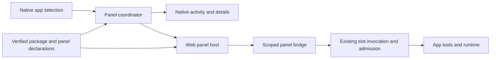

# meecp: custom app panels

Status: proposed implementation plan, 2026-10-08. Custom panels are not implemented or verified. The source baseline reviewed for this plan is commit `587f44c`.

## Objective and product name

Allow an installed app to supply its own interactive workspace inside **meecp**. Selecting the app discovers its available panels and opens its default panel. The existing native activity, details, connection, configuration, and lifecycle controls remain available. An integrated application's original UI continues to operate independently.

The product is being renamed from **mcpme** to **meecp**. This plan uses meecp for the product name. Existing repository paths, Swift targets, Python modules, manifest filenames, environment variables, connection exports, and private-state locations still use `mcpme`. Changing those identifiers and migrating installed state requires a separate coordinated rename. The rename is recorded here as a product decision; runtime and storage migration remain future work.

The desired setup flow is: describe an app, let Pi prepare its tools and a useful interface, review the verified package, then select the installed app to use that interface. Installing another app should require another package, with no app-specific changes to the meecp host.

## Decisions for the first release

- Keep the native shell and standard controls owned by meecp.
- Introduce a shared panel interface, selection coordinator, and renderer registry. Existing native panels can adopt this interface incrementally.
- Support optional, locally bundled HTML/CSS/JavaScript panels through one web renderer. Native renderers are compiled into the host.
- Store panel declarations and all assets in the verified package. Use the existing artifact lock and package digest to bind their identity.
- Give a panel a host-mediated bridge to an explicit set of tools in its own installed app.
- Initially support panels on Pi's existing `mcp-stdio` package path. Additional execution profiles need their own acceptance evidence.
- Use MCP Apps as the reference for UI lifecycle and messaging. The first release uses package-based discovery and makes no claim of full MCP Apps compatibility.
- Preserve ordinary tools-only packages and existing assistant connections. A panel is optional.

The modularization work is concentrated at selection, rendering, lifecycle, and authority boundaries. Native activity/detail data remains a typed model; custom HTML belongs in a separate hosted surface.

## Current architecture and gaps

| Area | Current source | Required change |
| --- | --- | --- |
| App selection | `showDetails` / `loadDetails` in [main.swift](../Sources/McpmeMenuBar/main.swift) load one slot's metadata and guard against a different selection. | Coordinate standard panels and optional custom panels using stable slot and package identity. |
| Native presentation | [Dashboard.swift](../Sources/McpmeMenuBar/Dashboard.swift) and [Management.swift](../Sources/McpmeMenuBar/Management.swift) display a shared `DashboardDetails` model. | Add a shared panel host without embedding executable UI in `DashboardSection` text. |
| Package declarations | [contracts.py](../backend/mcpme/contracts.py) uses closed models. The MCP manifest has no UI declaration; schema 2 selects the separate `HostCommandManifest` profile. | Allocate an explicit compatible package/host API revision for panel declarations. Schema 2 is not a general MCP package revision. Keep old parsers strict. |
| Package integrity | `PackageLock` binds the manifest and bounded artifacts by hash, size, executable mode, provenance, and license. | Validate panel entrypoints, complete asset closure, and panel metadata against that lock. |
| Pi preparation | [pi_setup.py](../backend/mcpme/pi_setup.py) supplies package guidance; [pi_verification.py](../backend/mcpme/pi_verification.py) independently checks candidate tools and fixtures. | Advertise panel facilities, generate assets and UI fixtures, and add an independent panel check. |
| MCP transport | [gateway.py](../backend/mcpme/gateway.py) and [http_gateway.py](../backend/mcpme/http_gateway.py) enforce the supported protocol and runtime lifecycle. | Reuse tool invocation and admission behind a scoped panel bridge. Broader MCP Apps support needs separate protocol changes. |

Current MCP package declarations permit the `tools` capability. Tool descriptors do not model structured UI `_meta`, and the verifiers require exact tool contracts. Supporting MCP Apps resources or metadata therefore requires changes to declarations, capability negotiation, gateways, and verification together. Adding a web view alone does not implement that protocol.

The owning contracts remain [host design](MCPME_DESIGN.md), [Pi setup](PI_SETUP.md), [package authoring](PACKAGE_AUTHORING.md), [configuration and secrets](CONFIGURATION_SECRETS.md), and the original [component and transport design](DESIGN.md).

## User experience

### Selecting an installed app

1. The user selects an app by its stable slot identity.
2. meecp loads the installed package's panel declarations. An app without a custom panel opens the existing native view.
3. An app with a panel opens its declared default workspace. A persistent native header keeps app identity, runtime status, and Start/Stop controls visible.
4. **Activity & Details** opens the existing native information. Multiple custom panels appear as named workspace choices beneath the selected app.
5. Switching apps tears down the previous custom surface and opens the new selection. Async work remains bound to its original identity.

Manage Apps provides the full workspace. The menu-bar companion panel uses the same selection contract and shows a compact workspace when the panel declares compact support. A panel requiring more room gets a native **Open Workspace** action that opens Manage Apps with the same app and panel selected. The host controls available dimensions; panel content scrolls or adapts within them.

Selecting a stopped app can display its bundled UI without starting the runtime. Tool actions are disabled until the user starts the app through the native control. Selection does not clear an explicit Stop or change startup policy. Loading a panel must not invoke tools automatically; the first release requires user interaction to start a tool call.

### Pi setup

Add App includes an **Include an app workspace** option, enabled by default for new Pi drafts. Older drafts with no recorded choice default to disabled, preserving their saved setup intent. Changing the option creates a new draft revision before Pi runs and invalidates an attached result for the previous revision. Pi investigates source, documentation, tool schemas, outputs, and the user's intent to design the workspace. A useful UI may combine several tools into one workflow.

Pi generates the tool adapter, the panel, local assets, dependency locks, licenses, and synthetic verification fixtures. It uses the host's supported bridge and theme API. Host-owned setup tools run the UI checks, report fixed failure codes, and let Pi repair the result.

Package review includes the panel names, preview, callable tools, file-selection needs, and UI verification outcome. Stage D builds the preview and verification bridge. Preview uses synthetic data with no authority to invoke an installed app or alter host settings.

When the user requested a workspace, successful setup requires both tool and panel verification. A failed panel produces a repairable setup failure. The user can explicitly change the draft to proceed without a workspace; that creates a new revision and review result. Pi must not silently discard the requested UI to report success.

### First examples

| App | Workspace | Evidence it should establish |
| --- | --- | --- |
| JSON Utilities | JSON editor, Validate action, structured result and readable error. | Basic mounting, tool invocation, response handling, and a complete local asset bundle. |
| Hotdog classifier | Image selection, preview, Classify action, result. | Pi-generated UI, host-mediated file input, media handling, resizing, and repeated calls. |

The deterministic example is the initial host integration fixture. The classifier is the end-to-end Pi acceptance example, subject to its existing package/runtime requirements. A polished example establishes only its checked behavior; broad generated-UI quality remains unmeasured.

## Components and ownership



| Component | Responsibility |
| --- | --- |
| Native shell | App list, selection, persistent controls, workspace navigation, and installation review. |
| Panel coordinator | Resolves available panels, chooses the default, binds instance identity, and coordinates activation and teardown. |
| Renderer registry | Maps a supported panel kind/version to a host-owned renderer factory. The registry does not load package-supplied native code. |
| Native renderer | Presents existing activity and details through the shared lifecycle interface. |
| Web renderer | Loads locked assets in an isolated web container, applies theme/dimensions, and handles content lifecycle. |
| Panel broker | Enforces the per-panel tool allowlist and request identity, holds invocation credentials, and owns bounded requests and sessions. |
| Pi panel verifier | Loads the actual generated UI, drives synthetic interactions, and validates behavior independently of Pi's success claim. |

The proposed internal `PanelProvider` interface exposes descriptor discovery, create, activate, deactivate, context update, and dispose operations. Native and web implementations share that interface while keeping their rendering and authority rules explicit. Host lifecycle controls are native components outside package-controlled content.

Only the selected custom surface is mounted initially. Avoid preloading every installed app's UI or creating MCP sessions on selection. Opening the menu and Manage Apps simultaneously creates distinct instances; each owns its requests and session. Existing runtime admission and model serialization still apply across all instances and assistant clients.

## Proposed package contract

Add an optional `ui` declaration in a new supported package contract revision. Select the top-level schema and host API numbers during contract implementation after checking all existing package profiles. The example below is the proposed `ui` section, not a complete installable manifest:

```json
{
  "ui": {
    "schema_version": 1,
    "default_panel": "classifier",
    "panels": [
      {
        "id": "classifier",
        "title": "Classifier",
        "kind": "bundled-web",
        "entrypoint": "ui/classifier/index.html",
        "tool_names": ["classify_image"],
        "display_modes": ["workspace", "compact"],
        "capabilities": ["select-file"]
      }
    ]
  }
}
```

Validate the following before attachment or installation:

- Unique bounded panel IDs and titles; the default refers to one declared panel.
- Supported renderer and bridge versions; explicit required host capabilities.
- Every callable tool exists in the verified tool contract for this package.
- Canonical relative entrypoint and asset paths, with no traversal, escaping links, or files outside the locked package.
- All shipped assets, bundled dependencies, and UI fixtures have lock entries and applicable licenses/provenance. Panel assets are served as data and never executed as native programs.
- Bounded panel count, individual asset size, total UI bytes, and tool request/response sizes. Freeze these constants in the initial host spike using actual fixture/media needs.
- Closed capability declarations. Unsupported required capabilities fail preparation/review with a fixed code.

Prefer a self-contained production bundle requiring no runtime package manager, CDN, remote JavaScript, font service, or additional web server. A virtual package resource origin can serve locked assets without a new TCP listener. The WebKit spike must prove this path under the required sandbox and CSP rules.

Existing packages without `ui` retain their current behavior. Old host versions must reject a panel-bearing package they cannot interpret at static attachment/planning validation, before candidate execution or installation, with a clear compatibility error. A failed attachment retains the draft and leaves an existing installation/recovery state intact. External package authors and Pi use the same contract. Panel bytes and declaration changes require a new package version and the existing review/install process.

## Bridge, isolation, and input handling

Embed custom content in a sandboxed frame inside a dedicated web container with nonpersistent storage. A WebKit view by itself is not the complete isolation design. The host supplies and enforces the frame sandbox, CSP, navigation policy, asset routing, and message-source checks. Prove their combined behavior before committing to the renderer implementation.

Bundled JavaScript dependencies are permitted as locked production files. The first release uses static script/style assets and rejects inline event handlers/scripts, `eval` and equivalent code generation, runtime dynamic imports, WASM, service workers, and package-created nested frames. Any host-generated bootstrap script must be explicitly bound by CSP. Media uses host-controlled handles; blob/data script execution and document navigation remain denied. Stage A must prove this policy supports the examples with their compiled UI dependencies; changes to it require an explicit contract decision.

For the first release, the bridge supports initialization, theme/size/runtime-state updates, invocation of declared tools, bounded results/progress, cancellation requests, teardown, and optional host-mediated file selection. It exposes no manager route, shell execution, arbitrary HTTP proxy, credential access, or cross-app calls. External network access and external navigation are denied in the panel; app tools retain their independently declared runtime access.

Every instance is bound to installation identity, host generation, slot UUID, installed package digest, runtime generation when connected, panel ID, and an activation epoch. Every accepted call must match the live instance and its verified allowlist. The broker enforces these checks; hiding controls in JavaScript is insufficient. Owner and slot bearer credentials remain outside HTML, JavaScript, storage, and bridge responses.

Read slot UUID, `package_digest`, and registry `generation` from the authoritative [registry Slot](../backend/mcpme/registry.py), and validate package identity through `Supervisor.package(slot)`. Existing resident model runtimes have generation identity; generic stdio sessions need a new broker-owned session epoch tied to the admitted gateway/session lifetime. Add explicit supervisor lifecycle invalidation for stop, restart, upgrade, removal, and shutdown. UI polling and JavaScript-supplied identity cannot grant invocation authority.

The broker initializes and reuses one ordinary slot invocation session per active instance when the user first calls a tool. It uses the current gateway validation, activity accounting, queue limits, timeouts, process ownership, and inference serialization. Panel-specific bounds can be tighter than the package limits. Exhausted or unavailable services return a usable panel error without weakening runtime admission.

For the first stdio implementation, retain `Gateway.new_session()` admission and `Gateway.handle()` tool-call activity accounting. Build a focused internal invocation service around that path, or extract shared logic with regression coverage, so the broker never directly launches or calls package processes. There is currently no panel-authorized invocation service. Session disposal must use the gateway's owned session cleanup and release reservations; closing one panel must not close the whole slot gateway or other clients' sessions. Broader HTTP/model-service support must likewise preserve its existing admission/cleanup paths.

Treat tool results as untrusted data. Render text safely, validate structured content, and handle media through bounded host-managed resources. Synthetic fixtures may contain test data; production inputs, outputs, prompts, tokens, and raw exception payloads must not enter diagnostics, persisted panel state, or verification records. Durable records contain identities, counts, outcome codes, and verification metadata only.

File selection is a native host action requested by the panel. The host enforces declared type/size limits and returns an instance-bound opaque handle for the explicitly selected file. A declared tool argument binding determines how the host converts that handle to bounded bytes or a runtime-required path. The panel cannot use a string to read an arbitrary path. Handle lifetime, single-tool scope, cancellation, and cleanup are part of the contract. Rendering an image preview must not expose broader filesystem access.

The panel boundary limits web content's access to host facilities. Installed app processes retain the repository's existing macOS-account trust boundary. The panel design does not establish new isolation for those processes.

## Lifecycle, persistence, and recovery

| Event | Required behavior |
| --- | --- |
| App/panel selection changes | Revoke the old instance's bridge authority immediately, request cancellation of owned calls, and discard late results. Allow bounded teardown before destroying the view. |
| Tool cancellation | Stop delivery to the disposed instance and close owned work/session as supported. Cancellation does not promise to reverse a completed write or a runtime side effect. |
| App stops, restarts, or fails | Invalidate the invocation session and runtime generation, show current state, and require a fresh session after readiness. Preserve host Stop semantics. |
| Package upgrade | Close the old instance before switching package identity. Resolve declarations from the newly installed digest. Late messages from old content are rejected. |
| App removal | Revoke instances and handles, close owned sessions, and follow the existing retained-data removal policy. |
| Host replacement or quit | Invalidate all bridges and settle owned sessions/process work using the current shutdown path. |
| Web process fails | Show a native recoverable panel error. A Reload Panel action creates a new epoch. Native lifecycle controls remain usable. |
| Panel cannot load | Show a fixed error and the available native details. A runtime failure does not imply the package's bundled files failed integrity validation. |

The first release keeps form inputs and results in memory while the surface is open. It may persist a nonsecret last-panel choice per slot/package, with fallback if the panel disappears. Persisting documents, conversations, generated content, or arbitrary app UI state needs a later explicit storage contract.

## Relationship to MCP Apps

[MCP Apps](https://apps.extensions.modelcontextprotocol.io/api/documents/Overview.html) defines tool-linked HTML UI resources, a sandboxed view, host context, and bidirectional JSON-RPC messaging. It provides the reference vocabulary and lifecycle for this design. The [published extension specification](https://github.com/modelcontextprotocol/ext-apps/blob/main/specification/2026-01-26/apps.mdx) is the starting compatibility target; pin and record the chosen revision before implementation.

meecp adds an app-selection workspace with a declared default panel. That selection trigger is a host product behavior. MCP Apps ordinarily discovers a UI through tool metadata and supplies its inputs/results around a tool invocation.

The first release discovers locked UI assets through the package manifest and invokes existing tools through the broker. Reuse standard lifecycle/message shapes where their semantics apply, and document the supported bridge subset. Do not advertise the MCP Apps extension until its negotiation, resource delivery, tool visibility, metadata, security, and lifecycle requirements are implemented and tested.

A later compatibility stage must add and verify:

- Typed `_meta.ui` support and exact descriptor/runtime agreement.
- UI resource discovery/read support, capabilities, and method forwarding through each supported gateway.
- The distinction between model-visible and app-visible tools, enforced at each call boundary.
- Resource MIME/CSP/permission metadata and immutable package-to-resource mapping.
- Host/AppBridge negotiation and conformance tests, including unsupported optional host features.

Keep package resource estimates such as memory/GPU reservations distinct from MCP UI resources. Full compatibility is its own delivery gate; it is not required to prove the initial custom workspace.

## Pi generation and verification

Extend Pi's `capabilities` guidance with the supported panel schema, bridge contract, theming tokens, production bundling rules, and verification facilities. Pi can choose its UI structure and libraries, provided it produces a complete local dependency closure.

Pi must inspect the actual tool behavior and document what the panel lets the user accomplish. A schema supplies valid inputs; it does not establish a useful workflow, appropriate defaults, accessible labels, or clear treatment of side effects. Missing consequential behavior or access requirements can use the existing inline question flow.

Verification has three distinct layers:

1. **Static package checks:** validate declarations, artifact closure, limits, capability/tool references, integrity, provenance, and licenses.
2. **Independent UI checks:** load the real bundle in a verification container, exercise semantic controls with synthetic broker responses, and check visible outcomes, invalid input, errors, and denied capabilities. UI tests must execute events and bridge requests rather than trust screenshots or Pi-written success markers.
3. **Integrated checks:** call the candidate runtime through the production broker using synthetic inputs, validate results and expected UI state, relocate the package, and recheck hashes after teardown.

UI fixtures describe bounded user actions and observable outcomes. The host owns the driver and assertion vocabulary. Do not add arbitrary fixture scripts with host privileges. Extend `check_package` to report tool and panel outcomes separately while keeping attachment contingent on all requested checks. Existing MCP fixture verification stays required.

The Stage D verification preview must use the same renderer, policies, and broker checks as the installed workspace, with a separately scoped candidate/mock backend. Successful tool verification cannot substitute for panel verification. Capture content-free summaries; show transient synthetic screenshots during review only if useful.

## Delivery sequence and parallel work

Use scoped agents within available concurrency. After freezing shared contracts, the backend and native renderer can proceed in parallel with a synthetic package. Pi integration depends on working verification and broker interfaces.

| Stage | Work | Dependencies | Exit evidence |
| --- | --- | --- | --- |
| A: renderer and authority spike | Build a minimal locked JSON workspace in the real WebKit container; prove CSP, frame/message origin checks, local assets, broker scoping, teardown, and two-screen-size behavior. Set concrete limits. | This plan and current runtime contracts. | Working synthetic panel; failed cross-app/manager/network/path attempts; recorded platform limitations and go/no-go decision. |
| B: contract freeze | Define the package revision, panel schema, provider interface, broker messages, file bindings, UI fixture vocabulary, and compatibility behavior. | Stage A findings. | Reviewed Markdown contract and synthetic fixtures with explicit version/limit constants. |
| C1: package and broker | Implement validation, serving, instance authority, invocation sessions, cancellation, identity fencing, and content-free failures. | Stage B. Can run alongside C2. | Backend contract/authority/lifecycle checks and compatibility checks pass. |
| C2: native composition | Extract selection/coordinator seams; implement renderer registry and custom workspace; adapt native details; add menu/full-workspace routing and native recovery UI. | Stage B. Can use a synthetic broker while C1 progresses. | Native selection, controls, resize, keyboard/accessibility, and stale-callback checks pass. |
| D: verification and Pi | Add the host-owned panel driver, integrated checks, setup option, capability guidance, generated artifacts, review preview, and repair feedback. | C1 and C2. Driver fixtures can be prepared earlier. | A Pi-generated package passes all requested checks and is reviewed/installed through the existing flow. |
| E: release acceptance | Test relocated installed bundles, the examples, concurrent clients/panels, upgrade/remove/restart, and existing packages. Update supported-scope documentation. | Stage D. | Recorded checks against the exact built artifact; no outstanding required first-release behavior. |
| F: MCP Apps compatibility | Implement protocol resources/metadata/negotiation and conformance for the supported profiles. | Stable host/broker contracts; separately scheduled scope. | Protocol and UI conformance evidence; extension support advertised only for verified capabilities. |

Likely implementation ownership is `Sources/McpmeMenuBar` for native composition, new focused panel modules under `backend/mcpme` for contracts/brokering, existing validators/installers for package integration, and `agents/pi` plus `pi_*` modules for generation and verification. Keep the new lifecycle out of the existing large controller where a dedicated component can own it.

## Acceptance criteria

| Area | Required checks |
| --- | --- |
| Compatibility | Packages without panels retain existing selection, controls, startup, assistant connections, and fixtures. Unsupported contract versions produce a clear error. |
| Selection | The correct default panel appears; multiple panels route correctly; rapid selection/filter changes and late loads never display another app's data. |
| Authority | Undeclared tools, cross-slot calls, manager calls, stale epochs/generations, arbitrary paths, remote navigation, and network requests are rejected by the owning boundary. No credential enters web content. |
| Invocation | Repeated calls reuse the initialized session; overload/timeouts are usable errors; activity is counted; concurrent assistant/panel calls retain existing model serialization. |
| Lifecycle | Stop/start/restart, host loss, web failure, close/reopen, upgrade, removal, and quit settle owned work and reject late messages. Selection does not auto-start the app. |
| Media and limits | File handles enforce scope/expiry; oversized input/output/assets fail cleanly; previews and repeated media calls remain bounded. |
| Integrity | Relocation works without source/global runtimes/CDNs; asset substitution and post-verification changes fail existing integrity checks. |
| UI quality | Light/dark theme, keyboard navigation, accessible labels, focus, scrolling, compact layout or workspace handoff, progress, and error recovery are exercised in the shipped renderer. |
| Pi workflow | The saved workspace choice binds to the draft revision; generated UI/tool fixtures both pass; a failing UI is repaired or explicitly removed through a new draft revision. |
| Data handling | No production content or secrets are logged or persisted by the panel infrastructure; verification summaries remain content-free. |

Passing the first release's checks establishes the supported package profile, bridge subset, examples, and target macOS/WebKit version. It does not establish arbitrary generated interfaces, all app ecosystems, full MCP Apps support, or isolation of installed native runtimes.

## Deferred work and decision gates

Remote panels, direct web networking, package-supplied native plugins, persistent content state, automatic tool calls on selection, background panels, camera/microphone access, cross-app workflows, and generated UI self-modification are deferred. Additional capabilities need versioned authority and verification contracts.

Stage A must establish the local asset origin and frame isolation design, practical UI/media limits, cancellation behavior, and renderer dependency/signing requirements. Stage B must settle exact message shapes and schema versions. Revisit the first-release approach if the chosen WebKit construction cannot enforce the required boundary or cannot share the installed and verification renderer faithfully.

The product rename should separately inventory bundle/display identities, updater/install paths, login items, private state and sockets, manifest/environment compatibility, CLI exports, documentation, and release artifacts. Existing installed apps and connection credentials need an explicit migration strategy before those identifiers change.

The immediate implementation starting point is Stage A with JSON Utilities. Once that proves the host boundary and lifecycle, freeze the contracts and run C1/C2 in parallel, then validate Pi generation with the classifier workspace.
