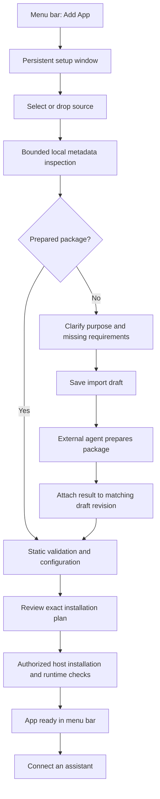

# Adding an app to mcpme

Status: accepted product direction, 2026-10-01. Prepared packages, source-folder and Markdown/text intake, resumable drafts, and external preparation are implemented in the first [Phase 2 milestone](PHASE2_ONBOARDING.md). Reference-document services and integrated preparation remain pending. This document describes the complete intended journey; consult the milestone record for verified scope.

The proposed [automatic-preparation implementation plan](AUTOMATIC_PREPARATION.md) covers extensible versioned recipes, binary artifact intake, controlled preparation jobs, optional integrated agents, and parallel delivery gates.

This document defines the Add App experience. It refines the user-facing flow in [MCPME_DESIGN.md](MCPME_DESIGN.md), which remains the technical reference for packages, import drafts, authorization, installation, and lifecycle management.

## Decision

Use a deterministic **drop, review, add** workflow with optional agent preparation. Keep the menu bar as the main entry point and open a small, persistent native window for setup. Prepared packages take the shortest path. Source code and setup documents become resumable drafts when an adapter or other preparation is required.

The first release uses the user's external coding agent for custom preparation. An integrated agent with user-supplied LLM API credentials is a later extension of the same workflow. No LLM connection is required to begin setup or install a compatible prepared package.

The next onboarding milestone, [Phase 3 automatic preparation](MCPME_DESIGN.md#phase-3-automatic-app-preparation), removes that manual handoff for supported inputs. Users select an app directory or configure a service connection; mcpme inspects it, asks for missing information, assembles dependencies and adapters, tests the result, and presents the installation review. Packages remain an internal installation boundary. User-authored manifests and manually collected runtime files are not the target experience. Deterministic recipes handle known combinations; agent assistance handles unfamiliar integration work through the same modular contracts. This execution path is not available in the current foundation.

The product should minimize what the user must explain: inspect the supplied source, identify missing information, and ask the next useful question. Inspection can identify a likely source type; it cannot establish which tools the user wants or turn an arbitrary program into an MCP service automatically.

## Product vocabulary

Use **App**, **Add App…**, and **Manage Apps…** consistently in the UI. An app is one configured local tool or model service that exposes tools to an assistant. It maps to the existing internal **slot** concept and retains its stable UUID, independent lifecycle, connection configuration, and package identity.

This terminology does not add another backend entity or rename the existing technical contracts. A source folder is input to setup. The installed app uses a sealed package; editing the original folder does not silently change the running service. The same package can support multiple separately configured apps.

## Entry point and window behavior

The menu bar provides app status, start/stop, restart, connection details, and **Add App…**. Installation and configuration live in a persistent native window.

The setup window must:

- Remain open when the user switches to Finder or another app.
- Accept drag-and-drop and provide a keyboard-accessible **Choose Files…** alternative that supports the relevant files and folders.
- Preserve an unfinished draft when closed and allow it to be resumed from Manage Apps.
- Show progress for host-owned operations after the window is reopened.
- Distinguish closing a window, canceling an import draft, and canceling an installation operation.
- Keep installed services running when the window closes, following the host lifecycle contract.

Apple recommends alternative controls for drag-and-drop actions in its [drag-and-drop guidance](https://developer.apple.com/design/human-interface-guidelines/drag-and-drop). The persistent setup window is a product choice that supports source selection, agent handoff, and interrupted work.

Dragging onto the menu bar icon may become a shortcut later. It is not required for the first release.

## The user journey

### 1. Bring a source

Start with one drop surface:

```text
Add App

Drop a source folder, prepared package, or document

                  Choose Files…
```

Do not require the user to choose between program, model, server, and package before selecting a source. Inspect what they supply, then show the source and its current readiness. Retain an explicit choice when inspection finds several plausible services or cannot classify the source.

Inspect metadata locally without importing modules, running repository code, executing build scripts, or starting an agent. Bound inspection and exclude credentials, unrelated files, generated artifacts, caches, and local environments from source snapshots. Follow the existing import contract for selected file lists, hashes, source identity, and private staging.

Use descriptions such as:

| Result | Meaning | Next action |
| --- | --- | --- |
| Ready to configure | A prepared package has the required static structure and matches a supported host profile. | Collect missing configuration and produce an installation plan. |
| Preparation needed | Source code, an existing MCP implementation, or a model still needs a compatible package or adapter. | Establish intent and prepare a draft. |
| Choose how to use this document | A supported text document could be reference information or setup instructions. | Ask which role the document should have. |
| More information needed | Source type, compatibility, or intended behavior is unresolved. | Identify the specific missing choice. |

These labels do not claim runtime readiness. A repository containing an MCP configuration is not automatically a prepared package, and a model artifact alone does not establish an engine or MCP interface.

### 2. Establish the useful interface

For source code, ask:

> What should your assistant be able to do?

Let the user edit any suggested answer. For example, a JSON utility folder might become a tool that validates JSON against a schema and explains validation errors. Exposing every function in a repository is not an acceptable default.

Begin with one focused question and ask follow-ups only when necessary. A complete draft may need synthetic input/output examples, side effects, retry behavior, external services, configuration, model/engine compatibility, and resource requirements. Unknown values remain visibly unresolved.

For a document, offer two choices:

| Choice | Intended outcome |
| --- | --- |
| Use this information | Prepare tools for finding and reading the document's contents. |
| Use these instructions | Use the document as requirements for preparing a service. |

A handbook and a specification for a tool have different roles. Do not silently interpret all documents as instructions or promise that any document can become a runnable service.

The information route requires a supported document-service template with defined search/read behavior, source references, parsing limits, and update behavior. It is not available merely because mcpme can extract text. Until that template exists, explain the missing preparation and retain a draft; do not advertise a completed document-library feature. Broader PDF extraction and OCR are later work.

Keep source documents as explicitly selected source references or artifacts under the import contract. Store structured, nonsecret requirements in the draft. Do not copy source contents, conversation transcripts, prompts, credentials, or build logs into draft records, event journals, or diagnostic exports.

### 3. Prepare only when needed

A compatible prepared package skips agent preparation and proceeds through static validation, configuration, and planning.

**Try JSON Utilities** provides an included first app through that path, with no model download or user build step. Users who already have a publisher's package ZIP link can reveal **I already have a package download link** and supply its URL, size, and checksum. This advanced option is not a public package browser.

For other inputs, save a private import draft and offer:

- **Copy Agent Instructions** for use with the user's coding agent.
- **Export Setup Specification** for a structured handoff.
- **Import Prepared Package…** to return the result to the same draft.
- **Save Draft** to continue later.

The handoff contains the draft identity and revision, selected source references, requested capabilities, host compatibility requirements, preparation templates, expected output, and return instructions. It contains no credential values. Display or export generated instructions on demand; do not persist them as conversation history in the draft.

The agent prepares an adapter, pinned dependencies, provenance, and synthetic validation fixtures in its separate workspace. Its result attaches to the draft using the existing import contract. The UI can detect that attachment and resume at review without requiring the user to repeat setup.

Show **Waiting for prepared package** while no result has arrived. Copying instructions does not prove that an agent has started. Do not display fabricated build progress. Canceling this draft cannot stop an external agent's work.

Attaching a package performs static validation and snapshots the result. It does not install or execute the package. Reject stale draft revisions, incompatible host profiles, missing required fields, and unresolved artifacts with an actionable explanation. Changed tools, configuration, or access must be visible when comparing the result with the requested draft.

### 4. Review the actual app

Every preparation path converges on the same installation review. Lead with information the user can evaluate:

- App name and source.
- Tools the assistant will receive, described in plain language.
- Requested filesystem and network access, and other declared side effects.
- Required credentials, supplied through the supported secret-reference mechanism.
- Whether the app will start now and how it will start in later sessions.
- Material downloads, storage requirements, resource reservations, and compatibility issues.

Keep full tool schemas, executable entrypoints, dependency pins, artifact hashes, licenses, signature/build provenance, and detailed estimates in expandable sections. Mark estimates and package declarations as such. A declaration of read-only behavior is not an enforced operating-system sandbox; preserve the same-user trust boundary described in the architecture.

For example:

```text
Review JSON Utilities

Tools             Validate JSON against a schema
Source            Prepared local package
Declared use      No file writes or network requests
Start now         Yes
When mcpme opens  Manual

Package and verification details…

Back                              Add & Start App
```

Use **Add App** for installation without immediate activation and **Add & Start App** when the selected plan includes activation. New apps retain the architecture's manual-start default. The review must distinguish starting now from starting automatically later.

Bind installation to the actual package, configuration, draft revision, and plan effects. Existing user authority may cover that exact scope; do not add redundant confirmation steps. A changed artifact or expanded access requires a revised plan and corresponding authority. Agent output cannot grant installation authority.

### 5. Install, verify, and connect

Show distinct host-owned stages such as downloading, verifying, installing, starting, warming up, and ready. Include cancellation where supported and useful recovery actions on failure. A listening socket is not proof of service or model readiness.

The trusted host performs compatibility and health checks and any authorized synthetic smoke test. Agent-reported success remains unverified until the host checks pass. Preserve submitted-draft history and follow the installation operation's recovery rules; a terminal failure or cancellation requires a new draft and plan for another installation attempt.

After successful installation and runtime verification, show **App ready**, make it available in the menu bar, and offer **Connect an Assistant…**. Client selection and registration are a separate explicit action. Show the proposed connection settings and preserve unrelated client configuration.

### 6. Manage an installed app

Select an installed app in **Manage Apps** to view its details and choose **Manual** or **Automatic when mcpme opens**. Saving that choice changes the policy for future launches; it does not start or stop the current runtime. An explicit Stop suppresses automatic startup across mcpme restarts until Start clears the suppression.

**Remove App** closes the app's endpoint, stops its owned processes, revokes its connection credential, and removes it from the installed-app list. The host retains its data and sealed package for recovery and leaves the original source intact. Removal follows a durable operation so progress remains visible after the window closes.

## Flow and state ownership



These UI stages map to the existing import-draft, installation-operation, and runtime states. They are not a replacement backend state machine. Before submission, closing and reopening resumes the draft. After submission, the window follows the linked operation. Do not allow draft edits, expiration, or cleanup to change an executing installation candidate.

## Optional integrated agent

Add **Prepare Here** beside the external-agent handoff in a later release. Show it when preparation is needed, with provider connection management in Settings. It must use the same import specification, package output, validation, and installation review as the external path.

An API connection alone is insufficient. Integrated preparation also requires:

- Credential storage appropriate to macOS, such as Keychain, with no secret values in exports or logs.
- A clear view of which selected source data will be sent to which provider before that transfer is authorized.
- A controlled preparation workspace and defined permissions for source access, builds, and tool execution.
- Bounded cost and execution time, cancellation, and recovery after interruptions.
- Visible unresolved requirements and editable proposals.
- A structural separation between agent suggestions and trusted installation authority.

The existing JevK5 decision runtime does not supply a general-purpose coding agent. Adding integrated preparation is separate product and runtime work.

## Delivery order

1. Implement the persistent native setup window, resumable drafts, prepared-package review, and installation integration.
2. Add source-folder intake and external-agent preparation using the versioned templates and package contract.
3. Accept Markdown/text setup briefs with explicit intent and missing-requirement handling.
4. Complete automatic directory/service preparation with modular recipes, private build toolchains, independent verification, and native progress. Keep current external-agent preparation available during this transition.
5. Add agent-assisted adapter creation through the same preparation contracts and explicit execution/transfer authority.
6. Add a supported document-service template before advertising reference-document onboarding; extend supported parsers deliberately.

Expose only host-supported profiles and capabilities. The broader architecture's model and HTTP-service paths remain contingent on their implementation and validation. Do not make onboarding promises from proposed contracts alone.

## Acceptance criteria

- A user can begin from the menu bar and complete the supported prepared-package path without an LLM account or API key.
- File selection and keyboard interaction can accomplish every drag-and-drop action.
- Switching apps or closing setup preserves an unfinished draft without starting an unrequested installation.
- Source inspection does not execute source or build code and distinguishes detected metadata from validated runtime behavior.
- Ambiguous sources prompt for the missing choice; documents distinguish reference information from setup instructions.
- External preparation resumes the matching draft when a valid package arrives. Stale results and unsupported capabilities produce actionable feedback.
- The review describes the actual tools, requested effects, credentials, and start policy in the bound plan.
- Installation, runtime verification, and client registration have distinct outcomes and authorization boundaries.
- Failures preserve the existing draft/operation recovery semantics and do not expose raw source, prompts, credentials, or execution errors in diagnostics.
- User-facing language consistently uses App while backend slot identity and package contracts remain intact.
- Manage Apps persists startup policy changes without changing current runtime state or clearing an explicit Stop.
- Removing an app closes its endpoint and revokes its connection while retaining source, package, and data for recovery.
