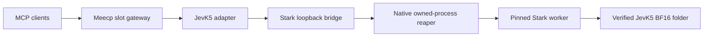

# Experimental Stark JevK5 package

The [versioned generator](../templates/jevk5-stark-v1/prepare.py) creates
`local.jevk5.stark`, a separate JevK5 decision package using the pinned
[Stark dependency](STARK_DEPENDENCY.md). This integration is experimental. The
existing [llama.cpp JevK5 package](../templates/jevk5-llamacpp-v1/README.md) remains
available. This package adds no engine behavior for Pi or general models.

## Package and runtime contract

The host owns one engine bridge and one adapter generation. The bridge owns one
`bin/stark-score` worker through the copied native `native/meecp-reap` and Meecp's
`ProcessOwner`. The adapter depends on the bridge's authenticated readiness and
uses the same `jevk5_decide` and `jevk5_status` tool declarations as JevK5.
Native launchers preserve the host-owned PID when they replace themselves with
the private interpreter. The host injects endpoint, key, generation and nonce
through its inherited private configuration descriptor.



The package declares `model-service`, profile `jevk5-stark-bf16-v1`, context 8192,
temperature 1.22 and knockout temperature 0.93. Its model artifact is
`models/jevk5-bf16/model.safetensors`, SHA-256
`7165b96777823061753fa96b247d687d591596b20cf24fa518a5b87a96b1be8a`.
The folder contains exactly seven verified regular files: weights, engine model
configuration, tokenizer, tokenizer configuration, generation configuration,
chat template and JevK5 calibration configuration. The tracked
[conversion provenance](../experiments/uzu-rust/jev-scoring/MODEL_PROVENANCE.json)
binds their byte counts and hashes to the merged JevK5 revision.

The engine identity records `name=stark`, immutable revision and tree, worker
hash, dependency-lock hash and worker protocol. Startup checks the worker's
readiness identity against the bundled dependency lock. Both private HTTP
processes bind to `127.0.0.1`, require their injected bearer credentials and retain
Host/Origin checks. Health echoes the current generation and nonce. Complete
decisions serialize against one worker with a bounded adapter queue.

Consecutive whole-vocabulary caching defaults off. The explicit builder flag
`--consecutive-cache` sets package model parameter `consecutive_cache` to `true`
and opts into Stark's single
entry cache for identical consecutive token IDs, context and model instance.
Candidate/temperature readout is applied to the current call. An intervening
input, engine error or generation restart invalidates reuse. The generator seals
the selected cache setting in the manifest, complete lock and preparation receipt.

The package reserves 12,288 MiB and one GPU resident package through the existing
host admission policy. The host still applies configured memory headroom and
exclusive GPU residency. Multiple clients share this package's model; this does
not add scheduling for multiple simultaneously resident GPU packages.

## Build and install

Use the [Stark dependency build/verification workflow](STARK_DEPENDENCY.md) to
prepare the exact committed revision. The package generator accepts only an
official immutable receipt matching the current `engines/stark.lock.json`; a
dirty local checkout build is useful for dependency testing but cannot supply
this package.

```sh
uv run --locked --group dev --python 3.12.13 python scripts/prepare_stark_jevk5_package.py \
  --build /absolute/path/to/verified-stark-build \
  --model /absolute/path/to/verified-jevk5-bf16 \
  --runtime /absolute/path/to/bundled-meecp-host \
  --output /absolute/path/to/fresh-stark-jevk5-package
```

To create the explicit cache-enabled candidate, add `--consecutive-cache` and
choose another fresh output directory. The command above creates the default
cache-disabled candidate. Each candidate has its own package digest.

The builder uses the standard library and copied host interpreter. It copies the
selected worker unchanged, the complete verified model folder, private CPython
and locked dependencies, minimal owned-process helpers, the JevK5 adapter and
prompt/answer modules, provenance and licenses. It compiles fixed native
entrypoints for `meecp_stark engine` and `meecp_jevk5 adapter`. It seals generator,
backend, runtime, model and engine inputs before copying and rechecks them after
generation. Every shipped file appears in the complete package lock. Failures
emit authored error codes and remove an incomplete output.

Install the generated package through the existing reviewed local package plan
and apply flow. Installing this package does not update the Stark dependency
lock or discover a moving engine revision. Generated packages, copied weights,
runtime files and private receipts remain in ignored local directories.

## Verification scope

The dependency's [public native acceptance](../engines/STARK_VALIDATION.json)
establishes bit-exact preservation against the frozen native scoring reference
for its pinned worker and BF16 checkpoint. Those dependency counts are not an
installed-package acceptance result, a llama.cpp probability-parity claim, or a
new timing result.

Package builder tests cover input identity, source mutation, symlink rejection,
copy closure, private runtime provenance, launcher routing and metadata/lock
validation. The [historical installed acceptance record](../engines/STARK_JEVK5_VALIDATION.json)
binds the completed run to the exact package, recorded consumer sources, native
worker and model hashes at source commit
`893ca7289fcaf0634a0fa9f49390c37deb033821`. The current host supervisor has changed
since that run. [Current scope](../engines/STARK_JEVK5_CURRENT_SCOPE.json) explicitly
retires installed integration acceptance and requires a fresh native replay.
It pins every current deviation without changing the accepted record. CI rejects
undeclared further drift or a claim of current acceptance. The standalone engine
dependency and its numerical qualification remain unchanged; their gates do not
qualify the changed installed host. On 2026-10-11 the recorded source passed:

- All 243 tokenizations and 486 cold/repeat private scoring replies, preserving
  candidate logits, vocabulary log probabilities and calibrated probabilities by
  type and bits against the frozen native reference.
- All 486 public API typed answers and 96 private context-boundary replies. The
  maximum calibration-formula error was `2.220446049250313e-16`.
- Twelve official SDK decisions each over HTTP MCP and stdio, unchanged tool
  declarations, 13 transport rejections and five native-input rejections with
  cold recovery after errors.
- Sixteen concurrent calls: eight completed and eight received `queue_full`.
  Stop, start and restart reaped the observed native descendants, released GPU
  reservations and preserved a cold cache in the new generation.
- A separate default-off package returned two exact cold MCP answers. Killing
  its owned native worker exited the facade, marked the host slot
  `failed/runtime_crashed` and settled all descendants and reservations.

The SDK disconnect test cancels the client's wait. The existing gateway keeps
the server operation running: both that decision and its successor completed
on the same engine, with the expected cache hit and a drained queue. This does
not establish remote cancellation of an in-flight stateless MCP operation.
Adapter-operation cancellation and its settled cache reset have focused tests.
The first full harness attempt incorrectly required a cold reply after an SDK
wait cancellation; that expectation was corrected to the existing contract.
The complete run was replayed with unchanged data, selection and numerical gates.

The current pin's complete-vocabulary digest gate remains recorded in
[STARK_VALIDATION.json](../engines/STARK_VALIDATION.json); the integration run
checks transported candidate fields and does not rerun that digest gate.
All 182 focused integration, package, scorer, protocol, ownership and receipt checks passed. The source secret scan, 16 scanner unit tests and 32 actual scanner exact-pair controls also passed.
A broader repository run stopped after 1,505 passes and three failures; all
three timing-sensitive command tests passed when retried in isolation. Complete
repository-suite completion remains unverified. No disabled workflow was enabled.

## Short before/after benchmark

The same twelve cases were selected by token length alone: four each under 256,
256–1023 and 1024–4095 tokens. Each block had three warmups, then one fresh and
one identical-repeat request per case. Engines ran sequentially using BF16
weights converted from the same checkpoint, context 8192 and temperature 1.22.
The Stark timing package explicitly enabled the consecutive cache.

| Path | Mean fresh decision | Mean identical repeat |
| --- | ---: | ---: |
| Standalone Stark, exact-token scoring IPC | 174.2 ms | 0.71 ms |
| llama.cpp, existing Jev rendering/scoring path | 347.8 ms | 26.9 ms |
| Installed Stark through Meecp API | 297.8 ms | 7.3 ms |
| Installed Stark through Meecp MCP | 270.5 ms | 8.4 ms |

In this snapshot MCP was about **1.29x faster** than the llama.cpp path for
fresh decisions and **3.20x faster** for identical repeats. These are short,
ordered blocks with uncontrolled background activity. MCP's lower fresh mean
than API reflects variation between blocks; it does not establish a transport
speed advantage. Standalone Stark excludes rendering and tokenization, so the
differences from installed paths do not isolate integration overhead. Package
verification, installation and startup are excluded from request timings.

Stark stayed bit-exact against its native reference. Across the twelve llama.cpp
controls, the maximum probability difference from Stark was `0.01163773223713066`
(1.16 percentage points). All twelve typed answer objects failed bit-exact comparison. That count includes
numeric differences and does not measure selected-label disagreement. This
run preserves Stark calibration and retains the existing cross-engine
differences. It provides no new ground-truth accuracy assessment.

Replay with a fresh private state/report directory and the host's bundled
`python/bin/python3` interpreter. Supply its `python/site-packages` plus this
checkout's `backend`, `vendor` and `scripts` in `PYTHONPATH`. Compile the native
validator reaper from the verified build's
`source/scripts/stark-validation-reap.c`; its protocol differs from the host
reaper. The harness owns and cleans up both through their respective adapters.

```sh
STARK_HOST_RUNTIME=/absolute/path/to/bundled-meecp-host
PYTHONPATH="$PWD/backend:$PWD/vendor:$PWD/scripts:$STARK_HOST_RUNTIME/python/site-packages" \
  "$STARK_HOST_RUNTIME/python/bin/python3" -P scripts/validate_stark_jevk5_integration.py \
  --package /absolute/path/to/cache-enabled-stark-package \
  --host "$STARK_HOST_RUNTIME" --state /absolute/path/to/fresh-private-state \
  --build /absolute/path/to/verified-stark-build \
  --reference-directory /absolute/path/to/frozen-portable-reference \
  --native-reaper /absolute/path/to/compiled-stark-validation-reap \
  --report /absolute/path/to/fresh-report.json --expect-cache enabled \
  --llama-binary /absolute/path/to/llama-server \
  --llama-gguf /absolute/path/to/same-checkpoint-bf16.gguf
```

The harness writes scalar aggregates and hashes. It prints only fixed stages,
counts and allowlisted failure codes. Native logits, probability vectors,
prompts, tokens and typed answers are compared in memory and never persisted.
Replacing the dependency or consumer sources requires fresh acceptance.

## Rollback

Keep the existing llama.cpp package installed or retained while evaluating the
experimental package. Stop the Stark app through Meecp, then start the existing
JevK5 app; the host's exclusive GPU policy requires the first model to be stopped.
To change an installed Stark package, prepare a fresh package and use the normal
reviewed upgrade flow. Restoring a prior dependency lock changes future builds;
it does not replace an already installed package.
