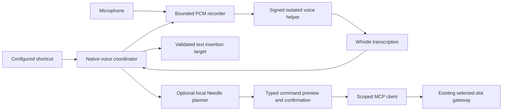

# Whistle voice input for meecp

Status: proposed implementation, researched 2026-10-08 against meecp commit `6ae1bb4`. This document adds no working voice feature. Scope: Apple silicon macOS, configurable activation starting with Fn, dictation by default, and separately enabled voice commands for installed meecp tools.

## Recommendation

Add a native voice subsystem with a dedicated signed inference helper. AppKit owns keyboard events, microphone permission, recording feedback, and text insertion. The helper runs Whistle locally through the published C API. Voice commands use an optional local Needle 3 planner and invoke explicitly selected tools through the existing slot MCP gateways.

Keep the feature independent of Pi setup and the JevK5 decision service. Whistle alone transcribes speech; interpreting speech as tool calls requires a planner. Do not make an ordinary installed package responsible for intercepting the system keyboard or typing into other applications.

Commercial use is permitted by the published Apache-2.0 licenses for Whistle and the Needle distribution. The practical unresolved questions are native runtime privacy, binary dependency notices, and Fn behavior on actual keyboards. Resolve these during the first implementation spike.

## User behavior

1. The user enables **Voice** in meecp. Setup downloads and verifies Whistle, requests Microphone access, and walks through the keyboard/accessibility permissions actually needed by the chosen implementation.
2. **Dictation** is the default mode. Hold Fn to record; release to transcribe and insert the final text at the original insertion target. A small nonactivating panel shows listening, elapsed time, processing, and recoverable failures without taking keyboard focus.
3. Escape cancels capture or discards a pending transcription. No text is inserted after cancellation. Silence produces no insertion. The first version stops at 30 seconds and displays a countdown; it does not silently truncate longer speech.
4. A shortcut recorder supports other keys/modifier combinations. Settings also offer a press-to-start/press-to-stop gesture, with an unmistakable recording indicator and the same duration limit. Hold-to-speak remains the initial default.
5. **Voice Commands** is a separate opt-in mode. The user selects eligible installed apps and tools. Choose the mode explicitly from the menu/settings; optionally assign a separate shortcut. Do not infer command mode from phrases inside ordinary dictation.
6. Command mode displays the recognized request and proposed tool/arguments for confirmation before execution. A later explicit per-tool policy can permit tested read-only actions without confirmation. No spoken phrase is treated as a generic shell command.

The two modes share recording and transcription but have different destinations. Dictation never executes a tool. Commands never type a tool request or result into an unrelated focused app. Switching modes cancels any active session and invalidates its insertion target or command proposal. Command mode captures no AX text target; its review window can become active without retaining a dictation destination.

## Fn and macOS permissions

Fn is a modifier with hardware and OS behavior; it is not an ordinary character shortcut. Apple documents an Fn event flag, but that does not establish that every keyboard exposes a usable standalone Fn event. Prototype a `CGEvent` tap observing `flagsChanged`, supported Fn transitions, key-down/up, and cancellation. Test the built-in Apple keyboard, an external Apple keyboard, and a third-party keyboard. Some third-party Fn keys are handled entirely by keyboard firmware; offer a different shortcut when detection fails.

For Apple-keyboard Fn setup, guide the user through **System Settings > Keyboard > Press Fn key to > Do Nothing** when a conflicting system action is enabled, or let them choose another shortcut. Apple also uses Fn for input switching, the character viewer, or double-press dictation. Provide a guided test and settings link. Do not rewrite global keyboard preferences. Observe events initially; only add selective filtering if the spike proves it necessary and reliable. Preserve Fn+function-key and other OS combinations: abandon a standalone activation if another key joins it. A short arming interval and cancellation rules must be measured so ordinary Fn combinations neither insert text nor visibly flash recording feedback.

| Capability | Planned implementation and permission |
| --- | --- |
| Microphone | Native `AVAudioEngine` capture and `AVAudioConverter`; `NSMicrophoneUsageDescription` in the generated app plist. Add the hardened-runtime `com.apple.security.device.audio-input` entitlement to the native recorder executable. |
| Shortcut observation | Use `CGPreflightListenEventAccess` / `CGRequestListenEventAccess` for the selected listening implementation and test Input Monitoring behavior. Keep the callback bounded; enqueue transitions without recording or inference in the callback. |
| Target inspection/insertion | Check AX trust using `AXIsProcessTrustedWithOptions` when dictation is enabled. If paste/event posting is enabled, separately use `CGPreflightPostEventAccess` / `CGRequestPostEventAccess`. Test the actual listen-only/filtering/posting path; request only its required access. Command-only use should not request AX insertion authority. |
| Speech recognition | Whistle performs inference. Apple's Speech framework and its speech-recognition permission are unnecessary. |

Handle denied/revoked permissions, Secure Input, disabled event taps, missing key-up, sleep/wake, screen lock, and device removal. Cancel recording and invalidate its output on lock/sleep/permission loss. If an event tap disables itself, cancel the active session before attempting recovery. Never leave the microphone recording indefinitely after losing key events. Keep a native record button available when keyboard access is unavailable.

Sources: [Apple keyboard settings](https://support.apple.com/en-au/guide/mac-help/-kbdm162/mac), [Quartz events](https://developer.apple.com/documentation/coregraphics/cgevent), [Fn flag](https://developer.apple.com/documentation/coregraphics/cgeventflags/masksecondaryfn), [microphone permission](https://developer.apple.com/documentation/avfaudio/avaudioapplication/requestrecordpermission(completionhandler:)), [audio-input entitlement](https://developer.apple.com/documentation/bundleresources/entitlements/com.apple.security.device.audio-input).

## Architecture and ownership

| Proposed component | Responsibility |
| --- | --- |
| `Sources/VoiceCore/` | Testable settings, shortcut transitions, session state, request identities, PCM limits, target checks, and command validation interfaces. |
| `Sources/MeecpMenuBar/VoiceCoordinator.swift` | Lifecycle integration, permission onboarding, microphone ownership, mode selection, and a nonactivating status panel. |
| `Sources/MeecpMenuBar/VoiceHotkey.swift` | Native tap, shortcut recording, Fn detection, and event-tap recovery. |
| `Sources/MeecpMenuBar/VoiceRecorder.swift` | Audio tap, conversion off the real-time thread, duration limits, and device changes. |
| `Sources/MeecpMenuBar/DictationInserter.swift` | Original target capture, AX insertion, optional paste compatibility, and explicit recovery. |
| `Sources/VoiceEngine/` plus a C API bridge target | Signed helper linked to the pinned macOS arm64 `libneedle.a`; one serialized inference lane, bounded IPC, lifecycle watchdog, and sanitized result envelopes. |
| Scoped command client/worker | Discover selected slot tool schemas, validate proposals, and call existing MCP gateways using slot invocation authority. Implement in the locked Python MCP SDK if a native client would duplicate the existing transport machinery. |
| Voice artifact manifest and build checks | Model/runtime identity, license snapshots, artifact acquisition, signing inventory, relocation, and release acceptance. |

`Sources/MeecpMenuBar/main.swift` owns app startup and shutdown today. Attach the coordinator there; put feature behavior in separate files. Add library/helper/test targets in `Package.swift`. The generated plist and signing inventories belong in `scripts/build_meecp_app.py`; the root legacy JevK5 plist is not the current meecp app's metadata source.

The voice helper is a new host-owned native service, not an unmanaged package child. Integrate owned-process identity, bounded termination, and reaping with the existing native reaper pattern. Define and test this extension before relying on it; a bare `Process` launch is insufficient. App quit/crash/SIGKILL must leave neither an inference child nor an active recorder. The command worker also needs explicit ownership and cleanup.

Use inherited pipes/descriptors with a versioned, length-prefixed protocol for private voice IPC. Descriptors establish authority without opening another TCP listener. Do not send audio through the manager HTTP routes or enlarge their 1 MiB body limit. Native PCM can exceed that limit. Any additional HTTP route would still require authentication and the existing Host/Origin policy.

Keep the signed helper in the app bundle. Store verified model assets in an owner-only voice cache outside the signed bundle; offer preinstallation for offline deployments. Pin acquisitions to immutable repository revisions and hashes, stage atomically, reject partial/hash-mismatched files, and avoid runtime downloads inside an upstream wrapper. Disabling Voice terminates/reaps its helper and releases model memory; it does not stop an installed app or the JevK5 service.

Account for the built-in helper's measured memory reservation in the host's admission budget through a narrowly typed host-native reservation contract. CPU-only inference does not need the GPU inference lease, but it must not bypass memory headroom. Reserve before loading, release after reaping, and report insufficient resources as a recoverable Voice state. Measure CPU contention with an installed model active.

## Inference contract

The inspected [native header](https://huggingface.co/Cactus-Compute/needle3/resolve/2ae11323dc000f5e70c49f7403efa6af12ba9e67/macos-arm64/needle.h) specifies process-global, non-thread-safe models. Serialize loading, configuration, transcription, streaming, completion, reset, and error access across both Whistle and Needle. Copy error state immediately and map it to fixed codes without logging its text. Retain model buffers for the helper lifetime until ownership requirements are established.

For the first version, convert microphone audio to finite mono Float32 PCM at 16 kHz. Enforce 480,000 samples / 1,920,000 PCM bytes per utterance, plus small bounded framing. Bound intermediate capture buffers and output independently. Run conversion and inference away from the event tap, real-time audio callback, and AppKit main thread. Maintain one active voice session; reject a new session while the previous one is processing/reviewing rather than building a recording backlog.

The initial path calls synchronous `needle_transcribe` after release. The C API has no documented cancellation/unload operation. On cancellation, invalidate the session and discard late results; if inference does not finish within its deadline, terminate/reap and replace the helper. Use helper generation and request UUID checks on every response so a canceled or previous worker cannot insert text or authorize execution. Canceling a command after invocation has begun does not undo a tool's side effects; report an unknown outcome where necessary and never replay automatically.

Longer recordings can subsequently use `needle_stream_transcribe_process` and `needle_stream_transcribe_stop`. Preview committed words and the pending tail inside meecp, then insert one finalized transcript on stop. The stream's stability delay requires measurement. Do not inject provisional words into a document or execute a partial command. This is an extension after the bounded release-to-transcribe path passes acceptance, not a need to build a new speech streaming algorithm.

Default to the published full speech decoder and automatic language detection. Settings may force a supported language or use an explicitly saved vocabulary. Tune decoder depth only after measuring accuracy. Whistle currently covers English, German, French, Spanish, Italian, Dutch, and Polish. The upstream small size and benchmark latency establish feasibility, not meecp's accuracy, memory use, battery cost, or key-release-to-insertion latency.

## Dictation insertion

Capture the original application process identity, focused editable AX element, and selection-range metadata where available at activation, without reading its document text. The recording panel must not become the target. Immediately before insertion, revalidate the original target, editability, focus, unchanged selection metadata, and nonsecure role. If the target has changed, disappeared, become secure, or cannot be verified, show the transcript in an ephemeral recovery panel instead of typing elsewhere.

Prefer replacing the current selection through `kAXSelectedTextAttribute` when the attribute is supported and settable. Do not replace an entire `AXValue` or reconstruct a document from a captured snapshot. Test native fields, browser fields, and Electron editors separately; support varies. Prevent insertion into known secure/password fields and suspend automatic insertion when Secure Input or target classification is uncertain.

Offer an explicitly enabled paste compatibility path for targets whose AX insertion is unsupported. Snapshot bounded supported pasteboard representations, paste to a revalidated original app, and restore only if the pasteboard change count still belongs to meecp. Clipboard consumption is asynchronous and focus checks are not atomic with event delivery; this path needs app-specific evidence and must not promise perfect restoration or universal target safety. Fall back to **Copy Transcript** or a manual paste when checks fail. Explain that clipboard managers can retain copied/pasted text; meecp cannot erase their history.

Never send Return, submit a form, or send a message after insertion. Content stays in memory until insertion, explicit copy, cancellation, or dismissal; meecp retains no audio/transcript history.

Source: [Apple selected-text AX attribute](https://developer.apple.com/documentation/applicationservices/kaxselectedtextattribute).

## Voice command execution

Use the finalized Whistle transcript as text input to Needle 3 with only the selected apps' explicitly enabled tool schemas. Keep tool routing separate from speech recognition so the transcript and proposed arguments can be reviewed. Call the prediction API; do not use an upstream convenience function that immediately executes predicted functions.

Resolve the command destination set before recording/planning. If no apps are enabled or none has an eligible live tool contract, show **Choose Command Tools** and do not call the planner. Construct unique bounded model-facing aliases for each `(slot UUID, tool name)` and reject an unresolved alias collision. Do not guess a destination from the frontmost application or an ambiguous spoken app name.

Identify each allowed destination by installation identity, slot UUID, package digest, runtime/session generation, tool name, and schema digest. Map model-facing aliases back to those identities. Validate the complete returned proposal against the live allowlist and tool input schema; reject unknown tools, missing/invalid arguments, ambiguous routing, and stale package state. Tool annotations and the model's confidence score do not establish that an action is harmless or correctly understood.

Start with one tool call per utterance. Display its target, recognized request, and actual arguments in native review UI. Bind confirmation to that exact proposal and current destination; editing/replanning or a slot change invalidates confirmation. Recheck immediately before calling. A future multi-step feature needs explicit ordering, partial-failure behavior, and separate authorization for additional calls.

Invoke via existing slot MCP gateways and the locked SDK, with narrowly scoped invocation credentials kept out of the planner. Reuse initialized sessions within bounded lifetimes and preserve queue/admission, cancellation, result limits, Host/Origin checks, and private-socket peer validation. Do not add arbitrary tool forwarding to the management API. The management API currently has no generic runtime execution route, and the custom-panel broker is itself still proposed in [the panel plan](MEECP_CUSTOM_PANELS_PLAN.md); voice cannot depend on it being implemented.

Respect manually stopped slots. Surface a native **Start App** action instead of silently changing lifecycle policy. Slot stop, restart, upgrade, removal, host restart, or changed schemas invalidate pending proposals and connections. Transport failure after dispatch may mean the action completed; do not retry a side effect automatically. Show the bounded result only in meecp. A tool may itself use the network; its normal package access declarations still apply even when speech recognition and planning are local.

## License and productization assessment

| Artifact inspected | Published terms and evidence |
| --- | --- |
| Whistle model | Apache-2.0 in its model card and root LICENSE at [revision `b358ddad`](https://huggingface.co/Cactus-Compute/whistle/tree/b358ddadd89b7a713b5aa131f23032d3cca1b251). |
| Needle native distribution/header/library | Engine repository has Apache-2.0 metadata and root LICENSE at [revision `2ae11323`](https://huggingface.co/Cactus-Compute/needle3/tree/2ae11323dc000f5e70c49f7403efa6af12ba9e67). Inspect the exact binary's dependency notices before shipping. |
| Public Needle Python/model source | [Apache-2.0 LICENSE](https://github.com/cactus-compute/needle/blob/af2654dffa4987f7e2cbbacdf59c2f854fd18302/LICENSE), GitHub revision `af2654df`. |

Apache-2.0 permits commercial use, modification, redistribution, and a proprietary meecp application without a royalty or a requirement to publish meecp source. Distribution must carry the license, applicable attribution/NOTICE material, and prominent notices on changed upstream files. It does not grant broad trademark rights or a general third-party IP warranty. No NOTICE file appeared in the inspected upstream listings; recheck the exact acquired distributions. See [Apache sections 2–4 and 6–7](https://www.apache.org/licenses/LICENSE-2.0) and [the Apache licensing FAQ](https://www.apache.org/foundation/license-faq.html).

The public GitHub tree contains Python model/training/export code and wrappers; it does not contain the C/C++ engine source/build. Prebuilt redistribution can be permitted under Apache without source availability. The consequences here are reduced auditability, inability to reproduce the native engine, and dependence on upstream for engine fixes. Obtain the native dependency/license inventory and record that limitation; do not claim a source-reproducible build.

meecp has `THIRD_PARTY_NOTICES.md` and component licenses but no root license for its own code. Choose a proprietary distribution/EULA policy or an open-source license based on the intended business model and ownership. Absence of a root open-source license does not prevent the code owner from selling the application. Do not silently license all meecp code under Apache because Whistle uses Apache.

The checked-in host notices describe Python/per-wheel licenses, MIT components, and Apache components; Pi/Node carry their own inventory under `agents/pi/licenses/`. Optional model packages have independent license/provenance obligations. This focused check does not clear every generated wheel/npm/runtime dependency or third-party installed package. Generate and review the exact shipped component inventory, retain all applicable notices, and make them accessible in the app. Existing Developer ID/notarization tooling is present; extend it for the new helper and microphone entitlement instead of describing signing as wholly unimplemented.

### Runtime privacy verification

Upstream descriptions conflict. The [pinned GitHub README](https://github.com/cactus-compute/needle/blob/af2654dffa4987f7e2cbbacdf59c2f854fd18302/README.md) says binary telemetry defaults on; the [Python telemetry implementation](https://github.com/cactus-compute/needle/blob/af2654dffa4987f7e2cbbacdf59c2f854fd18302/needle/_telemetry.py) implements opt-out usage reporting. The [device guide](https://cactuscompute.com/blog/needle-supported-devices) says native folders do not phone home, while the [Whistle article](https://cactuscompute.com/blog/whistle) says the engine reads no environment variables. Native telemetry has not been established by this research.

For any Python spike, set `NEEDLE_TELEMETRY=0` and `DO_NOT_TRACK=1` before importing upstream code. Those variables are not proof about the native library. Before release, observe the pinned native helper's network behavior during model load, normal/silent/error transcription, streaming, and command planning; request upstream clarification where needed. Prefer an enforceable network-denied helper if its file/IPC needs are compatible, and prove that restriction in the signed build. A clean observation alone is limited evidence. Until resolved, do not claim guaranteed offline privacy.

Never log audio, transcripts, planner input/output, tool arguments/results, saved vocabulary, tokens, credentials, or raw exceptions. Keep diagnostics to allowlisted state transitions, durations, artifact identity, and fixed failure codes. Discard helper stderr rather than forwarding upstream dumps. No cloud fallback is part of this plan.

### Initial artifact pins

These are upstream metadata values, not hashes of files downloaded during this planning task. Verify actual bytes when acquiring them. Keep model/runtime binaries in ignored directories and retain manifests, licenses, and provenance in Git.

| Artifact | Revision | Bytes | Upstream SHA-256 |
| --- | --- | ---: | --- |
| `whistle.cact` | Whistle `b358ddadd89b7a713b5aa131f23032d3cca1b251` | 16,919,407 | `b6e02f048568ac5d01a2042556c658061e699acbc0aa2a1439f52f3d461dffeb` |
| `macos-arm64/libneedle.a` | Needle 3 `2ae11323dc000f5e70c49f7403efa6af12ba9e67` | 1,534,232 | `98da47c15e1065b4cdc7ddc55e825be78414d4586832db3becaeded39a373df4` |

Freeze the fetched header/license hashes and the optional Needle text model's exact bytes/hash during the spike. Verify arm64 architecture, actual minimum macOS version, linked system/dependency closure, model compatibility, and release signature identity. Preserve current installation/bundle identity `com.jshahbazi.mcpme` so the new feature does not unintentionally change existing identity or permission continuity.

## Delivery sequence and acceptance

### Stage 0: prove the two uncertain integrations

Run two independent spikes in parallel: native Fn/permissions/capture and the pinned C API/helper/artifact/privacy path. Use synthetic or explicitly recorded test utterances. Establish app signing/permission attribution, standalone Fn detection and combinations, helper linkage, load lifetime, local transcription, cancellation/reaping, and outbound behavior. Inspect native dependency notices. Measure cold load, resident memory, capture-to-ready delay, and release-to-final-text latency separately. The article's 11.1 ms first-token result on a prerecorded clip is not a meecp latency target.

Exit: actual Fn activation works on the initial supported hardware; alternate shortcuts work; the signed recorder captures audio; the helper handles valid/silent/error input, remains serialized, and can be reaped; privacy and distribution evidence is recorded. An unresolved native privacy requirement blocks release of that engine, not independent UI development.

### Stage 1: working default dictation

Implement settings/coordinator, hotkey transitions, bounded recording, helper IPC, target insertion, permission recovery, and native status/recovery UI. Enable the engine only after verified setup. Add pure state/contract tests and an explicit macOS integration harness that does not silently alter the user's permissions or record their microphone.

Exit: hold Fn, speak, release, and insert once into supported focused fields; both activation gestures and shortcut replacement work; Escape/silence/focus change insert nothing; 30-second limits are visible; microphone disconnect, sleep/lock, helper crash, denied/revoked permissions, and repeated activation fail recoverably. Document supported target applications from real runs.

### Stage 2: opt-in voice commands

Add local Needle planning, slot/tool selection, schema validation, exact confirmation, scoped MCP sessions, and bounded result UI. Implement using a deterministic JSON Utilities fixture first, then a installed model/tool fixture. Maintain separate command and dictation gestures/modes.

Exit: speech invokes only an enabled tool after exact confirmation; malformed/unknown/stale proposals fail; slot lifecycle changes invalidate review; stopped apps stay stopped until explicitly started; canceled/failed delivery never replays a call. Exercise collisions between tool names in two slots and a side-effect fixture with lost-result delivery.

### Stage 3: release and optional long recordings

Extend the build, signature/entitlement inventory, model acquisition, legal notices, relocation checks, and existing signed installer verification. Validate a fresh installed app's permission experience and a relocated app. Add streaming only after Stage 1 behavior is stable, with committed/pending transcript tests and a measured stop-to-finalization bound.

Exit: Developer ID signed/notarized app with the new helper and correct microphone entitlement; no global Python/Node/Homebrew dependency introduced; acquired artifacts match pins; no audio/content logging; helper network policy verified; no owned process survives quit/crash; host/package regressions pass. Streaming, if included, produces one final insertion and cannot execute provisional speech.

### Parallel implementation boundaries

With four available agent slots, keep one integration owner and three scoped workers after Stage 0: (1) shortcut/permissions/capture, (2) helper/provenance/packaging, and (3) insertion/status UI. Freeze session/settings/IPC interfaces before parallel edits and keep `main.swift`, `Package.swift`, and central build edits with the integration owner. Command planning/client work starts after the transcription envelope and slot identity contract are stable, using a freed worker. Do not assume more agents or sequential human staffing estimates.

Run checks appropriate to each implementation stage, then the existing `./test.sh` and signed artifact checks for the completed feature. Do not create or run new runtime tests for this documentation-only planning change. Record measured behavior separately from proposed behavior and remaining release requirements.
